# Finty — Documentación Consolidada de Arquitectura y Dominio

**Versión:** 3.0
**Fecha:** 2026-10-19
**Estado:** Vigente — sustituye funcionalmente a los supuestos técnicos de Phase 0, Phase 1 y DDD Stage 1
**Cambios de v2.1:** correcciones derivadas de la implementación de los módulos de la Entrega 1 (ver §0, filas C-11 a C-19)
**Cambios de v3:** decisiones de la Entrega 2 — microservicios Flask, Gateway Nginx, una base por servicio, despliegue en AWS, adaptadores externos, tareas asíncronas e i18n (ver §0, filas C-20 a C-33, y ADR-07 a ADR-16)
**Alcance:** Documento único de referencia para la implementación del monolito Django + DRF y de los microservicios Flask de la Entrega 2

> Este documento **no reemplaza** los artefactos de Service Design (Phase 0 / Phase 1) ni el Event Storming / Bounded Context Map (DDD Stage 1). Los **consume, corrige y traduce** al stack y a la doctrina arquitectónica definitivos. Donde exista contradicción entre este documento y los anteriores, **prevalece este**.

---

## 0. Registro de cambios

Las filas C-01 a C-19 registran los cambios respecto a v1 (Entrega 1). Las filas C-20 en adelante registran los de v3 (Entrega 2); en ellas, la columna "Estado en v2" describe v2.1 y "Estado en v3" la decisión vigente.

| # | Área | Estado en v1 | Estado en v2 | Motivo |
|---|------|--------------|--------------|--------|
| C-01 | Nombre del producto | Finova / Finova Web | **Finty** | Decisión de producto |
| C-02 | Stack backend | Python + FastAPI + PostgreSQL | **Python + Django + DRF + PostgreSQL** | Requisito del entregable |
| C-03 | Capa de dominio | Implícita, mezclada con supuestos ORM | **Capa `domain/` pura, sin imports de framework** | Portabilidad (Strangler Pattern) |
| C-04 | Lógica de negocio | Sin ubicación explícita | **Exclusivamente en `services.py` y `domain/`** | Penalización del 50% si aparece en `views.py` o en métodos de modelo |
| C-05 | Modelos | Entidades ricas (estilo DDD clásico) | **Modelos anémicos: solo persistencia** | Restricción explícita de la rúbrica |
| C-06 | Patrones creacionales | No definidos | **Factory + Builder asignados y justificados** | Requisito del entregable |
| C-07 | Capa de entrada | REST o GraphQL (indefinido) | **DRF: ViewSet para CRUD, APIView + Service para transacciones de negocio** | Criterio de Presentación 04 |
| C-08 | API Gateway | No contemplado | **Etapa 1: `urls.py` de Django; producción: Nginx; futuro: Kong/KrakenD** | Requisito de la Wiki |
| C-09 | Alcance de implementación | 100% conceptual | **Corte del 50–60% del diagrama de clases** | Definición de la Entrega 1 |
| C-10 | Invariantes | Clasificadas por capa abstracta | **Mapeadas a mecanismos concretos de Django/DRF** | Ejecutabilidad |
| C-11 | Retorno de `TransactionBuilder.build()` | Devolvía `Transaction` (modelo) | **Devuelve `TransactionDraft`** (objeto de valor) | Un builder en `domain/` que importe modelos arrastra el ORM al núcleo por transitividad y rompe el ADR-01 |
| C-12 | Entrada del builder | Recibía `Account` (modelo) | **Recibe `AccountSnapshot`** (objeto de valor) | Misma razón que C-11, en sentido de entrada |
| C-13 | Invariantes | 13 | **14** — se formaliza INV-14 | El catálogo DDD anotaba `balance >= 0 (dependiendo tipo)` sin identificador |
| C-14 | `Transaction` | Sin registro de confianza | **Campo `categorization_confidence`** | Phase 0 exige explicabilidad con indicadores de confianza (mitigación de R-02) |
| C-15 | Tipos enumerados del dominio | `@dataclass(frozen=True)` | **`enum.StrEnum`** | Inmutabilidad y conjunto cerrado por construcción; `.value` mapea directo a los `choices` del ORM |
| C-16 | Cliente de IA | Implícitamente asumido | **Costura inyectada, sin implementación concreta** | Sin dependencias de red ni claves de API en el entregable; el respaldo determinista queda demostrado en código |
| C-17 | Formulación de INV-07 | `balance = SUM(transacciones)` | **`balance = opening_balance + SUM(transacciones)`** | La fórmula original asumía tácitamente que toda cuenta abre en cero; con saldo de apertura, recalcular desde cero destruye dinero |
| C-18 | Acceso a cuenta ajena | `AccountNotOwnedError` (403) | **`AccountNotFoundError` (404) en ambos casos** | Un 403 confirmaría que ese identificador existe en el sistema |
| C-19 | `CategorizationSource` | Tres valores: `ai`, `rule`, `manual` | **Cuatro: se agrega `mock`** | El mock reportándose como `rule` violaba A-14; no hay constraint de base sobre la columna, así que el costo es un `AlterField` de `choices` |

| # | Área | Estado en v2 | Estado en v3 | Motivo |
|---|------|--------------|--------------|--------|
| C-20 | Versión de Python | 3.12 | **3.11** (imágenes `python:3.11-slim`) | Es la versión real del entorno y la que declara el README |
| C-21 | Unidades de despliegue | Monolito Django único | **Monolito Django (`identity` + frontend + verificación de auth) y cinco microservicios Flask** | Bono de migración >70% (ADR-07) |
| C-22 | Contextos `analytics`, `recommendation`, `subscription` | Diferidos como apps Django | **Nacen directamente como servicios Flask**; nunca existen como apps Django | Evitar construirlos dos veces (ADR-07) |
| C-23 | Strangler Pattern | `/api/v2/` al microservicio mientras `/api/v1/` sigue en el monolito | **Conmutación en Nginx, sobre el mismo `/api/v1/`, del bloque `finance` completo y de una vez** (upstream `finance_backend`); `/api/v2/` reservado para cambios incompatibles del contrato | El cliente no cambia al migrar (ADR-08) |
| C-24 | Autenticación | `IsAuthenticated` de DRF en cada vista | **Validación única en Nginx con `auth_request`** contra Django; los servicios Flask confían en `X-User-Id` | Función de autenticación del Gateway (ADR-09) |
| C-25 | Persistencia | Una base compartida | **Una base lógica por servicio** en una sola instancia de PostgreSQL | Autonomía de los servicios (ADR-10) |
| C-26 | `Account.user` | `ForeignKey(User, PROTECT)` | **`user_id: UUID` sin FK** en `finance-service` | Una FK no puede cruzar bases de datos (ADR-10) |
| C-27 | Frontend | HTML estático desacoplado (headless) | **Plantillas Django con gettext** que consumen `/api/v1/` desde el navegador | Corrección eliminatoria de la E1 e i18n completo (ADR-11) |
| C-28 | Multi-moneda (D-04) | Sin conversión | **Conversión solo de presentación hacia `preferred_currency`** vía Adapter de tasas de cambio; INV-11 intacta | API de terceros por Adapter (ADR-12) |
| C-29 | Pasarela de pagos | `subscription/infra/gateways.py` (app Django) | **`PaymentGateway` en `subscription-service`** con `MockPaymentGateway` y `WompiSandboxGateway`; confirmación por consulta periódica en Celery, sin webhooks | ADR-14. **Sustituida por C-33** (E2-M6b): sin pasarela real |
| C-30 | Comunicación entre contextos (D-03, D-05) | Llamada directa; sin eventos | **HTTP en la red interna o eventos de dominio en Redis**; tareas asíncronas con Celery | ADR-15 |
| C-31 | Coherencia interna de v2.1 | `mock` ausente en §4.2.1, §5.2 y §9.1; cabecera "C-11 a C-18"; §5.3 decía que todo VO es `dataclass`; §9.2 usaba `AccountNotOwnedError` | **Corregido**: cuatro valores de `CategorizationSource`; cabecera C-11 a C-19; enums como `StrEnum`; §9.2 con `AccountNotFoundError` (404) | Alinear el documento con C-15, C-18 y C-19 |
| C-32 | Comportamiento HTTP fuera del contrato JSON, al conmutar `finance` (E2-M2b) | Lo que hacían Django y DRF: aceptaban cuerpos de formulario, redirigían con 301 la ruta sin barra final, respondían `OPTIONS` con metadatos y servían la API navegable en HTML | **Diferencias aceptadas** de `finance-service`: (1) un cuerpo que no es JSON responde **415**; (2) la ruta sin barra final redirige con **308** en lugar de 301; (3) `OPTIONS` responde **sin metadatos**; (4) **no hay API navegable** (`.api`, `?format=api`). Además, una URL que no existe responde 404 en JSON en lugar de la página HTML de Django. El JSON de toda ruta del contrato es idéntico (A-20) | El contrato de Finty es JSON y el frontend solo envía JSON; replicar esas piezas de DRF no aporta a ningún cliente |
| C-33 | Pasarela de pagos (E2-M6b) | `PaymentGateway` con `MockPaymentGateway` y `WompiSandboxGateway` (sandbox real), con confirmación por consulta periódica en Celery (C-29) | **Sin pasarela real.** `MockPaymentGateway` es la única implementación y el pago es una **simulación de interfaz**. Se conservan el puerto `PaymentGateway` y `PaymentGatewayFactory`, así que una pasarela real se agregaría como un adaptador más, sin tocar el dominio (OCP). Dos salvaguardas: el backend rechaza cualquier dato de tarjeta (400) y el formulario del frontend se identifica como simulación. La integración con Wompi se evaluó y se descartó (ADR-14) | Es un ejercicio académico: una pasarela real no aporta a los criterios evaluados, y la consulta de estado que exigía no está documentada por Wompi. El requisito de API de terceros ya lo cumple `ExchangeRateProvider` (§11.3) |

---

## 1. Identidad del producto (actualizada)

| Campo | Valor |
|-------|-------|
| **Nombre** | Finty |
| **One-liner** | Finty ayuda a las personas a gestionar sus finanzas mediante seguimiento estructurado, insights automáticos y guía de decisión explicable |
| **Tipo** | Aplicación web B2C, desktop-first, SaaS |
| **Modelo de negocio** | Freemium + suscripción |
| **Ambición IA** | AI-augmented (la IA mejora un producto que funciona sin ella) |
| **Backend** | Python 3.11 · monolito Django 5.2 + DRF (`identity`, frontend, verificación de auth) · microservicios Flask (`finance`, `categorization`, `analytics`, `recommendation`, `subscription`) |
| **Base de datos** | PostgreSQL — una instancia, una base lógica por servicio |
| **Broker / asincronía** | Redis (broker de Celery y canal de eventos de dominio) |
| **API Gateway** | Nginx: punto de entrada único, enrutamiento, autenticación (`auth_request`) y rate limiting |
| **Despliegue** | Docker Compose en una instancia EC2 de AWS Academy con IP elástica |
| **Frontend** | Plantillas Django con gettext; las pantallas consumen `/api/v1/` desde el navegador, en el mismo origen, a través de Nginx |
| **Idiomas** | `es` y `en`, con selector visible; sin textos quemados |
| **Autenticación** | Token de DRF emitido por `identity`; validado una sola vez en el Gateway |

**Restricción arquitectónica no negociable:** la IA es **opcional en tiempo de ejecución**. Toda funcionalidad AI-powered debe tener fallback determinístico. Esto viene de Phase 0 (decisión "AI-augmented") y es lo que justifica el patrón Factory en la Sección 6.

---

## 2. Decisiones arquitectónicas (ADR)

### ADR-01 — Django + DRF como framework de la capa externa

**Contexto:** el catálogo de dominio original asumía FastAPI.
**Decisión:** se adopta Django + DRF.
**Consecuencia:** la capa de dominio documentada en DDD Stage 1 (entidades, value objects, invariantes) **se conserva íntegra** porque no depende del framework. Solo se re-expresa la capa externa. Esto es precisamente la propiedad que la arquitectura por capas promete: cambiar de framework debe tocar únicamente el anillo más externo.
**Estado:** aceptada. En la Entrega 2 queda acotada al monolito (`identity`, frontend y verificación de auth); ADR-07 lleva el resto del sistema a Flask, y es esta misma propiedad la que lo hace posible.

### ADR-02 — Arquitectura de tres anillos

```
┌─────────────────────────────────────────────┐
│  Infraestructura + Presentación             │  ← views.py, serializers.py, urls.py,
│                                             │     models.py (ORM), infra/
│  ┌───────────────────────────────────────┐  │
│  │  Servicios (Casos de uso)             │  │  ← services.py
│  │                                       │  │
│  │  ┌─────────────────────────────────┐  │  │
│  │  │  Dominio                        │  │  │  ← domain/ (Python puro)
│  │  │  Entidades, VOs, reglas         │  │  │
│  │  └─────────────────────────────────┘  │  │
│  └───────────────────────────────────────┘  │
└─────────────────────────────────────────────┘
```

**Regla de dependencia:** las flechas apuntan hacia adentro. `domain/` no importa nada de Django. `services.py` puede importar `domain/` y `models.py`. `views.py` solo importa `services.py` y `serializers.py`.

**Verificación mecánica:** `grep -r "django" core/domain/` debe devolver cero resultados (A-01); en `finance-service`, la pureza del dominio la verifica A-16 por AST. Este check se documenta como criterio de aceptación.

**Extensión a la Entrega 2:** cada microservicio Flask repite los tres anillos. Su `domain/` no importa Flask, SQLAlchemy ni ningún paquete de infraestructura; los blueprints ocupan el lugar de `views.py` y los modelos SQLAlchemy el de `models.py`, con las mismas prohibiciones (A-16).

### ADR-03 — Modelos anémicos

**Decisión:** `models.py` contiene únicamente campos, `Meta`, constraints de base de datos, relaciones y `__str__`. **Ningún método de negocio.**

**Justificación:** la rúbrica penaliza con el 50% de la sección la presencia de lógica de negocio en métodos de modelo. Adicionalmente, un modelo con lógica ata esa lógica al ORM de Django y rompe la portabilidad prometida en ADR-01.

**Contrapartida aceptada:** se sacrifica el "modelo rico" clásico de DDD. Las invariantes de entidad se hacen cumplir en `domain/` y en los Builders, y se replican como constraints de base de datos cuando aplica (defensa en profundidad).

**Prohibido explícitamente:**
- `Account.recalculate_balance()`
- `Transaction.save()` con lógica sobreescrita
- `Model.clean()` con reglas de negocio
- Signals (`post_save`) que ejecuten reglas de negocio

### ADR-04 — Estructura de carpetas

```
finty/
├── manage.py
├── requirements.txt
├── .env.example
│
├── config/                        # Proyecto Django
│   ├── settings.py
│   ├── urls.py                    # ← API Gateway de Etapa 1
│   ├── asgi.py
│   └── wsgi.py
│
├── core/                          # Compartido entre contextos
│   ├── domain/
│   │   ├── value_objects.py       # Money
│   │   └── exceptions.py          # DomainError y subclases
│   └── api/
│       └── exception_handler.py   # DomainError → HTTP status
│
├── identity/                      # UserIdentityContext
│   ├── models.py                  # User, UserProfile
│   ├── services.py                # ProfileService
│   ├── api/
│   │   ├── serializers.py
│   │   ├── views.py
│   │   └── urls.py
│   └── tests/
│
└── finance/                       # FinancialDataContext
    ├── domain/
    │   ├── interfaces.py          # Categorizer (ABC)
    │   ├── value_objects.py       # AccountType, TransactionType, CategorySuggestion
    │   ├── logic.py               # BalanceCalculator, TransactionRules
    │   └── builders.py            # TransactionBuilder, AccountBuilder
    ├── infra/
    │   ├── categorizers.py        # AICategorizer, RuleBasedCategorizer, MockCategorizer
    │   └── factories.py           # CategorizerFactory
    ├── models.py                  # Account, Transaction, Category
    ├── services.py                # AccountService, TransactionService
    ├── api/
    │   ├── serializers.py
    │   ├── views.py
    │   └── urls.py
    └── tests/
```

> **Desde E2-M3a**, `finance/` ya no existe en el monolito: sus módulos viven en `services/finance-service/` con la misma forma de tres anillos (ADR-04.1). Las rutas `finance/...` de este árbol y de §4 a §9 describen la Entrega 1.

**Justificación de las desviaciones respecto al árbol de la Presentación 02:**

| Desviación | Razón |
|------------|-------|
| `domain/builders.py` (archivo nuevo) | Los Builders son lógica de construcción de dominio, no infraestructura. Ubicarlos en `domain/` mantiene la regla de dependencia. |
| `infra/categorizers.py` en vez de `gateways.py` | Nombre semánticamente preciso: en Finty el adaptador externo no es una pasarela de pago sino un clasificador. La pasarela de pago aparece en la Entrega 2 dentro de `subscription-service` (ADR-14), no en una app Django. |
| `api/` como subpaquete | Separa el contrato REST del resto del app; facilita añadir un segundo contrato (GraphQL, gRPC) sin reorganizar. |
| `core/` transversal | `Money` y las excepciones de dominio se comparten entre contextos; duplicarlas rompería DRY y el lenguaje ubicuo. |

#### ADR-04.1 — Estructura de la Entrega 2

Todo el árbol es real: la raíz y `deploy/` existen desde E2-M1a, y `services/` desde E2-M2a, con `finance-service` como primer servicio. Cada servicio Flask repite la forma interna de `finance-service`: los mismos tres anillos del monolito.

```
finty/
├── Dockerfile                     # Dos etapas: `django` (python:3.11-slim, collectstatic,
│                                  # gunicorn, usuario sin root) y `gateway` (nginx con los
│                                  # estáticos copiados desde la etapa `django`)
├── docker-compose.yml             # db, db-init y migrate (un solo uso), redis, django,
│                                  # finance-migrate (un solo uso), finance-service,
│                                  # finance-outbox-relay, categorization-service,
│                                  # analytics-migrate (un solo uso), analytics-service,
│                                  # analytics-worker, recommendation-migrate (un solo
│                                  # uso), recommendation-service, subscription-migrate
│                                  # (un solo uso), subscription-service, nginx
├── .dockerignore
├── .env.example                   # ejecución local con PostgreSQL en el host
├── .env.docker.example            # ejecución con Compose
├── deploy/
│   ├── nginx/                     # ← API Gateway de la Entrega 2 (ADR-06, ADR-08, ADR-09)
│   │   ├── conf.d/finty.conf      # upstreams (`monolith`, `finance_backend`,
│   │   │                          # `analytics_backend`, `recommendation_backend`,
│   │   │                          # `subscription_backend`) y rutas
│   │   └── snippets/
│   │       ├── proxy.conf         # cabeceras de proxy; X-User-Id solo si lo verificó el Gateway
│   │       └── gateway-auth.conf  # auth_request contra Django (ADR-09), en los bloques
│   │                              # finance, analytics, recommendation y subscription
│   └── postgres/
│       └── init/                  # 01-create-databases.sh: una base lógica por servicio
│                                  # (lo corren initdb y el servicio db-init)
│
├── tests/contract/                # Suite de contrato de caja negra contra CONTRACT_BASE_URL (A-20)
├── tests/services/                # Contratos estáticos entre servicios, por AST: catálogo
│                                  # (A-12) y eventos de finty.finance.events (A-25)
│
├── config/ core/ identity/        # Monolito Django (sin cambios de forma)
├── frontend/                      # ADR-11 (E2-M8): templates/finty/ (plantillas con gettext) y
│                                  # static/finty/ (CSS, JS por pantalla, Manrope, favicon)
├── locale/                        # .po de es y en (django y djangojs); los .mo se compilan
│                                  # en la etapa `messages` del Dockerfile
├── docs/design/                   # Las 10 pantallas aprobadas (Claude Design): especificación visual
│
└── services/
    ├── analytics-service/         # Modelo de lectura alimentado por eventos (E2-M4b): misma
    │                              # forma que finance-service; `flask consume-events` es el
    │                              # worker y no hay pydantic (solo lee `?period=`)
    ├── categorization-service/    # Sin base de datos: domain/, infra/, services.py, api/ (E2-M3b)
    ├── subscription-service/      # Planes, suscripciones, pagos y derechos premium (E2-M6a)
    ├── recommendation-service/    # Perfil de riesgo, recomendaciones, planes y tasas (E2-M5).
    │                              # infra/: cliente HTTP de analytics, TRM oficial, tasa
    │                              # fija y cache de Redis
    └── finance-service/           # Plantilla de los demás servicios Flask
        ├── Dockerfile             # python:3.11-slim, gunicorn, usuario sin root
        ├── requirements.txt       # dependencias propias del servicio
        ├── .env.docker.example    # solo la URL de su base (A-21)
        ├── app.py                 # create_app(): configuración, blueprints, sonda /health/
        ├── domain/                # Python puro: ni Flask ni SQLAlchemy (A-16)
        │   └── shared/            # copia propia de Money y DomainError (D-13)
        ├── infra/                 # cliente de categorización, respaldo, sesión, Listing,
        │                          # outbox, serialización de eventos y stream de Redis
        ├── models.py              # SQLAlchemy: solo persistencia
        ├── services.py            # casos de uso, sobre una sesión inyectada
        ├── commands.py            # flask verify-invariants, relay-outbox y outbox-backfill
        ├── messages.py            # catálogo único de mensajes al usuario (→ Flask-Babel en E2-M8)
        ├── api/                   # blueprints, esquemas pydantic, salida, errores, paginación
        ├── alembic.ini
        ├── migrations/            # Alembic: 0001 esquema, 0002 siembra del catálogo, 0003 outbox
        └── tests/                 # dominio, categorización, persistencia, servicios, contrato
```

**Migraciones:** el servicio `migrate` de Compose usa la misma imagen que `django`, corre `manage.py migrate` y termina. `django` no arranca hasta que ese paso termina con éxito (`service_completed_successfully`). Así cada `up` deja el esquema al día sin un paso manual, una migración fallida impide arrancar contra un esquema incompleto y los workers de gunicorn nunca compiten por migrar. `finance-migrate` repite el patrón con `alembic upgrade head` sobre la imagen de `finance-service`, y `analytics-migrate` sobre la de `analytics-service`; cada servicio Flask nuevo tendrá el suyo.

**Creación de bases en volúmenes existentes (`db-init`).** El script de `deploy/postgres/init/` lo ejecuta la imagen de PostgreSQL solo cuando inicializa un volumen vacío. En un volumen que ya existe, como el de la EC2, una base nueva nunca aparecería. Por eso Compose tiene un paso de un solo uso, `db-init`, que corre **ese mismo script** en cada `up`, por TCP contra `db`, antes de cualquier paso de migración (`migrate`, `finance-migrate` y `analytics-migrate` dependen de él). El script es idempotente: crea las bases que falten y no toca las existentes.

Se eligió sobre la alternativa de que cada paso de migración cree su propia base por tres razones:
- La lista de bases sigue en **un solo lugar** (`FINTY_DATABASES`). Agregar un servicio es agregar su nombre ahí.
- Crear bases es una operación de administración del servidor. Así no la hace el código de ningún servicio ni requiere privilegios de administración en su configuración.
- No se escribe código nuevo: se reutiliza el script que ya existía y que initdb sigue usando en un volumen vacío.

### ADR-05 — ViewSet vs APIView

Criterio: *¿la operación solo lee/escribe filas, o ejecuta reglas de negocio?*

| Endpoint | Clase DRF | Razón |
|----------|-----------|-------|
| `/api/v1/categories/` | `ModelViewSet` (read-only) | Catálogo de soporte, sin reglas |
| `/api/v1/accounts/` | `ModelViewSet` + Service en `perform_create` | CRUD con una regla (ownership) |
| `/api/v1/transactions/` (POST) | **`APIView` + Service** | Orquesta Factory + Builder + recálculo de balance + transacción atómica |
| `/api/v1/transactions/{id}/categorize/` | **`APIView` + Service** | Regla de negocio (INV-08) y reclasificación |
| `/api/v1/profile/` | `APIView` | Lectura/escritura simple con validación semántica |

Tener ambos tipos en el mismo proyecto es evidencia de criterio arquitectónico, no de dogma.

**En los servicios Flask** el mismo criterio se conserva sin las clases de DRF: un blueprint de lectura/escritura simple delega en el servicio igual que un `ViewSet`; uno que ejecuta reglas de negocio delega en el servicio igual que un `APIView`. En ningún caso el blueprint decide.

### ADR-06 — API Gateway por etapas

| Etapa | Rol del Gateway | Tecnología | Estado |
|-------|-----------------|------------|--------|
| **Entrega 1** | Enrutamiento y punto de entrada único | `config/urls.py` de Django + DRF | Implementado |
| **Entrega 2** | Proxy inverso, enrutamiento por servicio (Strangler), autenticación centralizada con `auth_request`, rate limiting | Nginx | Implementado (E2-M1a, E2-M2b) |
| **Escala (Horizonte 3)** | Agregación, circuit breaker | Kong / AWS API Gateway / KrakenD | Futuro |

La autenticación centralizada, que v2.1 dejaba para el Horizonte 3, se adelanta a la Entrega 2 (ADR-09). TLS queda abierto porque requiere un dominio (D-12). Las cuatro funciones críticas y su realización en Finty se detallan en la Sección 10.

### ADR-07 — Microservicios Flask para los contextos nuevos y para `finance`

**Contexto:** la Entrega 2 otorga un bono a quien migre más del 70% de los servicios y la lógica de negocio a microservicios Flask independientes. Los tres contextos diferidos en la Entrega 1 más la categorización dejan la cobertura en torno al 55–65%, según cómo se mida.
**Decisión:** `analytics`, `recommendation` y `subscription` **no se construyen en Django**: nacen como servicios Flask. Además, todo el contexto `finance` se extrae a `finance-service` y la categorización a `categorization-service`. Django conserva `identity`, la verificación de autenticación y el servidor de plantillas del frontend.
**Consecuencia:** 18 de las 20 clases del diagrama de dominio (90%) quedan fuera del monolito (§4.4, §9.8). El dominio de `finance` se traslada casi sin cambios porque ya es Python puro (ADR-02); lo que se reescribe es el anillo externo: ORM, vistas y repositorios.
**Estado:** aceptada. La métrica oficial del 70% (clases, endpoints o contextos) está por confirmar con el profesor (D-09); la distribución la supera en las tres.

### ADR-08 — Strangler Pattern por conmutación de ruta en Nginx

**Decisión:** la migración de `finance` no cambia el contrato. `accounts`, `transactions` y `categories` forman **un solo bloque de rutas**, que se conmuta **completo y de una vez**. Son un mismo agregado con FK entre sí (`Transaction → Account` por INV-02 e INV-13, `Transaction → Category`). Con una base por servicio (ADR-10) no pueden quedar repartidos entre el monolito y `finance-service`: una transacción servida por Flask no puede referenciar una cuenta que vive en la base del monolito.
**Mecanismo:** en `deploy/nginx/conf.d/finty.conf`, las tres rutas comparten un único `location` regex que hace proxy al upstream `finance_backend`. Conmutar consiste en cambiar su línea `server` de `django:8000` a `finance-service:8000` e incluir `snippets/gateway-auth.conf` (el `auth_request` de ADR-09) en ese `location`; revertir es deshacer esas dos líneas. La regex del bloque captura también las variantes sin barra final y con sufijo `.json`, así que ninguna ruta del agregado cae en el bloque genérico de `/api/v1/` (lo verifica `tests/contract/test_routing.py` con la cabecera `X-Finty-Route: finance`). No hay conmutación parcial por ruta. El bloque se conmuta solo cuando `finance-service` pasa, para las tres rutas a la vez, la misma suite de contrato que el monolito (A-20). El cliente sigue llamando a `/api/v1/` y no se entera del cambio.
**Estrategia de datos:** `finty_finance` arranca **vacía**, salvo el catálogo de categorías, que se siembra con el equivalente de `finance/migrations/0002_seed_categories.py`. Las cuentas y transacciones existentes en la base del monolito **no se migran en esta entrega** (D-16).
**Retiro del monolito:** el código de `finance` en Django permaneció como respaldo mientras duró la verificación, con el bloque entero apuntando a uno solo de los dos, y **se eliminó en E2-M3a**. El comando `verify_invariants` pasó a `finance-service` como `flask verify-invariants`. Las tablas que la app dejó en `finty_identity` no se borraron (D-20).
**Versionado:** `/api/v2/` queda reservado para cambios **incompatibles** del contrato. No se usa para migrar.
**Estado:** aceptada y **conmutada el 2026-10-20** (E2-M2b). Evidencia: la suite de contrato `tests/contract/` dio el mismo resultado, test por test, con Django detrás (`tests/contract/runs/2026-10-20-antes-de-conmutar.txt`) y con `finance-service` detrás (`…-despues-de-conmutar.txt`): 111 verdes. **Monolito retirado el 2026-10-20** (E2-M3a): la app `finance` se eliminó de Django y la suite volvió a dar el mismo resultado (`…-tras-retirar-finance-del-monolito.txt`). Sustituye la nota de v2.1 en §10.2 que proponía `/api/v2/` como vía de migración.

### ADR-09 — Autenticación centralizada en el Gateway

**Decisión:** Nginx valida cada petición dirigida a un microservicio con `auth_request` contra un endpoint interno de Django, `/internal/auth/verify/`. Django valida el Token y responde `200` con la cabecera `X-User-Id`, o `401`. Nginx reenvía `X-User-Id` al servicio.
**Reglas que la hacen segura:**
- Los servicios Flask **no validan tokens**: confían en `X-User-Id`.
- Nginx **descarta cualquier `X-User-Id` que envíe el cliente** y lo reemplaza por el que devuelve la verificación. Sin esto, cualquiera suplantaría a otro usuario con una cabecera.
- `/internal/` no es alcanzable desde fuera: solo existe como subpetición de Nginx.
- Los servicios Flask no publican puertos en el host; solo Nginx lo hace (A-17).

**Consecuencia:** INV-01 cambia de mecanismo en los servicios Flask (§7). Las rutas propias de `identity` (`auth/`, `profile/`) siguen protegidas por DRF dentro de Django.

**Implementación (E2-M2b):**
- **Verificación:** la subpetición es una `location` interna (`/_gateway/auth/verify`) que hace proxy a Django **siempre con GET**, sin cuerpo y con una sola cabecera de la petición original, `Authorization`.
- **Django:** `GatewayAuthVerifyAPIView` delega en `TokenVerificationService`, que reproduce los casos de `TokenAuthentication` de DRF. Responde `200` con `X-User-Id`, o `401` con el motivo en `X-Auth-Error` (por ejemplo `invalid_token`), sin cuerpo: Nginx no lee el cuerpo de una subpetición. No le aplican throttles, porque el Gateway la llama una vez por petición y la IP de Nginx agotaría cualquier cuota.
- **Respuesta al cliente:** Nginx traduce `X-Auth-Error` con un `map` al mismo `{"detail": ...}` y el mismo `WWW-Authenticate: Token` que respondía DRF.
- **Hacia el servicio:** el token no sigue hacia `finance-service`, que no lo necesita (`Authorization` se borra en el bloque).

**Llamadas entre servicios (E2-M6a):** un servicio que llama a otro por la red interna se identifica con `X-Finty-Caller` (hoy, `recommendation-service` → `analytics-service`). Tiene el mismo modelo de confianza que `X-User-Id`: **Nginx la borra de toda petición externa** (`proxy_set_header X-Finty-Caller ""` en `proxy.conf`), así que solo puede llegar desde la red interna. `analytics-service` no aplica el gating de INV-06 a esas llamadas (§7.1). La suite de contrato verifica que un cliente que la envía sigue recibiendo 403.

**Estado:** aceptada e **implementada el 2026-10-20** en el bloque `finance` (E2-M2b); hoy cubre también analytics, recommendation y subscription. Realiza la "validación una sola vez en la entrada del Gateway" que §10.1 dejaba como futura.

### ADR-10 — Una base de datos lógica por servicio

**Decisión:** una sola instancia de PostgreSQL en Compose, con **una base lógica por servicio** (`finty_identity`, `finty_finance`, …). Ningún servicio consulta la base de otro; se comunican por HTTP en la red interna o por eventos en Redis (ADR-15).
**Consecuencia sobre `Account`:** la `ForeignKey(User, PROTECT)` no puede cruzar bases. En `finance-service` se sustituye por `user_id: UUID`, **sin FK** e indexado. El tipo coincide con `identity.User.id`, que es `UUIDField` (verificado en `identity/models.py`). INV-03 se cumple filtrando **toda** consulta por el `user_id` recibido en `X-User-Id`, y una cuenta ajena sigue respondiendo 404, no 403 (D-08).
**Contrapartida aceptada:** se pierde la protección referencial entre `User` y `Account`. Hoy no existe un caso de uso de borrado de usuario, así que no hay huérfanos posibles por la vía de la aplicación; si aparece, deberá resolverse con un evento (D-15).
**Estado:** aceptada.

### ADR-11 — Frontend en plantillas Django con gettext

**Decisión:** el cliente deja de ser un HTML estático. Django sirve plantillas con `` / `` y el `JavaScriptCatalog` para los textos que genere JavaScript. Las pantallas consumen `/api/v1/` desde el navegador, en el mismo origen y a través de Nginx. Idiomas `es` y `en`, con selector visible.
**Consecuencia:** el frontend ya no es headless en sentido estricto, pero sigue sin renderizar datos de negocio en el servidor: la plantilla aporta estructura y textos traducidos, y los datos llegan por JSON. El diseño visual lo produjo Claude Design (`docs/design/*.dc.html`, las 10 pantallas aprobadas), y E2-M8 lo traduce a plantillas.

**Los servicios Flask no usan Flask-Babel (E2-M8a).** Cada servicio responde sus errores de dominio con un `code` estable (`{"error": {"code", "message"}}`), y lo mismo hacen los insights, los beneficios, las recomendaciones y los avisos. El frontend traduce por `code` en **un solo módulo**, `frontend/static/finty/js/codes.js`, con `gettext()` del `JavaScriptCatalog`. Las respuestas 401 y 429 del Gateway, que no traen `code`, se traducen por código de estado (D-21). Así hay un solo catálogo de traducciones (el de Django) en lugar de uno por servicio, y ningún servicio necesita conocer el idioma del usuario. El `message` de cada error queda como texto de respaldo para clientes de la API, en español.

**Implementación (E2-M8a y E2-M8b):**
- **Estructura (sin apps nuevas, RULES.md §7):** plantillas en `frontend/templates/finty/` y estáticos en `frontend/static/finty/` (`css/finty.css`, `js/`, `fonts/`, `img/`). Las páginas son `TemplateView` sin contexto en `config/urls.py`: `/` (ingreso), `/registro/`, `/dashboard/` y `/movimientos/` (E2-M8a); `/insights/`, `/inversiones/`, `/perfil-de-riesgo/`, `/planes/`, `/pago/`, `/bienvenida/` y `/ajustes/` (E2-M8b). Sus nombres de ruta llevan el prefijo `page-` porque identity ya usa `login` y `register` para su API. Las plantillas solo interpolan el idioma activo y la ruta actual (lo verifica `core/tests/test_frontend.py`).
- **Sistema visual:** un único CSS con variables extraídas de los diseños (`--ground`, `--primary`, `--ink`, `--expense`, `--premium`…) y clases para cabecera, tarjetas, botones, campos, chips, tablas, avisos, estados y diálogos. Sin frameworks CSS ni librerías de gráficos: la tendencia son barras en CSS. La tipografía Manrope (variable, OFL-1.1, `@fontsource-variable/manrope` 5.2.8) se sirve desde el proyecto, sin Google Fonts: la sustentación puede no tener red.
- **i18n:** `LocaleMiddleware`, `LANGUAGES = [es, en]`, `LOCALE_PATHS = [locale/]`, la vista `set_language` (`/i18n/setlang/`) para el selector ES/EN y la elección guardada en la cookie `django_language`. `LANGUAGE_CODE` sigue en `es-co`: los textos de DRF que reproduce el contrato son los mismos en `es`.
- **Catálogos:** `locale/{es,en}/LC_MESSAGES/django.po` (plantillas) y `djangojs.po` (JavaScript), completos en los dos idiomas. **Los `.mo` se compilan en el build, no se versionan:** una etapa `messages` del Dockerfile instala GNU gettext, corre `msgfmt --check` sobre cada `.po` y la imagen de Django solo recibe los `.mo`, sin gettext. Así los `.po` son la única fuente y un `.mo` nunca queda desactualizado. Para correr el frontend fuera de Docker hay que compilarlos con `python manage.py compilemessages`.
- **Sesión y cliente de API:** el token vive en `localStorage`. `js/api.js` agrega `Authorization` y centraliza los errores: 401 lleva al ingreso; 403 `premium_required` lleva a Planes; 503 `entitlements_unavailable` muestra "intenta de nuevo", nunca la invitación a pagar; 429 avisa. También da el `preferred_currency` del perfil para `?display_currency=`.
- **Navegación (E2-M8b):** la cabecera tiene cuatro secciones (Dashboard, Movimientos, Insights e Inversiones). El indicador de plan sale de `GET /subscriptions/me/`: Free enlaza a Planes y Premium a Ajustes. El avatar lleva a Ajustes, donde está "Cerrar sesión". La tarjeta premium del dashboard lleva a Planes (Free) o a Insights (Premium).
- **Sin lógica de negocio en el navegador:** el JavaScript pide, presenta y envía. Formatear con `Intl.NumberFormat` según el idioma, escalar las barras o convertir con la tasa que entregó `/exchange-rates/` es presentación. El saldo total por moneda, el período anterior, la variación de los gastos y la tasa de ahorro los calcula la API (D-29); el dashboard muestra cada moneda con su equivalente y la fuente de la tasa, **sin un total que mezcle monedas**. En el perfil de riesgo, el puntaje y el tipo son reglas de `recommendation-service`: el resultado se muestra con lo que devuelve el `PUT`, no se recalcula en vivo como en el diseño, y el instrumento sugerido aparece solo si `GET /recommendations/` lo trae.
- **Checkout simulado (E2-M8b, ADR-14):** aviso "Modo demostración: no se realiza ningún cobro", `autocomplete="off"`, campos de tarjeta **sin `name`** y validación de formato solo en el navegador. "Continuar" envía `POST /subscriptions/checkout/` con `{plan}` y nada más; ningún dato de la tarjeta se envía, se guarda ni se escribe en la consola. Con el pago `APPROVED`, la bienvenida lista los beneficios de `/subscriptions/plans/`, traducidos por `code`. Lo verifican `core/tests/test_frontend.py::TestCheckout` (inspecciona el JavaScript y falla si el cuerpo lleva algo más que `plan`) y el recorrido en Chrome (pestaña Network).
- **Formato:** un monto en cero se muestra sin signo (`$ 0`, nunca `+ $ 0`), en todas las pantallas (`js/format.js`, con test de Node en `frontend/tests/js/`). En la tendencia, un monto en cero no dibuja barra: un mes sin movimientos queda solo con su etiqueta.
- **Estáticos con nombres con hash (E2-M8b):** `STORAGES["staticfiles"]` usa `config.storage.FintyStaticFilesStorage` (`ManifestStaticFilesStorage` con `support_js_module_import_aggregation`), así que `collectstatic` reescribe también los `import` de los módulos. Nginx sirve los nombres con hash con `Cache-Control: public, max-age=31536000, immutable` y el resto con `no-cache`. Un despliegue nuevo nunca sirve JavaScript o CSS viejo (reemplaza el `expires 7d` de E2-M8a).
- **Estados (Phase 1):** cada región tiene carga (esqueletos con la forma del contenido), vacío (mensaje útil y acción principal, por ejemplo "Crea tu primera cuenta") y error (con "Reintentar"), con el mismo sistema visual.
- **Accesibilidad:** elementos reales (`<button>`, `<a>`, `<label>`, `<dialog>`, `<fieldset>`), foco visible, enlace para saltar al contenido, `aria-live` en avisos y objetivos táctiles de 44 px. En móvil, las secciones van en una fila con desplazamiento horizontal, sin barra visible, y la sección activa queda a la vista al cargar.

**Estado:** aceptada e implementada en todas las pantallas del diseño: base, ingreso, registro, dashboard y movimientos (E2-M8a); Insights, Inversiones, Perfil de riesgo, Planes, Checkout, Bienvenida y Ajustes (E2-M8b). Atiende la corrección eliminatoria de la Entrega 1 (frontend intuitivo y agradable).

### ADR-12 — Adapter de tasas de cambio (TRM)

**Decisión:** la API de terceros obligatoria es una API pública de tasas de cambio, detrás del puerto `ExchangeRateProvider` (ABC). Hay un adaptador concreto contra la API externa y un **adaptador de respaldo con tasa fija**, que es el que responde si la externa falla. Las tasas se **cachean**.
**Alcance de la conversión:** **solo de presentación**, hacia el `preferred_currency` del `UserProfile`. Nunca modifica montos persistidos ni la moneda de una cuenta. **INV-11 queda intacta**: una transacción sigue teniendo la moneda de su cuenta.
**Ubicación:** `recommendation-service` (E2-M5).

**Cómo llega `preferred_currency` (cerrado en E2-M5):** `recommendation-service` **no lo conoce y no lo pide**. Vive en `UserProfile`, en `finty_identity`, y ningún servicio consulta esa base (ADR-10). Una llamada de servicio a servicio hacia Django solo para leerlo agregaría una dependencia síncrona nueva hacia el monolito. El cliente ya lo tiene: el frontend lee `GET /api/v1/profile/` y lo envía como `?display_currency=` en `GET /api/v1/recommendations/`, o convierte por su cuenta con `GET /api/v1/exchange-rates/`. Sin el parámetro no hay conversión, y cada monto sale en su moneda original.

**Implementación (E2-M5):**
- **Adaptador concreto:** `TrmExchangeRateProvider` (`infra/exchange_rates.py`), contra la TRM oficial del Banco de la República publicada en datos.gov.co: `https://www.datos.gov.co/resource/32sa-8pi3.json` (API Socrata, sin llave). Se verificó el 2026-10-21, desde el host y desde un contenedor. La respuesta real es una lista de filas `{"valor": "3163.76", "unidad": "COP", "vigenciadesde": "2026-10-21T00:00:00.000", "vigenciahasta": "2026-10-21T00:00:00.000"}`. `valor` son pesos por dólar y viaja como **texto**. Una TRM cubre varios días en fines de semana y festivos (la del 17 de octubre vale hasta el 19), así que se pide la más reciente con `vigenciadesde <= hoy` (`$where`, `$order=vigenciadesde DESC`, `$limit=1`). Timeout de 3 s. Se rechaza una fila con `unidad` distinta de `COP` o un `valor` no positivo. El adaptador traduce la fila a un `ExchangeRate` del dominio, y ningún campo de la API cruza el puerto.
- **Par soportado:** solo USD↔COP. COP→USD es la inversa de la misma tasa, con su misma procedencia. Cualquier otro par responde 422 `unsupported_currency_pair`.
- **Cadena de degradación** (`ExchangeRateService`, A-22):
  1. Si la tasa ya está en el caché del día, se usa (`cached`).
  2. Si no, se consulta la API oficial (`live`). La tasa se guarda en el caché del día, con TTL hasta la medianoche local, y como última conocida, sin TTL.
  3. Si la API falla, se usa la última tasa conocida de cualquier día (`cached`, con su `fetched_on`).
  4. Sin nada de lo anterior, se usa la tasa fija `EXCHANGE_RATE_FALLBACK_USD_COP`, 3200 por defecto (`fallback`).
- **Procedencia veraz (criterio de A-14):** `live` solo cuando la API respondió **en esa consulta**. Lo que sale de Redis es `cached`, aunque haya entrado como `live` ese mismo día. Se eligió esa regla estricta y no llamar `live` a la tasa del día memorizada: así la procedencia nombra siempre el mecanismo que produjo el valor. Cuándo se obtuvo lo dicen `fetched_on` y la vigencia oficial (`valid_from`, `valid_until`). Con la tasa fija, esas tres fechas son `null`.
- **Redis caído:** el caché se comporta como vacío y nunca rompe la consulta.
- **Valor de respaldo:** 3200 COP por dólar: la TRM oficial del 2026-10-21 (3163,76) redondeada, un 1,1% por encima. Es solo el último recurso y se reporta siempre como `fallback`, pero una tasa fija desactualizada distorsiona las cifras de presentación. Por eso su fecha de referencia está escrita junto al valor, en `app.py` y en `.env.docker.example`, y conviene actualizar los dos si la TRM se aleja mucho.

**Estado:** aceptada e implementada (E2-M5). Resuelve D-04 solo en su vertiente de presentación.

### ADR-13 — Servicio expuesto y servicio del equipo aliado

**Expuesto:** un resumen financiero agregado en JSON (por ejemplo, gasto por categoría del período), servido por `analytics-service`. La ruta y el contrato exactos se acuerdan con el equipo aliado.
**Consumido:** el servicio del aliado va detrás del puerto `AllyServiceProvider` (ABC), con `MockAllyAdapter` como respaldo cuando el aliado no responde. El adaptador concreto se escribe en un módulo aparte cuando lleguen el dominio, la URL y el contrato del aliado; **no se inventan** antes.
**Implementación del expuesto (E2-M4b):** `GET /api/v1/public/spending-summary/?period=AAAA-MM`, sin autenticación, servido por `analytics-service`. Publica el gasto agregado por categoría y moneda de todos los usuarios, con número de usuarios, total y promedio por usuario. **Privacidad por k-anonimato:** una categoría solo aparece si la tienen al menos *k* usuarios distintos (*k* = 3 por defecto, `ANALYTICS_PUBLIC_MIN_USERS`). No se publica un total general del período: restándole las categorías visibles revelaría la suma de las ocultas. El bloque de Nginx no lleva `auth_request` y tiene su propia zona estricta, `finty_public` (D-17). Contrato **provisional** en §10.7, a confirmar con el aliado (D-10).
**Estado:** aceptada. El expuesto está implementado (E2-M4b); el consumo del aliado sigue sin asignar (D-10).

### ADR-14 — `PaymentGateway`: un puerto, la Factory y un pago simulado

**Decisión (E2-M6b, C-33):** Finty **no integra una pasarela de pagos real**. Es un ejercicio académico, y el pago del plan PREMIUM es una **simulación de interfaz**. `MockPaymentGateway` es la única implementación del puerto `PaymentGateway`, y `PaymentGatewayFactory` solo acepta `MOCK`.

**Por qué se conservan el puerto y la Factory:** el caso de uso (`SubscriptionService`) depende solo de la ABC, y la Factory concentra la elección de implementación en un punto. Una pasarela real se agregaría como **un adaptador más**: una clase en `infra/gateways.py` y una fila en la tabla de la Factory, sin tocar el dominio ni el servicio. Es el mismo argumento de OCP y DIP que `CategorizerFactory` (§6.1, §8). El puerto ya admite un resultado `PENDING`, el de una pasarela asíncrona, y el servicio lo maneja: `payment_in_progress` y `confirm_payment()` idempotente.

**Implementación (E2-M6a):**
- **Puerto:** `PaymentGateway.submit(PaymentRequest) → PaymentOutcome` (`domain/interfaces.py`). La petición lleva la referencia, el monto en centavos, la moneda y el usuario; el resultado, el estado del pago. El método no se llama *charge*, porque Charge es sinónimo prohibido de `Payment` (§12).
- **Factory Method:** `PaymentGatewayFactory` (`infra/factories.py`) lee `PAYMENT_GATEWAY`, sin distinguir mayúsculas y con `MOCK` por defecto. **Diferencia deliberada con la categorización:** `CategorizerFactory` falla al clasificar, mientras que esta factory se llama en `create_app()`. Un valor desconocido impide **arrancar** el servicio con `ConfigurationError`.
- **`MockPaymentGateway`:** aprueba de forma síncrona y determinista, y nunca sale a la red. Los pagos rechazados, con error o con una pasarela que lanza excepción se prueban con dobles. Una excepción de la pasarela deja el pago en `ERROR`, nunca un 500.
- **Orden del checkout:** la suscripción (`PENDING_PAYMENT`) y el pago (`PENDING`) se confirman en la base **antes** de llamar a la pasarela, y `confirm_payment()` aplica el resultado después (INV-05).

**Salvaguardas de la simulación:**
1. **El backend no recibe datos de tarjeta.** `POST /api/v1/subscriptions/checkout/` acepta solo `{plan}`. Su esquema (`CheckoutInput`, `extra="forbid"`) rechaza con 400 cualquier otro campo (`card_number`, `cvc`, `expiry`…), sin repetir el valor recibido. El error no encadena la excepción de pydantic, que guarda los valores, para que ninguno pueda terminar en el log. Lo verifican `services/subscription-service/tests/api/test_card_data.py` y `tests/contract/test_subscriptions.py`.
2. **El formulario se identifica como simulación.** El frontend (E2-M8) muestra un formulario de tarjeta con validación de formato solo en el navegador, `autocomplete="off"` y el aviso visible "Modo demostración: no se realiza ningún cobro". Ningún dato del formulario se envía, se guarda ni se registra; "Continuar" llama al checkout solo con `{plan}` (HANDOFF, requisitos de E2-M8).

**Alternativa evaluada y descartada: Wompi (sandbox).** Se analizó antes de construir:
- **Web Checkout:** redirige a `https://checkout.wompi.co/p/` con `public-key`, `currency`, `amount-in-cents`, `reference`, `signature:integrity` (SHA-256 de `<referencia><monto><moneda><secreto>`, calculada en el servidor) y `redirect-url`. Así el backend nunca vería la tarjeta.
- **Confirmación:** la documentación de pagos solo publica `GET /v1/transactions/{transaction_id}`, con llave privada. Con Web Checkout, Finty no conoce ese id: solo llega en la redirección o en un webhook. La **búsqueda por referencia no está documentada**. Una consulta sin llaves a `GET /v1/transactions?reference=…` respondió 401 y no 404, lo que sugiere que existe, pero no hay garantía de su contrato.
- **Redirección:** la propia documentación de Wompi pide no usarla para validar transacciones, solo para informar al usuario.
- **Webhooks** (`transaction.updated`): son lo que Wompi recomienda, pero exigen una URL pública con HTTPS, y la instancia se expone por IP sin dominio (D-12).
- **Resultado:** cada camino exigía un endpoint no documentado, una validación que el proveedor desaconseja o infraestructura fuera de alcance. Para un ejercicio académico, la simulación con el puerto intacto demuestra lo mismo (Adapter, Factory, INV-05) sin esos riesgos.

**Lenguaje ubicuo:** `Payment` es el pago de una suscripción; la palabra `Transaction` queda reservada para `finance` y no aparece en `subscription-service` (§12).

**Estado:** aceptada (revisada en E2-M6b, C-33). Implementada desde E2-M6a.

### ADR-15 — Eventos de dominio y tareas asíncronas

**Decisión:** cuando un servicio no necesita la respuesta de otro, publica un evento de dominio en Redis en lugar de llamarlo de forma síncrona. Celery, con Redis como broker, ejecuta las tareas asíncronas. **Implementadas en E2-M7:** el reporte mensual en CSV (`analytics-service`), los correos de bienvenida y de aviso de vencimiento, y `expire_subscriptions`, que pasa a EXPIRED las suscripciones ACTIVE o CANCELED cuyo período terminó (§6.7) (`subscription-service`). La recategorización por lotes no se hizo. No hay consulta de estado de pagos: sin pasarela real no hay nada que consultar (ADR-14, C-33).
**Consecuencia:** resuelve D-03 y D-05. **Corrección de E2-M5:** `recommendation` no consume los eventos de `finance`, sino que lee a `analytics` por HTTP (ver abajo).

**Publicación desde `finance-service` (E2-M4a):**
- **Eventos:** `TransactionManuallyAdded`, `TransactionCategorized` y `TransactionDeleted` (§12). Son value objects inmutables de `domain/events.py`, y cada uno lleva la foto completa de la transacción, así el consumidor no consulta a `finance-service`. La serialización vive en `infra/event_serialization.py`, y el contrato está en §10.5.
- **Outbox transaccional:** `TransactionService` escribe el evento en la tabla `outbox_event` dentro del mismo bloque `atomic()` que el cambio de negocio. Si el registro falla no queda evento, y si el evento no se puede escribir no queda registro (`tests/test_outbox.py::TestAtomicidad`). Publicar directo a Redis desde la petición habría dejado una ventana en la que la base confirma pero Redis no recibe, o al revés.
- **Relay:** `flask relay-outbox`, en el contenedor `finance-outbox-relay` con la misma imagen y sin puertos. Lee los pendientes en orden de `id` con `FOR UPDATE SKIP LOCKED`, los publica con `XADD` y marca cada uno en su propia transacción. Si Redis no responde, espera de 1 a 30 s y reintenta, sin terminar con error: los eventos siguen en el outbox.
- **Durabilidad de Redis:** AOF activo (`--appendonly yes --appendfsync everysec`) sobre el volumen `redisdata`. Es imprescindible: una vez que el relay marca un evento como publicado, el stream es su única copia viva. Sin AOF, un reinicio de Redis perdería esas entradas y nadie las reenviaría. Con `everysec`, lo máximo que se arriesga es alrededor de un segundo de escrituras ante una caída del contenedor. Si se necesitara cero pérdida, haría falta `appendfsync always` o que el relay confirme la escritura en disco antes de marcar.
- **Stream:** Redis **Streams** (`finty.finance.events`) y no Pub/Sub, porque Pub/Sub descarta el mensaje si no hay un consumidor conectado. El stream lo conserva, así se puede publicar hoy y consumir desde E2-M4b. No se recorta: `analytics` leerá la historia completa la primera vez.
- **Entrega al menos una vez:** si el relay muere entre el `XADD` y la marca, ese evento se publica otra vez. **Los consumidores deben ser idempotentes por `event_id`.** El orden está garantizado por cuenta, porque los eventos de una misma cuenta se escriben bajo el bloqueo de su fila. Entre cuentas distintas el orden es el de confirmación.
- **Backfill:** `flask outbox-backfill` genera `TransactionManuallyAdded` para las transacciones anteriores al outbox, con `occurred_at` = `created_at`. Es idempotente, y lo garantiza también el índice único parcial `uq_outbox_manually_added_once`. Corre en `finance-migrate` después de Alembic, así que la EC2 rellena sus datos existentes en el primer `up`.

**Consumo en `analytics-service` (E2-M4b):**
- **Worker:** `flask consume-events`, en el contenedor `analytics-worker` con la imagen de `analytics-service` y sin puertos. Lee `finty.finance.events` con el grupo de consumidores `analytics` (`XREADGROUP`). La primera vez crea el grupo **desde el inicio del stream** (`XGROUP CREATE … 0 MKSTREAM`), así recibe la historia completa, incluido el backfill. Si el grupo ya existe, sigue donde quedó.
- **Confirmación después del commit:** cada mensaje se aplica en su propia transacción de `finty_analytics` y se confirma con `XACK` solo después del `COMMIT`. Si el proceso muere entre los dos, el mensaje queda pendiente en el grupo y se vuelve a aplicar.
- **Recuperación al arrancar:** antes de leer mensajes nuevos, `XAUTOCLAIM` reclama los pendientes sin confirmar de un worker anterior. Con un solo worker se reclaman sin esperar (`min-idle-time` 0); si un día hubiera varios, ese valor tendría que subir para no robarle mensajes a uno vivo.
- **Idempotencia por `event_id`:** la tabla `processed_event` tiene el `event_id` como clave primaria y se inserta con `ON CONFLICT DO NOTHING` en la misma transacción que el cambio. Un evento repetido no toca los hechos. Además, cada hecho guarda el `occurred_at` del último evento aplicado y descarta uno más viejo, y un borrado deja una lápida (`deleted_at`) que ningún evento posterior resucita. Reprocesar el stream completo deja las cifras idénticas (evidencia en `tests/contract/runs/2026-10-20-analytics-eventos.txt`).
- **Mensajes fuera de contrato:** si un mensaje no cumple §10.5 (versión desconocida, JSON inválido, campo faltante), se registra un aviso en el log y se confirma, para que no bloquee a los siguientes. No hay stream de mensajes muertos (D-23).
- **Resiliencia:** si Redis o la base no responden, el worker hace `ROLLBACK`, espera de 1 a 30 s y reintenta, sin terminar con error, igual que el relay. `finance-service` no depende del worker: con el worker detenido, los registros siguen respondiendo 201 y el worker se pone al día al volver.
- **Consistencia eventual:** el dashboard refleja una transacción **unos instantes después** de registrarla. En local, entre 0,6 y 1,1 s: el intervalo de sondeo del relay más la lectura del worker. Ningún cliente debe asumir que una lectura inmediatamente posterior a un `POST` ya la incluye. Por eso los tests de punta a punta sondean con un límite de tiempo y no duermen un tiempo fijo.
- **analytics no publica eventos** en este módulo (D-22).

**`recommendation-service` lee a `analytics` por HTTP, no los eventos de `finance` (E2-M5).** El plan original era que `recommendation` consumiera `finty.finance.events`. Se cambió por estas razones:
- Las recomendaciones de optimización salen de **insights y patrones**, no de transacciones crudas. Consumir los eventos obligaría a `recommendation` a construir otra proyección de los mismos hechos y a **duplicar** las reglas de `Insight` y `SpendingPattern` (§6.5). Dos copias de una regla terminan divergiendo, y el usuario vería un insight en su dashboard y una recomendación que lo contradice.
- El excedente mensual que usan las de inversión es el neto del **dashboard**. Leerlo de `analytics` garantiza la misma cifra que el usuario ve.
- D-03 sigue resuelto: la dependencia es `recommendation → analytics`, en un solo sentido. `analytics` no conoce a `recommendation`, y `finance` no conoce a ninguno de los dos. No hay ciclo.
- **El costo es una dependencia síncrona**, y se contiene así: el puerto `AnalyticsReader` y el adaptador `HttpAnalyticsReader` con timeout de 1 s. Si `analytics` no responde, las recomendaciones de optimización se omiten, las de inversión salen solo con el perfil y la respuesta lleva `degraded: true`, nunca un 500 (A-28). `recommendation-service` no espera a `analytics` en Compose (`depends_on`).
- La llamada va por la red interna directo a `analytics-service:8000`, reenviando el `X-User-Id` que puso el Gateway. Es el mismo modelo de confianza de ADR-09: solo la red interna alcanza a `analytics`.

`recommendation-service` **no publica** `OptimizationRecommendationGenerated` (D-24).

Diagramas en §9.9 (publicación) y §9.10 (de punta a punta, del registro al dashboard).

**Convención de Celery (E2-M7), igual en todos los servicios:**
- **Versión:** `celery==5.5.3`, fijada en el `requirements.txt` de cada servicio que la usa (`analytics-service` y `subscription-service`, este con `redis==5.2.1` para el transporte).
- **Broker:** Redis, en la **base lógica 1** (`CELERY_BROKER_URL=redis://redis:6379/1`). La base 0 queda para el stream de eventos y las cachés de derechos y de tasas. Así una limpieza de la cola no toca el stream, y el tamaño de cada cosa se ve por separado.
- **Sin result backend** (`task_ignore_result`): el estado que el usuario consulta vive en la base del servicio (`monthly_report.status`, `subscription.status`, `sent_notification`), no en Celery.
- **Una cola por servicio** (`analytics`, `subscription`): el broker es compartido, y cada worker consume solo la suya (`-Q`).
- **Las tareas son un mecanismo de entrega**, como un blueprint o un comando (regla 3): reciben el mensaje, arman el caso de uso y llaman a un método público de `services.py`. No consultan la base ni tocan el dominio. Lo verifica `tests/test_architecture.py::TestTareasSinLogica` de cada servicio, sobre el AST.
- **Entrega y reintentos:** `acks_late` con `task_reject_on_worker_lost` y `worker_prefetch_multiplier = 1`: si el worker muere a mitad de una tarea, vuelve a la cola. Por eso **toda tarea es idempotente**. Ante un error transitorio (la base, la red, identity) reintentan con espera creciente (`retry_backoff`, con tope y *jitter*). Tiempo límite: `soft_time_limit` de 60 s y `time_limit` de 90 s.
- **Contenedores:** la misma imagen del servicio, sin puertos y con `restart: unless-stopped`. **Un solo beat por servicio** (`analytics-celery-beat`, `subscription-beat`); lo verifica `tests/services/test_compose_celery.py`.
- **Encolar nunca rompe la petición:** el proceso web solo publica por nombre de tarea (`send_task`, sin reintentos de conexión). Si el broker no responde, el caso de uso registra el fallo y sigue.

**Reporte mensual (`analytics-service`, E2-M7):** `POST /api/v1/analytics/reports/` crea el reporte PENDING en `finty_analytics` y encola `analytics.generate_monthly_report` en `analytics-celery`. La tarea lee los hechos de transacción del período (el modelo de lectura, nunca `finty_finance`), arma `MonthlyReport` en el dominio y lo escribe como CSV con encabezados en el idioma de `Accept-Language` (`infra/report_csv.py`). Guarda el archivo en la base y lo deja READY, o FAILED si no se puede armar. Es idempotente: solo genera un PENDING, con la fila bloqueada (`FOR UPDATE SKIP LOCKED`). El beat (`analytics.requeue_pending_reports`, cada 2 minutos) vuelve a encolar los PENDING de más de 2 minutos: cubre un mensaje perdido o un broker que no respondió al pedirlo. **Retención (D-33):** el mismo beat programa `analytics.purge_expired_reports` cada día a las 3:30 de Bogotá, que borra los reportes pedidos hace más de `REPORT_RETENTION_DAYS` días (7 por defecto, al menos 1), en cualquier estado. El `analytics-worker` de eventos sigue siendo otro proceso. Secuencia en §9.13.

**Notificaciones y vencimiento (`subscription-service`, E2-M7):**
- `subscription.send_premium_welcome` se encola al activar la suscripción, **después del commit**: es el camino rápido. Si el broker no responde, la activación ya quedó hecha y solo se registra el fallo.
- `subscription.send_missing_welcomes`, cada 15 minutos, es la **red de seguridad** (D-32): envía la bienvenida a las suscripciones ACTIVE en período que no la tienen registrada en `sent_notification` para ese período. Si los dos caminos coinciden, la restricción única deja salir una sola.
- `subscription.notify_expiring_subscriptions`, diaria a las 9:00 de Bogotá, avisa a las ACTIVE y CANCELED cuyo período termina en 3 días o menos (no hay renovación automática, D-26).
- `subscription.expire_subscriptions`, cada 15 minutos, persiste EXPIRED en las vencidas. Al leer, EXPIRED ya se derivaba sin escribir (§6.7); esta tarea lo deja escrito también para las que nadie vuelve a tocar.
- **Cada aviso sale a lo sumo una vez** por usuario, tipo y período: `sent_notification` tiene una restricción única sobre `(user_id, kind, period_end)`. El aviso se registra con `INSERT … ON CONFLICT DO NOTHING` en la misma transacción en que se envía. Si ya existía, no se envía; si el envío falla, la transacción se revierte y la tarea reintenta. El único caso de duplicado sería que el `COMMIT` fallara después de enviar, una ventana de milisegundos que se acepta con un backend de consola o archivo.
- **El contacto sale de identity** (`GET /internal/users/<user_id>/contact/`, §10.4): correo, nombre e idioma. El texto del correo se elige con ese idioma (`infra/email_templates.py`, es y en). Si identity no responde, la tarea reintenta y no queda registro; si el usuario no existe, se registra para no reintentar. **Nunca se llama a identity desde el checkout**: la activación no depende de él.
- **Correo:** sin SMTP en esta entrega (D-34). `EMAIL_BACKEND=console` lo escribe en el log del worker; `file` además guarda el `.eml`.
- Secuencia en §9.14.

**Por qué la bienvenida no es un evento `SubscriptionActivated` (D-27):** el único interesado en la activación es el propio `subscription-service`. Ningún otro servicio necesita enterarse: el gating de INV-06 consulta el derecho cuando lo necesita, y la caché solo guarda los "sí". Publicar el evento exigiría un outbox como el de finance (ADR-15), un consumidor y un stream para que el mismo servicio se escuche a sí mismo. Encolar la tarea después del commit da la misma garantía práctica con mucho menos, y la pasada periódica de `send_missing_welcomes` cubre el caso en que el broker no respondió justo al activar (D-32). Si un día otro servicio necesitara saber de la activación, se publica el evento por outbox y la bienvenida pasa a ser uno de sus consumidores.

**Estado:** aceptada; la publicación (E2-M4a) y el consumo de `analytics-service` (E2-M4b) están implementados, igual que las tareas de Celery de E2-M7.

### ADR-16 — Despliegue en Docker Compose sobre EC2

**Decisión:** todo el sistema corre en Docker Compose (Django, servicios Flask, Nginx, PostgreSQL, Redis y workers de Celery) en una instancia EC2 de AWS Academy con IP elástica. Las imágenes Python parten de `python:3.11-slim`. Solo Nginx publica un puerto en el host; el resto se comunica por la red interna de Compose.
**Estado:** aceptada. Se implementa en E2-M1; la instancia debe estar encendida durante la sustentación.

---

## 3. Mapa de Bounded Contexts (actualizado)

| Contexto | App Django | Tipo | Sistema de registro | Entrega 1 |
|----------|-----------|------|---------------------|-----------|
| UserIdentityContext | `identity` | Generic | Sí | ✅ Parcial |
| FinancialDataContext | `finance` | **Core** | Sí | ✅ Completo |
| AnalyticsInsightsContext | `analytics` | Core | No | ⛔ Entrega 2 |
| RecommendationContext | `recommendation` | Core | No | ⛔ Entrega 2 |
| SubscriptionBillingContext | `subscription` | Supporting | Sí | ⛔ Entrega 2 |

**Relaciones vigentes en la Entrega 1:**

```
[identity] --(Customer-Supplier)--> [finance]
```

`finance` consume la identidad del usuario autenticado (`request.user`). No hay acoplamiento inverso: `identity` no conoce cuentas ni transacciones.

**Cambio respecto a v1:** la relación `RecommendationContext --(Conformist)--> FinancialDataContext` queda **fuera de alcance** y se revisará en la Entrega 2, porque introduce una dependencia circular en el mapa que conviene resolver con eventos de dominio y no con llamada directa.

### 3.1 Mapa de la Entrega 2

| Contexto | Unidad de despliegue | Tecnología | Base de datos | Módulo |
|----------|----------------------|------------|---------------|--------|
| UserIdentityContext | monolito (`identity`) + frontend + `/internal/auth/verify/` | Django | `finty_identity` | existente; frontend en E2-M8 |
| FinancialDataContext | `finance-service` | Flask | `finty_finance` | E2-M2 |
| FinancialDataContext (categorización) | `categorization-service` | Flask | ninguna: las reglas viven en código; sin estado | E2-M3b (implementado) |
| AnalyticsInsightsContext | `analytics-service` + `analytics-worker` + `analytics-celery` y `analytics-celery-beat` (reporte mensual) | Flask + Celery | `finty_analytics`: modelo de lectura alimentado **solo** por eventos; nunca consulta `finty_finance`. También guarda los reportes mensuales (E2-M7) | E2-M4b; reportes en E2-M7 |
| RecommendationContext | `recommendation-service` | Flask | `finty_recommendation`: perfiles de riesgo y planes de inversión; las recomendaciones se calculan al leer | E2-M5 (implementado) |
| SubscriptionBillingContext | `subscription-service` + `subscription-worker` y `subscription-beat` (correos y vencimiento) | Flask + Celery | `finty_subscription`: suscripciones, pagos (simulados, ADR-14) y avisos enviados (E2-M7) | E2-M6a; tareas en E2-M7 |

La app `finance` de Django sirvió de respaldo durante la verificación del Strangler y se retiró en E2-M3a (ADR-08). Sus tablas antiguas siguen en `finty_identity` sin uso (D-20).

**Relaciones de la Entrega 2** (diagrama en §9.5):

- `identity` → todos los servicios: **Customer-Supplier a través del Gateway**. Reciben la identidad ya resuelta en `X-User-Id`. **Única excepción (E2-M7):** las tareas de `subscription-service` piden a `identity` el contacto del usuario (`GET /internal/users/<user_id>/contact/`, §10.4) para escribirle en su idioma. Es HTTP interno, desde un worker y nunca desde una petición del usuario: si `identity` no responde, la tarea reintenta y nada más se detiene.
- `finance-service` → `categorization-service`: **HTTP síncrono** por la red interna, porque la categoría hace falta antes de persistir (INV-08). Contrato en §10.4. `finance-service` lo consume con `RemoteCategorizer`, que implementa el puerto `Categorizer` con un timeout corto (1 s por defecto). Ante timeout, error de red, 4xx/5xx, respuesta fuera de contrato o una categoría que no está en su catálogo, clasifica con su `RuleBasedCategorizer` local (A-12, A-22). La procedencia grabada es veraz: la que declara el remoto, o `rule` si actuó el respaldo (A-14). `categorization-service` no recibe `X-User-Id`: la clasificación no depende del usuario.
- `finance-service` → `analytics-service`: **eventos de dominio en Redis**. **Implementado (E2-M4b):** `analytics-worker` consume `finty.finance.events` con su grupo y proyecta cada transacción en `finty_analytics` (ADR-15). Es una relación **Conformist**: `analytics` adopta el contrato de §10.5 tal cual, sin capa anticorrupción propia más allá de su deserializador.
- `recommendation-service` → `analytics-service`: **HTTP síncrono por la red interna**, con degradación (E2-M5). `recommendation` es **Customer** de `analytics`: consume sus insights, patrones y dashboard tal como §10.6 los publica, y los traduce a sus propios value objects (`domain/analytics.py`). Ya no depende de `finance` ni por llamada ni por eventos, así que D-03 queda resuelto sin ciclo (ADR-15).
- `analytics-service` → equipo aliado: **Open Host Service**. Publica el resumen agregado de §10.7 sin autenticación y con k-anonimato (ADR-13).
- `analytics-service` y `recommendation-service` → `subscription-service`: **HTTP síncrono por la red interna** a `GET /internal/entitlements/<user_id>`, con caché corta en Redis, para el gating de INV-06 (§7.1, D-14). Es una relación **Customer-Supplier**: `subscription` publica el derecho (`premium`, `until`), y cada consumidor decide qué funciones suyas protege. Si no responde, se niega lo premium y lo gratuito sigue.
- `subscription-service` → `PaymentGateway`: hoy solo `MockPaymentGateway`, sin tercero (ADR-14, C-33). `recommendation-service` → API de tasas de cambio y el consumo del servicio aliado (servicio dueño por definir, D-10): **siempre detrás de un Adapter con respaldo**.

---

## 4. Corte de alcance de la Entrega 1

### 4.1 Criterio del corte

Se implementa el **camino crítico completo de extremo a extremo** en lugar de fragmentos de muchos contextos. Esto permite:

1. Demostrar el flujo APIView → Serializer → Service → Factory → Builder → Dominio → Persistencia sin simulaciones.
2. Concentrar los tres patrones creacionales en un mismo recorrido narrable.
3. Ejercitar invariantes de los cuatro tipos de capa (Middleware, App, Domain, DB).

### 4.2 Inventario del diagrama de clases completo

| # | Clase | Contexto | Entrega 1 |
|---|-------|----------|-----------|
| 1 | `User` | identity | ✅ |
| 2 | `UserProfile` | identity | ✅ |
| 3 | `Account` | finance | ✅ |
| 4 | `Transaction` | finance | ✅ |
| 5 | `Category` | finance | ✅ |
| 6 | `Money` (VO) | core | ✅ |
| 7 | `AccountType` (VO) | finance | ✅ |
| 8 | `TransactionType` (VO) | finance | ✅ |
| 9 | `CategorySuggestion` (VO) | finance | ✅ |
| 10 | `Categorizer` (ABC) | finance | ✅ |
| 11 | `BalanceCalculator` | finance | ✅ |
| 12 | `Insight` | analytics | ⛔ |
| 13 | `SpendingPattern` | analytics | ⛔ |
| 14 | `Dashboard` | analytics | ⛔ |
| 15 | `Recommendation` | recommendation | ⛔ |
| 16 | `RiskProfile` | recommendation | ⛔ |
| 17 | `InvestmentPlan` | recommendation | ⛔ |
| 18 | `Subscription` | subscription | ⛔ |
| 19 | `SubscriptionPlan` | subscription | ⛔ |
| 20 | `Payment` | subscription | ⛔ |

**Cobertura: 11 de 20 clases = 55%.** Dentro del rango 50–60% exigido.

### 4.2.1 Clases de soporte arquitectónico

Durante la implementación aparecieron cuatro clases adicionales que **no forman parte del modelo de dominio del mapa de bounded contexts** y por tanto no entran al denominador de la cobertura. Existen para sostener la frontera entre capas:

| Clase | Ubicación | Función |
|-------|-----------|---------|
| `CategorizationSource` | `finance/domain/value_objects.py` | Enumeración del origen de una categorización (`ai` / `rule` / `manual` / `mock`, C-19) |
| `TransactionDraft` | `finance/domain/value_objects.py` | Salida validada de `TransactionBuilder`; cruza del dominio hacia la persistencia |
| `AccountDraft` | `finance/domain/value_objects.py` | Salida validada de `AccountBuilder` |
| `AccountSnapshot` | `finance/domain/value_objects.py` | Lectura inmutable de la raíz de agregado que entra al dominio desde la persistencia |

Los drafts y el snapshot son las dos direcciones de la misma frontera: el snapshot entra al dominio, el draft sale. Ninguno conoce el ORM.

Tampoco entran al denominador los builders, la factory, los categorizadores concretos ni los servicios: son mecanismos de construcción y orquestación, no conceptos del lenguaje ubicuo.

### 4.3 Fuera de alcance, declarado

- Analítica, insights y detección de patrones.
- Motor de recomendaciones y perfil de riesgo.
- Suscripciones, pagos y feature gating (INV-05, INV-06 quedan diferidas).
- Integraciones bancarias automáticas (ya estaba fuera de alcance desde Phase 0).

Los tres primeros puntos entran en la Entrega 2 como microservicios Flask (ADR-07). Las integraciones bancarias automáticas siguen fuera de alcance.

### 4.4 Distribución de la Entrega 2 y cobertura de migración

Mismo denominador que §4.2: las 20 clases del diagrama de dominio. Diagrama en §9.8.

| Unidad | Tecnología | Clases del dominio | # |
|--------|------------|--------------------|---|
| Monolito: `identity` + frontend + verificación de auth | Django | `User`, `UserProfile` | 2 |
| `finance-service` | Flask | `Account`, `Transaction`, `Category`, `Money`, `AccountType`, `TransactionType`, `BalanceCalculator` | 7 |
| `categorization-service` | Flask | `Categorizer`, `CategorySuggestion` | 2 |
| `analytics-service` | Flask | `Insight`, `SpendingPattern`, `Dashboard` | 3 |
| `recommendation-service` | Flask | `Recommendation`, `RiskProfile`, `InvestmentPlan` | 3 |
| `subscription-service` | Flask | `Subscription`, `SubscriptionPlan`, `Payment` | 3 |

**Fuera del monolito: 18 de 20 clases = 90%.** Medido por bounded contexts, 4 de 5 contextos quedan fuera; medido por endpoints de negocio, solo `auth/` y `profile/` siguen en Django (más `health/` y el endpoint interno de verificación, que son de soporte).

**Criterio de asignación:** cada clase cuenta una sola vez, en el servicio que es su dueño. `finance-service` sigue *usando* `Categorizer` y `CategorySuggestion` como puerto de cliente hacia `categorization-service`, y `Money` se usa en varios servicios, pero su dueño está donde indica la tabla. Cada servicio lleva su propia copia del núcleo común (`Money`, `DomainError`) en su `domain/shared/` (D-13).
---

## 5. Modelo de dominio actualizado

### 5.1 Aggregate: `Account`

`Account` es la raíz de agregado y el punto de consistencia del balance. `Transaction` es una entidad **dentro** del agregado: no se modifica sin pasar por la raíz.

**Consecuencia práctica en Django:** toda escritura de transacciones ocurre dentro de `transaction.atomic()` con `select_for_update()` sobre la fila de `Account`, para que INV-07 (balance consistente) se sostenga bajo concurrencia.

**En `finance-service`:** la misma garantía se expresa con SQLAlchemy: una única transacción de sesión por caso de uso y `with_for_update()` sobre la fila de `Account`. El evento de dominio de la escritura se publica **después** del commit, nunca dentro de la transacción (§9.7).

**Nota sobre las tablas de §5.2:** los tipos se expresan en Django porque es el contrato vigente. En `finance-service` se usan los equivalentes de SQLAlchemy (`Numeric(14, 2)`, `Uuid`, `CheckConstraint`, `ForeignKey(..., ondelete="RESTRICT")`), con las mismas restricciones.

### 5.2 Entidades

#### `Account` (Aggregate Root)

| Atributo | Tipo Django | Requerido | Validación |
|----------|-------------|-----------|------------|
| `id` | `UUIDField(primary_key)` | Sí | Automático |
| `user` | `ForeignKey(User, PROTECT)` — en `finance-service`: `user_id: UUID` sin FK, indexado (C-26) | Sí | INV-03 |
| `name` | `CharField(120)` | Sí | No vacío |
| `type` | `CharField(choices=AccountType)` | Sí | Enum válido |
| `opening_balance` | `DecimalField(14,2)` | Sí | Saldo al abrir la cuenta; inmutable tras la creación |
| `balance` | `DecimalField(14,2)` | Sí | Derivado, persistido (INV-07) |
| `currency` | `CharField(3)` | Sí | Default `COP` |
| `is_archived` | `BooleanField` | Sí | Default `False` |
| `created_at` | `DateTimeField(auto_now_add)` | Sí | Automático |

**Ciclo de vida:** `Active → Archived`. La transición inversa está prohibida (requiere decisión de negocio, no está implementada).

**Decisión sobre `balance`:** persistido y recalculado por `BalanceCalculator`, no derivado en cada lectura. Motivo: el producto es dashboard-céntrico y desktop-first con alta densidad de información (Phase 0, PI-02); recalcular por agregación en cada carga de dashboard degradaría el p95 < 2 s exigido por SC-05.

#### `Transaction` (Entidad dentro del agregado)

| Atributo | Tipo Django | Requerido | Validación |
|----------|-------------|-----------|------------|
| `id` | `UUIDField(primary_key)` | Sí | Automático |
| `account` | `ForeignKey(Account, PROTECT)` | Sí | INV-02 |
| `amount` | `DecimalField(14,2)` | Sí | INV-04 (`!= 0`) |
| `type` | `CharField(choices=TransactionType)` | Sí | INV-09 |
| `category` | `ForeignKey(Category, PROTECT, null=True)` | No | INV-08 tras categorizar |
| `description` | `CharField(255)` | No | — |
| `occurred_on` | `DateField` | Sí | No futura |
| `categorization_source` | `CharField(choices, null=True)` | No | `ai` / `rule` / `manual` / `mock` (C-19) |
| `categorization_confidence` | `FloatField(null=True)` | No | `0.0 ≤ x ≤ 1.0` (constraint DB) |
| `created_at` | `DateTimeField(auto_now_add)` | Sí | Automático |

**Ciclo de vida:** `Created → Categorized`. El estado `IncludedInAggregation` del modelo v1 **se elimina del alcance de la Entrega 1** porque pertenece a `AnalyticsInsightsContext`.

#### `Category`

Catálogo global de solo lectura en la Entrega 1. `Categorizer` devuelve el nombre de una categoría existente; no crea categorías nuevas.

| Atributo | Tipo Django |
|----------|-------------|
| `id` | `UUIDField(primary_key)` |
| `name` | `CharField(80, unique)` |
| `applies_to` | `CharField(choices=TransactionType)` |

**Decisión pendiente de v1 resuelta:** se inicia con categorías **globales**, no por usuario. La evolución a `UserCategory` queda documentada como deuda.

#### `UserProfile`

| Atributo | Tipo Django |
|----------|-------------|
| `user` | `OneToOneField(User, CASCADE)` |
| `display_name` | `CharField(120)` |
| `preferred_currency` | `CharField(3)` |
| `onboarding_completed` | `BooleanField` |

### 5.3 Value Objects

| VO | Ubicación | Atributos | Igualdad | Validación |
|----|-----------|-----------|----------|------------|
| `Money` | `core/domain/value_objects.py` | `amount: Decimal`, `currency: str` | Por valor y moneda | 2 decimales; operaciones entre monedas distintas lanzan `CurrencyMismatchError` |
| `AccountType` | `finance/domain/value_objects.py` | `value` | Por valor | ∈ {`cash`, `bank`, `credit`} |
| `TransactionType` | `finance/domain/value_objects.py` | `value` | Por valor | ∈ {`income`, `expense`} |
| `CategorizationSource` | `finance/domain/value_objects.py` | `value` | Por valor | ∈ {`ai`, `rule`, `manual`, `mock`} |
| `CategorySuggestion` | `finance/domain/value_objects.py` | `category_name`, `confidence`, `source` | Por valor | `0.0 ≤ confidence ≤ 1.0` |

Dos formas de implementación, ambas inmutables y sin dependencia de Django (C-15):
- **Enumeraciones** (`AccountType`, `TransactionType`, `CategorizationSource`): `enum.StrEnum`. El conjunto es cerrado por construcción y `.value` se mapea directo a los `choices` del ORM.
- **VOs con atributos** (`Money`, `CategorySuggestion` y los drafts y snapshot de §4.2.1): `@dataclass(frozen=True)`.

**`CategorySuggestion` es nuevo en v2.** Es el contrato de retorno de `Categorizer` y lo que hace posible el LSP: cualquier implementación devuelve el mismo VO, incluida la que falla silenciosamente.

---

## 6. Patrones creacionales: asignación y justificación

### 6.1 Factory Method → `CategorizerFactory`

**Problema que resuelve:** la categorización de transacciones puede ejecutarse con un modelo de IA, con reglas determinísticas, o con un mock en desarrollo. Instanciar directamente el categorizador en el Service o en la View lo ataría a una implementación concreta y violaría OCP y DIP.

**Solución:**

```
domain/interfaces.py     Categorizer (ABC) con un único método
                         categorize(description, amount, type) -> CategorySuggestion

infra/categorizers.py    AICategorizer         → llama al proveedor externo
                         RuleBasedCategorizer  → diccionario de palabras clave
                         MockCategorizer       → categoría fija, para tests

infra/factories.py       CategorizerFactory.get_categorizer()
                         lee CATEGORIZER_PROVIDER desde el entorno
```

**Ventaja operativa demostrable:**

```bash
export CATEGORIZER_PROVIDER=MOCK && python manage.py runserver
```

cambia el comportamiento del sistema sin tocar una línea de código. Esto además evita consumir cuota de inferencia durante desarrollo, lo cual conecta directamente con la restricción HC-06 de Phase 0 (presupuesto limitado de IA).

**Por qué esta Factory y no la de pagos:** el `PaymentGatewayFactory` es el ejemplo más obvio, pero `SubscriptionBillingContext` está fuera del corte del 50–60%. El `CategorizerFactory` es funcionalmente equivalente en estructura, está dentro del alcance, y responde a una restricción real del producto (fallback determinístico obligatorio) en lugar de a una hipótesis futura.

**Fallback y LSP:** `AICategorizer` nunca propaga excepciones hacia arriba. Si el proveedor externo falla, delega internamente en `RuleBasedCategorizer` y devuelve un `CategorySuggestion` con `source="rule"` y confianza reducida. El contrato se mantiene: el Service no necesita saber qué ocurrió.

**En la Entrega 2 (E2-M3b):** `CategorizerFactory` y los tres categorizadores viven en **`services/categorization-service/infra/`**, y `CATEGORIZER_PROVIDER` es configuración de ese servicio. Se conmuta sin tocar código ni archivos: `CATEGORIZER_PROVIDER=MOCK docker compose up -d categorization-service`. `finance-service` conserva el puerto `Categorizer` y lo implementa con `RemoteCategorizer` (`services/finance-service/infra/categorization_client.py`), con `RuleBasedCategorizer` local como respaldo. Es el mismo patrón de fallback de `AICategorizer`, un nivel más afuera. La procedencia `rule` / `ai` / `mock` llega intacta a la fila (A-14). El ejemplo de pagos que este apartado descartaba aparece ahora en ADR-14, también elegido por variable de entorno.

### 6.2 Builder → `TransactionBuilder`

**Problema que resuelve:** crear una `Transaction` válida requiere coordinar cuenta, monto, tipo, categoría resuelta, fecha, origen de la categorización y el efecto sobre el balance de la cuenta. Un constructor posicional con siete argumentos es exactamente el antipatrón descrito en la Presentación 03: inconsistente, con alta carga cognitiva y lógica dispersa.

**Solución — interfaz fluida:**

```python
draft = (
    TransactionBuilder()
    .for_account(snapshot)            # AccountSnapshot, no el modelo
    .with_amount(Money(amount, currency))
    .of_type(TransactionType.EXPENSE)
    .occurred_on(day)
    .described_as(description)
    .categorized_by(categorizer)      # opcional: dispara la categorización
    .build()                          # ← aquí ocurren TODAS las validaciones
)
```

`build()` devuelve un `TransactionDraft`, no un modelo. Es la corrección C-11: un builder alojado en `domain/` que importara `finance.models` arrastraría el ORM al núcleo por transitividad, y el `grep` de pureza no lo detectaría porque la cadena `django` no aparecería en el archivo. El draft mantiene el dominio genuinamente portable; el servicio traduce draft → fila.

`build()` es **de un solo uso**: la segunda llamada falla. El categorizador se invoca durante `build()`, y permitir reconstrucciones dispararía llamadas repetidas a un colaborador externo. `AccountBuilder` no tiene esa restricción porque no invoca a nadie.

**Qué garantiza `.build()`:**

| Garantía | Invariante |
|----------|------------|
| Campos obligatorios presentes | — |
| Monto distinto de cero | INV-04 |
| Monto no negativo (el signo lo aporta `type`) | — |
| Tipo dentro del enum | INV-09 |
| Cuenta no archivada | — |
| Moneda de la transacción == moneda de la cuenta | INV-11 |
| Fecha no futura | INV-12 |
| Categoría resuelta si se invocó `categorized_by` | INV-08 |

**Qué NO garantiza:** INV-14 (balance resultante admisible). El saldo autoritativo vive en la base y solo es confiable bajo bloqueo; el snapshot es, por definición, una foto que puede quedar obsoleta. Esa verificación pertenece al servicio, después del `select_for_update()`. En `AccountBuilder` sí se verifica INV-14, porque en la creación el saldo inicial es el único dato en juego y no existe carrera posible.

**Beneficio arquitectónico:** el objeto solo existe cuando está completo y es válido. La lógica de armado no se filtra ni a la Vista ni al Servicio; el Servicio orquesta, el Builder construye.

**Segundo Builder:** `AccountBuilder`, más simple, para la creación de cuentas con balance inicial. Se incluye para demostrar que el patrón no es un caso aislado forzado.

### 6.3 Service Layer

| Servicio | Método | Orquesta |
|----------|--------|----------|
| `AccountService` | `create_account(user, data)` | `AccountBuilder` → persistencia |
| | `get_owned_account(user, account_id)` | INV-03; consulta filtrada por usuario, lanza `AccountNotFoundError` tanto si no existe como si es ajena (C-18) |
| | `get_locked_account(user, account_id)` | Igual, con `select_for_update()`; solo válido dentro de un bloque atómico |
| | `build_snapshot(account)` | Único punto donde una fila se convierte en objeto de dominio |
| | `archive_account(user, account_id)` | Archiva aunque haya transacciones; lo protegido es borrar, no archivar |
| | `recompute_balance(user, account_id)` | `opening_balance + recompute(movimientos)`; operación de reparación |
| `TransactionService` | `register_transaction(user, data)` | **Flujo completo**: ownership → Factory → Builder → atomic → BalanceCalculator |
| | `recategorize(user, transaction_id, category)` | Reclasificación manual, INV-08 |
| `ProfileService` | `complete_profile(user, data)` | Validación semántica del perfil |

**Inyección de dependencias:** el categorizador entra por constructor.

```python
class TransactionService:
    def __init__(self, categorizer: Categorizer):
        self._categorizer = categorizer
```

La View no decide qué categorizador usar; pide uno a la Factory y lo inyecta. El Service depende de la abstracción, nunca de `AICategorizer`.

**En `finance-service`** los servicios conservan los mismos métodos y el mismo contrato. Solo cambia la entrada de identidad: reciben el `user_id` resuelto por el Gateway (ADR-09) en lugar del objeto `User` de Django, y acceden a los datos con una sesión SQLAlchemy inyectada por constructor sobre los modelos de `models.py`, igual que los del monolito usan el ORM. Los listados devuelven un `Listing` (equivalente del `QuerySet` perezoso), de modo que el blueprint pagina sin escribir SQL. No se agregó una capa de repositorios: habría sido una abstracción que el monolito no tiene.

### 6.4 Adapter → integraciones externas (Entrega 2)

Toda dependencia externa entra por un puerto definido en el `domain/` del servicio y se implementa en su `infra/`. Cada puerto tiene un adaptador de respaldo que no depende de la red, así que la caída de un tercero degrada el resultado pero no tumba el caso de uso.

| Puerto (ABC) | Servicio | Adaptador concreto | Adaptador de respaldo | Selección | Referencia |
|--------------|----------|--------------------|-----------------------|-----------|------------|
| `Categorizer` | `finance-service` | `RemoteCategorizer`: cliente HTTP de `categorization-service` (§10.4), timeout de 1 s | `RuleBasedCategorizer` local | Siempre el remoto; respaldo ante timeout, error de red, 4xx/5xx, respuesta fuera de contrato o categoría fuera del catálogo | §6.1, A-12, A-22 |
| `ExchangeRateProvider` | `recommendation-service` | `TrmExchangeRateProvider`: TRM oficial de datos.gov.co, timeout de 3 s, con caché en Redis (`RedisExchangeRateCache`, puerto `ExchangeRateCache`) | `FixedExchangeRateProvider`: tasa fija configurable | `ExchangeRateService`: caché del día → API → última conocida → tasa fija; procedencia `live` / `cached` / `fallback` | ADR-12, A-22 |
| `AnalyticsReader` | `recommendation-service` | `HttpAnalyticsReader`: los endpoints de §10.6 por la red interna, reenviando `X-User-Id`, timeout de 1 s | Sin adaptador: la respuesta se degrada (`degraded: true`) | Ante timeout, error de red, no-200 o cuerpo fuera de contrato | ADR-15, A-28 |
| `AllyServiceProvider` | Por definir con el contrato del aliado (D-10) | Por escribir cuando llegue el contrato | `MockAllyAdapter` | Respaldo ante fallo; solo mock hasta que exista el aliado | ADR-13, E2-M9 |
| `PaymentGateway` | `subscription-service` | Ninguno: sin pasarela real (C-33). Una real se agregaría como otro adaptador | `MockPaymentGateway`, la única implementación: aprueba de forma síncrona | `PaymentGatewayFactory` con `PAYMENT_GATEWAY`; solo `MOCK` es válido, y otro valor impide arrancar | ADR-14 |
| `EntitlementsReader` | `analytics-service` y `recommendation-service` | `HttpEntitlementsReader`: `GET /internal/entitlements/<user_id>`, timeout de 1 s, envuelto en `CachedEntitlementsReader` (Redis, solo los "sí") | Sin respaldo que conceda: si falla, se **niega** lo premium (fail-closed) | Siempre; la caché solo guarda derechos premium, por `min(30 s, fin del período)` | §7.1, D-14 |

El Adapter traduce el modelo del tercero al lenguaje ubicuo de Finty. Ninguna estructura de respuesta externa cruza la frontera del puerto.

### 6.5 `Dashboard`, `Insight` y `SpendingPattern` (`analytics-service`, E2-M4b)

Las tres clases de §4.4 que son dueñas de `analytics-service`. Viven en `services/analytics-service/domain/`, son Python puro (A-16) y se **calculan al leer: no se persisten**. DDD Stage 1 las describe como value objects "no persistentes necesariamente", y persistirlas obligaría a invalidarlas con cada evento. Lo que se persiste son los hechos de los que salen: una fila por transacción en `transaction_fact`, alimentada solo por eventos (ADR-10, ADR-15).

Las reglas son **deterministas y explicables**, como exige Phase 0: cada resultado lleva los números que lo justifican. Ninguna cifra mezcla monedas: todo se agrupa por moneda, y la conversión llega con el Adapter de tasas de E2-M5 (ADR-12). Una transacción borrada (`TransactionDeleted`) no entra en ningún cálculo.

| Clase | Qué es | Regla |
|-------|--------|-------|
| `Period` | Mes calendario `AAAA-MM` (VO de soporte) | Un período inválido responde 400 en `period` |
| `Dashboard` | Foto de un período, por moneda | Ingresos, gastos y neto (ingresos − gastos); desglose por categoría con su participación en el total de su tipo; totales por cuenta; tendencia de los últimos 6 meses, incluido el pedido, con ceros en los meses sin movimientos |
| `Insight` | Hallazgo explicable de un período | `type`, `severity` (`info` / `warning`), `period`, un `code` estable en minúsculas, `params` (lo que el frontend interpola al traducir por `code`, igual que en D-21) y `evidence` (los números que lo justifican). Se ordenan con las advertencias primero |
| `SpendingPattern` | Gasto recurrente | Misma descripción normalizada (minúsculas, sin tildes ni signos, espacios colapsados), misma categoría y misma moneda. Solo cuentan las apariciones con monto a ±10% de la mediana del grupo, y deben estar presentes en al menos 3 de los últimos 6 meses. Reporta el monto promedio, los meses con presencia, las apariciones, la frecuencia mensual (apariciones / meses con presencia) y la última aparición. Una descripción vacía nunca forma patrón; solo gastos |

**Reglas de `Insight`:**

| `code` | Severidad | Se emite cuando | `params` | `evidence` |
|--------|-----------|-----------------|----------|------------|
| `category_spike` | `warning` | El gasto de una categoría en el período supera en un 30% o más el promedio de los 3 meses anteriores (un mes sin gasto cuenta como cero), el promedio es mayor que cero y el gasto del período vale al menos el mínimo absoluto | `category_name`, `currency`, `increase_pct` | `current`, `previous_average`, `previous_months` (total de cada mes), `threshold_pct`, `min_amount` |
| `negative_savings` | `warning` | Los gastos del período superan a los ingresos, en una moneda | `currency`, `deficit` | `income`, `expense` |
| `top_category` | `info` | Siempre que haya gasto categorizado: la categoría con mayor participación en el gasto del período | `category_name`, `currency`, `share_pct` | `category_total`, `expense_total` |

Las transacciones sin categoría cuentan en los totales, pero no generan insights de categoría.

**Umbrales** (`domain/thresholds.py`, `AnalyticsThresholds`). Cada uno se puede cambiar con una variable de entorno de `analytics-service`, sin tocar código:

| Umbral | Por defecto | Variable de entorno | Gobierna |
|--------|-------------|---------------------|----------|
| `trend_months` | 6 | `ANALYTICS_TREND_MONTHS` | Meses de la tendencia del dashboard |
| `spike_ratio` | 0.30 | `ANALYTICS_SPIKE_RATIO` | Aumento mínimo sobre el promedio para `category_spike` |
| `spike_min_amount` | 50000 | `ANALYTICS_SPIKE_MIN_AMOUNT` | Gasto mínimo del período para `category_spike`, en la moneda de la categoría. Evita alertas por ruido: pasar de 10 a 40 es un 300%, pero no importa |
| `spike_lookback_months` | 3 | `ANALYTICS_SPIKE_LOOKBACK_MONTHS` | Meses anteriores del promedio |
| `pattern_window_months` | 6 | `ANALYTICS_PATTERN_WINDOW_MONTHS` | Ventana de `SpendingPattern` |
| `pattern_min_months` | 3 | `ANALYTICS_PATTERN_MIN_MONTHS` | Meses con presencia exigidos |
| `pattern_amount_tolerance` | 0.10 | `ANALYTICS_PATTERN_AMOUNT_TOLERANCE` | Tolerancia del monto respecto a la mediana |
| `public_min_users` | 3 | `ANALYTICS_PUBLIC_MIN_USERS` | *k* del k-anonimato del resumen público (§10.7) |

El monto mínimo es uno solo para todas las monedas; con USD, 50000 es demasiado alto. Mientras no exista la conversión de E2-M5, en la práctica `category_spike` solo se dispara en COP.

### 6.6 `RiskProfile`, `Recommendation` e `InvestmentPlan` (`recommendation-service`, E2-M5)

Las tres clases de §4.4 que son dueñas de `recommendation-service`, en `services/recommendation-service/domain/`, Python puro (A-16).

**`RiskProfile`** (se persiste por usuario, en `risk_profile`). Cuestionario de 5 preguntas; cada respuesta vale de 1 (la opción más prudente) a 3 (la más tolerante al riesgo):

| Pregunta (`code`) | 1 | 2 | 3 |
|---|---|---|---|
| `investment_horizon`: ¿en cuánto tiempo necesitarías el dinero? | Menos de 1 año | De 1 a 3 años | Más de 3 años |
| `loss_reaction`: si tu inversión cae un 10% en un mes… | Retiro todo | Espero | Aporto más |
| `experience`: ¿con qué has invertido antes? | Con nada | Ahorro o CDT | Fondos o acciones |
| `income_stability`: tus ingresos son… | Inestables | Algo estables | Muy estables |
| `goal`: tu objetivo principal es… | Proteger el capital | Crecer con moderación | Maximizar el crecimiento |

| Suma (5 a 15) | `risk_profile_type` |
|---|---|
| 5 a 8 | `conservative` |
| 9 a 11 | `moderate` |
| 12 a 15 | `aggressive` |

Se persisten las cinco respuestas; el puntaje y el tipo se derivan en el dominio. Una respuesta fuera de 1 a 3 responde 422 `invalid_risk_answer`. Que sea un entero lo valida la entrada (400). Los textos de las preguntas los traduce el frontend por `code` (E2-M8).

**`Recommendation`** (value object, se calcula al leer). Lleva un `code` estable, `params` para que el frontend la traduzca, `evidence` numérica y su `source`: `insight`, `pattern` o `risk_profile`, que es veraz como A-14.

| `code` | Tipo | `source` | Se emite cuando | `params` | `evidence` |
|---|---|---|---|---|---|
| `build_budget` | optimización | `insight` | Hay un insight `negative_savings` | `currency`, `deficit` | `income`, `expense` |
| `reduce_category` | optimización | `insight` | Hay un insight `category_spike` | `category_name`, `currency`, `increase_pct` | `current`, `previous_average`, `potential_saving` (= actual − promedio) |
| `review_recurring_expense` | optimización | `pattern` | Hay un `SpendingPattern` | `description`, `category_name`, `currency`, `average_amount` | `months_present`, `window_months`, `monthly_frequency`, `last_seen`, `annualized_cost` (= promedio × frecuencia × 12) |
| `build_emergency_fund` | inversión | `risk_profile` | Hay perfil y el excedente de esa moneda es ≤ 0 | `currency`, `monthly_surplus` | `surplus_months` |
| `invest_by_risk_profile` | inversión | `risk_profile` | Hay perfil y el excedente es > 0, o analytics no respondió | `risk_profile_type`, `instrument_types`, `currency`, `monthly_surplus` (`null` si degradó) | `surplus_months` (vacía si degradó) |

- **Excedente mensual:** el promedio del neto (ingresos − gastos) del dashboard en los **3 meses completos anteriores** al actual, por moneda. El mes en curso no cuenta porque está incompleto, y un mes sin movimientos cuenta como cero. Sin ningún dato, el excedente es 0 en COP, la moneda por defecto de una cuenta.
- **Instrumentos genéricos por perfil**, nunca productos ni entidades: `conservative` → `cdt`, `liquidity_fund`; `moderate` → `collective_investment_fund`; `aggressive` → `etf`, `stocks`.
- **Sin perfil no hay recomendaciones de inversión.** Saldrían con `source: risk_profile` sin que exista un perfil.
- **Aviso:** toda recomendación de inversión lleva `disclaimer: {"code": "investment_disclaimer", "message": "…no constituye asesoría financiera…"}`. Las de optimización llevan `null`.
- **Orden:** primero las de optimización (presupuesto, categorías, gastos fijos) y luego las de inversión.

**`InvestmentPlan`** (entidad persistida, en `investment_plan`). El usuario guarda como plan una recomendación de inversión: tipo de instrumento, aporte mensual (> 0) y horizonte en meses (de 1 a 600).
- Exige un perfil de riesgo (409 `risk_profile_required`), y el instrumento debe ser uno de los de su perfil (422 `instrument_not_recommended`).
- Guarda el tipo de perfil con que se creó, para que su proyección no cambie si el usuario responde de nuevo el cuestionario.
- **Proyección:** aportes al final de cada mes, con capitalización mensual a la tasa anual ilustrativa del perfil dividida entre 12: `valor = aporte × ((1 + r)^n − 1) / r`. La respuesta la marca con `rate_is_illustrative: true` y una nota, y lleva el aviso.

**Parámetros** (`domain/settings.py`, `RecommendationSettings`). Cada uno se cambia con una variable de entorno:

| Parámetro | Por defecto | Variable de entorno |
|---|---|---|
| `surplus_months` | 3 | `RECOMMENDATION_SURPLUS_MONTHS` |
| `rate_conservative` (ilustrativa) | 0.08 | `RECOMMENDATION_RATE_CONSERVATIVE` |
| `rate_moderate` (ilustrativa) | 0.10 | `RECOMMENDATION_RATE_MODERATE` |
| `rate_aggressive` (ilustrativa) | 0.12 | `RECOMMENDATION_RATE_AGGRESSIVE` |
| `max_horizon_months` | 600 | `RECOMMENDATION_MAX_HORIZON_MONTHS` |

Las tasas ilustrativas no son la rentabilidad de ningún producto: son números redondos crecientes con el riesgo, para que la proyección enseñe el efecto del interés compuesto.

### 6.7 `SubscriptionPlan`, `Subscription` y `Payment` (`subscription-service`, E2-M6a)

Las tres clases de §4.4 que son dueñas de `subscription-service`, en `services/subscription-service/domain/`, Python puro (A-16).

**`SubscriptionPlan`** (value object, `domain/plans.py`). Cada plan lista sus beneficios como `code` estables, que traduce el frontend (Phase 0):

| Plan | Precio | Historial | Beneficios (`code`) |
|---|---|---|---|
| `FREE` | 0 | 3 meses | `transaction_tracking`, `standard_dashboard`, `history_3_months`, `optimization_recommendations` |
| `PREMIUM` | 29 900 COP al mes (`SUBSCRIPTION_PREMIUM_PRICE_IN_CENTS`, por defecto 2 990 000) | ilimitado | `transaction_tracking`, `standard_dashboard`, `optimization_recommendations`, `insights`, `spending_patterns`, `unlimited_history`, `investment_recommendations`, `investment_plans` |

**`Subscription`** (entidad, `domain/subscription.py`). Máquina de estados:

```
PENDING_PAYMENT ──pago APPROVED──▶ ACTIVE ──cancelar──▶ CANCELED ──fin del período──▶ EXPIRED
       ▲                              └──────────────fin del período──────────────▶ EXPIRED
       └── pago DECLINED / ERROR: sigue PENDING_PAYMENT; un checkout nuevo reintenta con otro Payment
```

- **Período:** un mes calendario desde la activación (el 31 cae en el último día del mes siguiente), **sin renovación automática**: renovar es un checkout y un pago nuevos cuando el período termina (D-26).
- **CANCELED** sigue dando acceso hasta `current_period_end`. Cancelar dos veces es idempotente; cancelar algo que no está activo responde 409 `no_active_subscription`.
- **EXPIRED** se deriva al leer cuando termina el período, sin escribir en un GET. Se persiste justo antes de un checkout nuevo, para liberar el lugar único del usuario. En E2-M7, la tarea periódica `expire_subscriptions` lo persistirá también para las que nadie vuelve a tocar (ADR-15).
- **Una sola suscripción vigente por usuario** (invariante implícita de DDD Stage 1): índice único parcial `uq_subscription_one_current_per_user` sobre `user_id` para `PENDING_PAYMENT`, `ACTIVE` y `CANCELED`. "Vigente" incluye la pendiente y la cancelada en período, porque las dos ocupan el lugar de la suscripción del usuario. Dos checkouts simultáneos chocan con el índice, y el segundo responde 409.

**`Payment`** (entidad). `PENDING → APPROVED | DECLINED | ERROR`. Guarda el monto en **centavos** (`BIGINT`), la moneda, una referencia única (`finty-<hex>`), la pasarela que lo procesó y cuándo se resolvió. Un pago ya resuelto no cambia de estado.

**INV-05:** `Subscription.activate()` exige un `Payment` APPROVED, y solo actúa desde `PENDING_PAYMENT`. **Idempotencia:** `confirm_payment()` bloquea la fila del pago (`FOR UPDATE`). Si ya estaba resuelto, no hace nada, y una suscripción ya activa no extiende su período. Confirmar dos veces el mismo pago no regala otro mes (`tests/api/test_api.py::TestIdempotencia`).

**`Entitlement`** (value object de soporte): `{premium, until}`. `premium` es verdadero si la suscripción está ACTIVE o CANCELED y el período no ha terminado; `until` es el fin del período. Es lo que publica `/internal/entitlements/<user_id>` y lo que consultan los servicios que hacen gating (§7.1).

---

## 7. Catálogo de invariantes mapeado a Django

| ID | Invariante | Capa | Mecanismo concreto | Entrega 1 |
|----|-----------|------|--------------------|-----------|
| INV-01 | Usuario autenticado para operar | Middleware | `permission_classes = [IsAuthenticated]` en DRF | ✅ |
| INV-02 | Transacción pertenece a cuenta existente | DB | `ForeignKey(Account, on_delete=PROTECT, null=False)` | ✅ |
| INV-03 | Cuenta pertenece al usuario | Domain / Service | `AccountService.get_owned_account()`; querysets filtrados por `request.user` | ✅ |
| INV-04 | Monto de transacción distinto de cero | Domain + DB | `TransactionBuilder.build()` **y** `CheckConstraint(~Q(amount=0))` | ✅ |
| INV-05 | Pago exitoso antes de activar suscripción | App | — | ⛔ Entrega 2 |
| INV-06 | Premium requiere suscripción activa | Middleware | — | ⛔ Entrega 2 |
| INV-07 | Balance consistente: `balance = opening_balance + Σ movimientos` | Domain | `BalanceCalculator` dentro de `transaction.atomic()` + `select_for_update()` | ✅ |
| INV-08 | Categoría obligatoria tras procesamiento | Domain | `TransactionBuilder.build()` exige categoría si se invocó categorización | ✅ |
| INV-09 | Tipo de transacción válido | DB | `TextChoices` + `CheckConstraint` | ✅ |
| INV-10 | Email único por usuario | DB | `unique=True` en el modelo de usuario | ✅ |
| **INV-11** | Moneda de transacción == moneda de cuenta | Domain | `Money.__add__` lanza `CurrencyMismatchError`; verificado en `.build()` | ✅ **Nueva** |
| **INV-12** | Fecha de transacción no futura | Domain | Validación en `.build()` | ✅ **Nueva** |
| **INV-13** | No se elimina cuenta con transacciones | DB | `on_delete=PROTECT` | ✅ **Nueva** |
| **INV-14** | Cuenta que no admite saldo negativo no queda negativa | Domain | `AccountType.allows_negative_balance()` + `TransactionRules.ensure_balance_allowed()`, verificado en el servicio bajo bloqueo y en `AccountBuilder` al crear | ✅ **Nueva** |

**Nota sobre defensa en profundidad:** INV-04 y INV-09 aparecen en dos capas. La fuente autoritativa es el dominio; la constraint de base de datos es la red de seguridad ante escrituras que evadan la capa de servicios (migraciones de datos, shell de Django, procesos batch futuros). Esto es intencional y se documenta como tal, no es duplicación accidental.

**Las invariantes implícitas** detectadas en v1 se formalizan: "no eliminar cuentas con transacciones" pasa a ser INV-13; "fechas no futuras" pasa a ser INV-12.

### 7.1 Mecanismos en la Entrega 2

Las invariantes no cambian; cambia dónde y cómo se hacen cumplir cuando su dueño pasa a Flask.

| ID | Dueño en la Entrega 2 | Mecanismo concreto | Módulo |
|----|-----------------------|--------------------|--------|
| INV-01 | Gateway | Nginx `auth_request` → Django `/internal/auth/verify/`; sin token válido la petición no llega al servicio (401). Las rutas de `identity` siguen con `IsAuthenticated` de DRF | E2-M2b (implementada) |
| INV-02 | `finance-service` | `ForeignKey` de SQLAlchemy dentro de `finty_finance`, `nullable=False`, `ondelete="RESTRICT"` | E2-M2 |
| INV-03 | `finance-service` | Toda consulta filtrada por el `user_id` de `X-User-Id`; cuenta ajena o inexistente → `AccountNotFoundError` (404, D-08) | E2-M2 |
| INV-04 | `finance-service` | `TransactionBuilder.build()` **y** `CheckConstraint` de SQLAlchemy | E2-M2 |
| INV-05 | `subscription-service` | `Subscription.activate()` exige un `Payment` APPROVED y solo actúa desde `PENDING_PAYMENT`. `confirm_payment()` bloquea el pago y es idempotente: confirmar dos veces no extiende el período. Con `MockPaymentGateway`, la única pasarela (ADR-14, C-33), la confirmación es síncrona en el checkout; una pasarela asíncrona dejaría el pago en PENDING y lo resolvería con el mismo `confirm_payment()` | E2-M6a (implementada) |
| INV-06 | `analytics-service` y `recommendation-service`, con el derecho que publica `subscription-service` | **Middleware en la capa de entrada de cada servicio** (`api/gating.py`, `before_request`), que consulta `GET /internal/entitlements/<user_id>` con caché corta en Redis. Premium: insights, patrones, dashboard fuera de los últimos 3 meses, recomendaciones de inversión y todo `/investment-plans/`. Sin derecho: 403 `premium_required`. Sin respuesta de `subscription-service`: 503 `entitlements_unavailable` (fail-closed). Detalle abajo | E2-M6a (implementada) |

**INV-06 en detalle (cierra D-14).**

| Ruta | FREE | PREMIUM | `subscription-service` caído |
|---|---|---|---|
| `GET /analytics/insights/`, `/analytics/spending-patterns/` | 403 `premium_required` | 200 | 503 `entitlements_unavailable` |
| `GET /analytics/dashboard/?period=` | Solo los últimos 3 meses, incluido el actual (otro período: 403); la tendencia cubre esos 3 meses | 200, con tendencia de 6 meses | Dentro de la ventana, 200 como FREE; fuera, 503 |
| `GET /recommendations/` | 200 solo con las de optimización; `locked: [{"kind": "investment", "code": "premium_required"}]` | 200 completo | 200 solo con optimización; `locked` con `entitlements_unavailable` |
| `/investment-plans/` (todo) | 403 `premium_required` | 200 | 503 |
| `/recommendations/risk-profile/`, `/exchange-rates/`, `/public/spending-summary/`, `finance` | sin gating | sin gating | sin gating |

- **Por qué en cada servicio y no en el Gateway:** la regla no siempre es "ruta sí o no". El dashboard depende del período pedido, y `/recommendations/` responde a un usuario FREE con una parte de su contenido. Nginx solo puede decidir por ruta, así que la decisión vive donde se conoce la respuesta. El gating está en la capa de entrada (`api/gating.py`) y el `domain/` sigue sin saber de planes: `RecommendationService` solo recibe un `investment_lock`.
- **INV-06 según DDD Stage 1:**

  > **INV-06 — Acceso a features premium requiere suscripción activa.** Tipo: Seguridad. Prioridad: P0. Contexto: SubscriptionBillingContext. Entidades: Subscription, User. Descripción: un usuario no puede acceder a funcionalidades premium sin suscripción activa. Expresión formal: `subscription.status = 'ACTIVE'`. Consecuencia si se viola: **pérdida de ingresos**. Capa de implementación: Middleware.

  La capa coincide: el mecanismo es un middleware (`before_request`) en cada servicio que ofrece funciones premium. **Sobre la expresión formal:** en la implementación, "activa" es `ACTIVE`, o `CANCELED` mientras no termine el período pagado (`Subscription.grants_premium()`, §6.7). El estado CANCELED con acceso hasta el fin del período no existía en DDD Stage 1; lo introdujo E2-M6a. Quien cancela ya pagó ese período, así que conservar el acceso no concede nada sin pago y no produce la pérdida de ingresos que la invariante protege.
- **Por qué se niega cuando `subscription-service` no responde (fail-closed):** la consecuencia que DDD Stage 1 asigna a violar INV-06 es la **pérdida de ingresos**. Si el sistema concediera lo premium cada vez que no puede verificar la suscripción, una caída de `subscription-service` (o un ataque que la provoque) abriría las funciones de pago a cualquiera: exactamente esa pérdida, y en una invariante de prioridad P0 y tipo Seguridad. Negar solo degrada la experiencia por un rato y no cuesta ingresos: el usuario premium recupera el acceso en cuanto el servicio responde. El error es 503 y no 403 porque no se trata de "paga para usar", sino de "no se pudo verificar; intenta luego". El frontend los distingue por `code`. Lo gratuito no consulta nada que pueda fallar y sigue respondiendo.
- **Caché:** solo se guardan los "sí", por `min(ENTITLEMENTS_CACHE_SECONDS = 30 s, tiempo hasta until)`. Un "no" nunca se guarda, así que quien acaba de pagar tiene acceso en la siguiente petición. Un "sí" no dura más que el período pagado, y en esta entrega nada revoca un período antes de su fin. Efecto: con `subscription-service` caído, un usuario premium que consultó en los últimos 30 s conserva el acceso hasta que expire su entrada de caché; uno sin entrada recibe 503.
- **Llamadas internas:** `recommendation-service` lee insights, patrones y dashboard para calcular las recomendaciones de optimización, que son gratuitas. Se identifica con `X-Finty-Caller`, y `analytics-service` no aplica el gating a esas llamadas (ADR-09).
| INV-07 | `finance-service` | `BalanceCalculator` dentro de una transacción SQLAlchemy con `with_for_update()` sobre `Account` | E2-M2 |
| INV-08 | `finance-service` | `TransactionBuilder.build()`; la categoría la aporta el puerto `Categorizer` (HTTP o respaldo local) | E2-M2, E2-M3 |
| INV-09 | `finance-service` | `StrEnum` en el dominio + `CheckConstraint` | E2-M2 |
| INV-10 | `identity` | Sin cambios: `unique=True` en `User.email` | — |
| INV-11 | `finance-service` | Sin cambios en el dominio. La conversión de ADR-12 es solo de presentación y nunca toca montos persistidos: `recommendation-service` agrega un bloque `display` con los equivalentes y deja intactos los montos originales | E2-M2, E2-M5 (implementada) |
| INV-12 | `finance-service` | Sin cambios: validación en `.build()` | E2-M2 |
| INV-13 | `finance-service` | `ondelete="RESTRICT"` en la FK `Transaction → Account` | E2-M2 |
| INV-14 | `finance-service` | Sin cambios: verificado en el servicio bajo bloqueo y en `AccountBuilder` | E2-M2 |

---

## 8. Evidencia de SOLID

| Principio | Dónde se evidencia en Finty | Verificación |
|-----------|----------------------------|--------------|
| **SRP** | `views.py` solo traduce HTTP. `serializers.py` solo valida sintaxis y formato. `services.py` solo orquesta casos de uso. `domain/` solo contiene reglas. `models.py` solo persiste. | Ninguna clase tiene dos razones para cambiar. Cambiar el cálculo de balance no toca la Vista. |
| **OCP** | Añadir un `LLMCategorizerV2` requiere: crear la clase + una línea en la Factory. **Cero cambios** en `TransactionService`, `views.py` o `serializers.py`. | El Service está cerrado a modificación, abierto a extensión. |
| **LSP** | `AICategorizer`, `RuleBasedCategorizer` y `MockCategorizer` son sustituibles sin romper el sistema: todas cumplen el contrato de devolver un `CategorySuggestion` y ninguna propaga excepciones. | Los tests del Service se ejecutan idénticos con las tres implementaciones. |
| **ISP** | `Categorizer` expone **un solo método**. No se obliga a `MockCategorizer` a implementar métodos de configuración de API, timeouts o reintentos que no usa. | Interfaz mínima. |
| **DIP** | `TransactionService.__init__(categorizer: Categorizer)` depende de la ABC de `domain/`, no de la implementación de `infra/`. La dirección de la dependencia se invierte respecto al flujo de control. | `finance/domain/` no importa nada de `finance/infra/`. |

**En la Entrega 2** la misma evidencia se extiende a los puertos de §6.4. `PaymentGateway`, `ExchangeRateProvider` y `AllyServiceProvider` repiten la forma de `Categorizer`: ABC en `domain/`, implementaciones en `infra/` y servicio que depende solo de la abstracción. Esto es DIP y OCP: añadir un proveedor no toca el caso de uso. También es LSP: el adaptador de respaldo sustituye al concreto sin que el servicio lo note.

---

## 9. Diagramas

### 9.1 Diagrama de clases — alcance Entrega 1


### 9.2 Diagrama de secuencia — Registrar transacción (flujo más complejo)

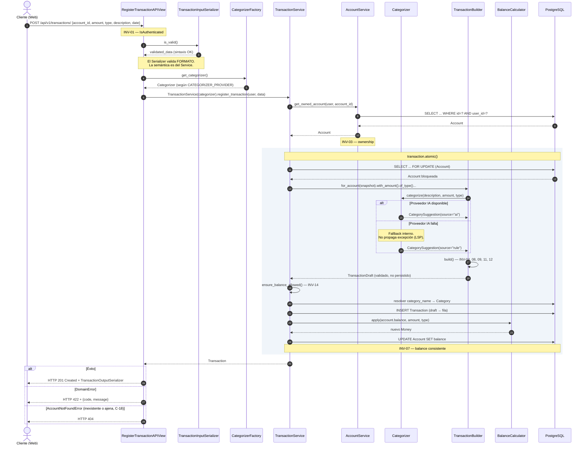

### 9.3 Diagrama de capas y dependencias

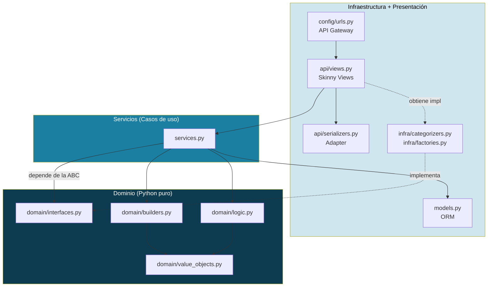

### 9.4 Diagrama de despliegue — Entrega 2

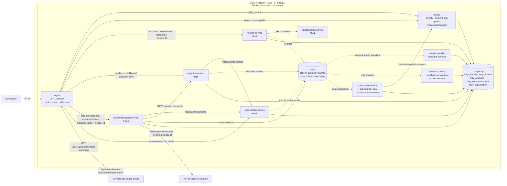

Cada servicio solo se conecta a **su** base lógica (ADR-10); sus contenedores de Celery usan la misma imagen y la misma base que el servicio (E2-M7). El bloque `finance` completo (`accounts`, `transactions`, `categories`) apunta a `finance-service` desde E2-M2b, y el monolito ya no tiene la app (ADR-08). `categorization-service` no tiene base: sus reglas viven en código.

### 9.5 Mapa de contextos — Entrega 2

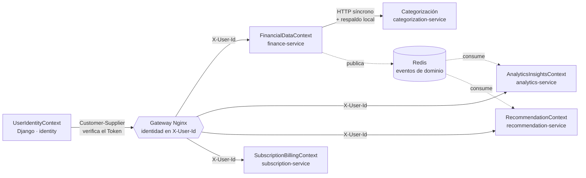

No hay ninguna flecha de `RecommendationContext` hacia `FinancialDataContext`: la dependencia circular de v1 (D-03) desaparece porque `recommendation` consume eventos en lugar de llamar a `finance`.

### 9.6 Diagrama de secuencia — Autenticación en el Gateway

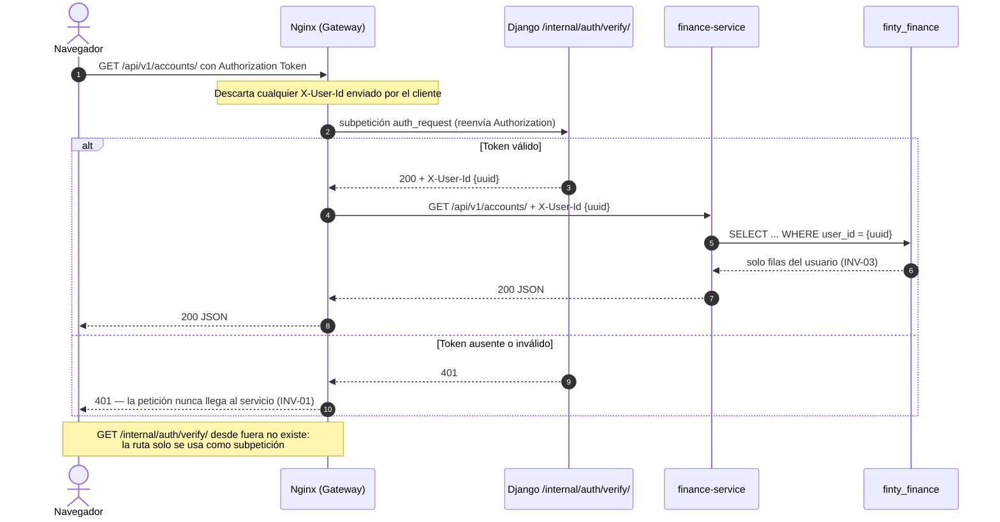

### 9.7 Diagrama de secuencia — Registrar transacción en `finance-service`

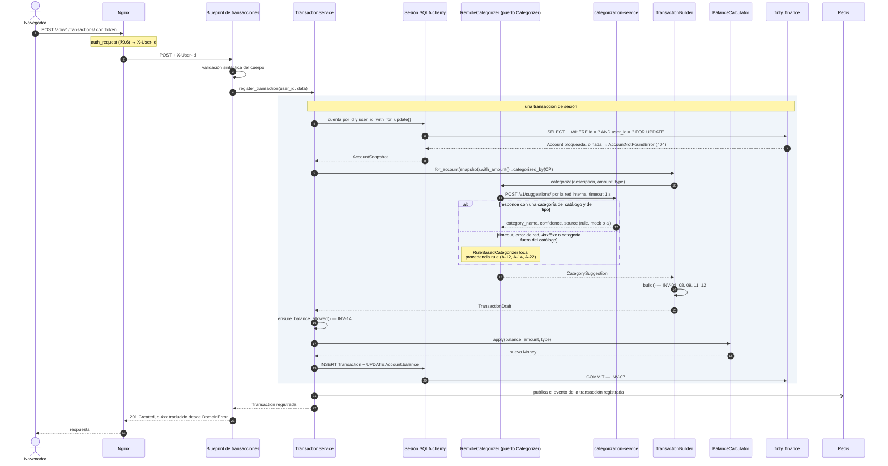

El evento se publica **después** del commit: si la transacción se revierte, nadie se entera de algo que no ocurrió.

### 9.8 Diagrama de clases — las 20 clases del dominio por servicio


Las relaciones internas de `analytics`, `recommendation` y `subscription` se fijan en el módulo de cada servicio (E2-M4 a E2-M6); aquí solo se muestran las que cruzan fronteras de servicio. La línea punteada `User .. Account` marca la referencia por identificador sin FK (ADR-10).

### 9.9 Diagrama de secuencia — Outbox transaccional y relay (ADR-15)

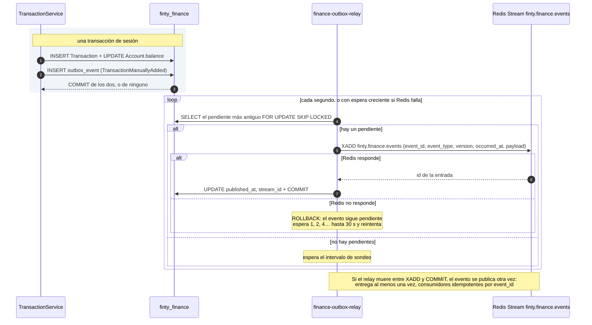

### 9.10 Diagrama de secuencia — Del registro al dashboard (E2-M4b)

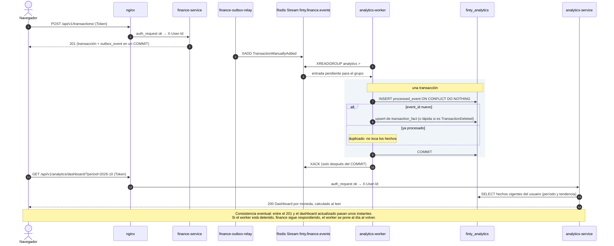

### 9.11 Diagrama de secuencia — Una recomendación con la cadena de degradación (E2-M5)

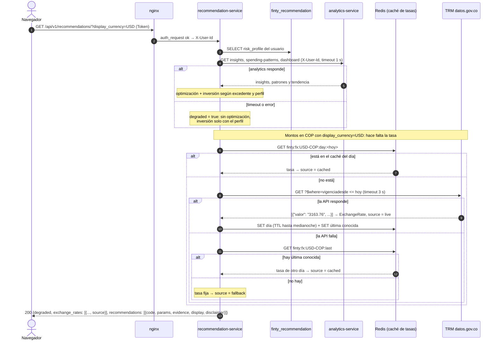

### 9.12 Diagrama de secuencia — Checkout y gating premium (E2-M6a)

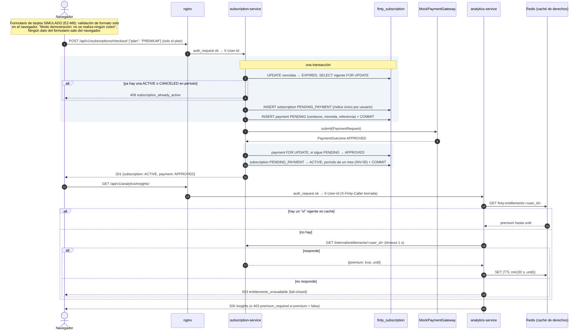

### 9.13 Diagrama de secuencia — Reporte mensual asíncrono (E2-M7)

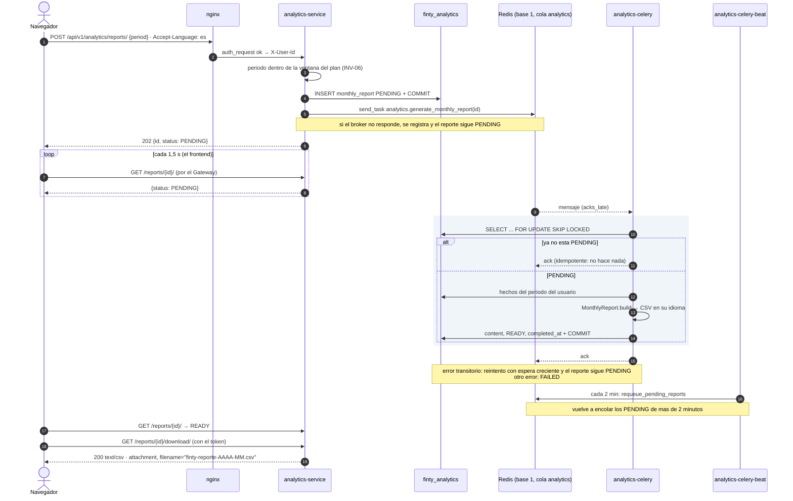

### 9.14 Diagrama de secuencia — Vencimiento con aviso por correo (E2-M7)

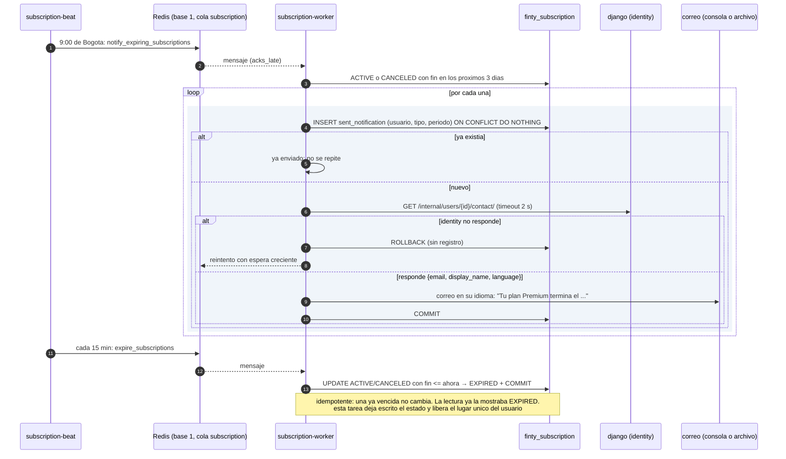

La bienvenida (`send_premium_welcome`) sigue el mismo camino que el aviso: la encola el checkout después del commit que activa la suscripción (§9.12), con la misma tabla de avisos y el mismo reintento si identity no responde.

---

## 10. Estrategia de API Gateway

### 10.1 Las cuatro funciones críticas aplicadas a Finty

| Función | Realización en Etapa 1 | Realización en la Entrega 2 (Nginx) | Realización futura |
|---------|------------------------|-------------------------------------|--------------------|
| **Autenticación / Autorización** | `IsAuthenticated` de DRF, validado en cada APIView | `auth_request` contra `/internal/auth/verify/`, una vez por petición; `X-User-Id` hacia el servicio (ADR-09) | JWT validado en el propio Gateway, sin subpetición |
| **Rate limiting** | `DEFAULT_THROTTLE_RATES` de DRF | Nginx `limit_req` | Plugin de Kong |
| **Abstracción (routing)** | `config/urls.py` incluye `identity/api/urls.py` y `finance/api/urls.py`; el cliente solo conoce `/api/v1/` | Bloques `location` por grupo de rutas hacia cada servicio, con conmutación Strangler (§10.3) | Descubrimiento de servicios |
| **Agregación de datos** | No aplica: monolito, una sola llamada | No se implementa en el Gateway; el frontend compone sus pantallas con varias llamadas al mismo origen | El dashboard consolidado de Finty pedirá en una llamada datos de `finance` + `analytics` + `subscription` |

### 10.2 Contrato de rutas — Entrega 1

```
/api/v1/
├── auth/
│   ├── register/          POST    → registro
│   └── login/             POST    → token
├── profile/               GET,PUT → perfil del usuario autenticado (desde E2-M7, con `language`)
├── accounts/              GET,POST
│   ├── summary/           GET     → saldo total por moneda (E2-M8b, D-29)
│   ├── {id}/              GET,PUT,DELETE
│   └── {id}/archive/      POST    → archivar (no borra)
├── categories/            GET     → catálogo (read-only)
│   └── {id}/              GET
└── transactions/          GET,POST
    ├── {id}/              GET,DELETE
    └── {id}/categorize/   POST    → reclasificación manual
```

**Extensión compatible de E2-M7:** `GET /profile/` devuelve también `language` (`"es"` o `"en"`), y `PUT /profile/` lo acepta (400 si no es uno de los dos). Al registrarse se toma el idioma activo de la petición. Es el idioma de los correos de `subscription-service`.

**Extensiones compatibles de E2-M8b (D-29, D-30):** las sirve `finance-service` y no cambian nada de lo anterior.
- `GET /transactions/` admite, además de `account_id`, `category_id`, `date_from` y `date_to`:
  - `q`: busca en la descripción sin distinguir mayúsculas ni tildes. `cafe` encuentra "CAFÉ"; `%` y `_` se toman literalmente. Hasta 255 caracteres, y en blanco no filtra.
  - `type`: `income` o `expense`; otro valor responde 400 con el mensaje de `ChoiceField`.

  Antes, un `type` desconocido se ignoraba; ahora es un filtro. El test de paridad que usaba `?type=x` como parámetro desconocido pasó a usar otro nombre.
- `GET /accounts/summary/` → `{"currencies": [{"currency": "COP", "balance": "312000.50", "accounts": 2}, …]}`: el saldo total y el número de cuentas **activas** por moneda, ordenado por moneda. Nunca suma monedas distintas ni convierte; el cliente presenta el equivalente con `/exchange-rates/` (ADR-12).

**Versionado desde el día 1 (`/api/v1/`):** el prefijo identifica el **contrato**, no la ubicación física de quien lo sirve. Por eso la migración a Flask no cambia de versión (ADR-08), y `/api/v2/` queda reservado para cambios incompatibles del contrato. *(v2.1 proponía usar `/api/v2/` como vía del Strangler; esa idea queda sustituida por C-23.)*

### 10.3 Tabla de enrutamiento — Entrega 2

| Bloque de rutas | Destino | Autenticación en el Gateway | Nota |
|-----------------|---------|-----------------------------|------|
| `/` (plantillas), estáticos, catálogo JavaScript de i18n | `django` | No | Frontend (ADR-11) |
| `/api/v1/health/` | `django` | No | Verificación de E2-M1 |
| `/api/v1/auth/login/`, `/api/v1/auth/register/` | `django` | No | Zona estricta `finty_auth` además de la general (D-17) |
| `/api/v1/auth/`, `/api/v1/profile/` | `django` | No (DRF lo hace dentro) | `identity` permanece en el monolito |
| `/api/v1/accounts`, `/api/v1/transactions`, `/api/v1/categories`, con o sin barra final y con sufijo `.json` | upstream `finance_backend` → **`finance-service`** (conmutado el 2026-10-20), las tres rutas juntas | **Sí** (`auth_request`, ADR-09) | Strangler (ADR-08); un solo `location`; mismo contrato que §10.2; responde con `X-Finty-Route: finance` |
| `/api/v1/analytics`, con o sin barra final y con sufijo | upstream `analytics_backend` → **`analytics-service`** | **Sí** (`auth_request`) | Lectura del modelo de analytics (§10.6); responde con `X-Finty-Route: analytics`. Nace en Flask: no hay versión en el monolito que conmutar |
| `/api/v1/public/` | upstream `analytics_backend` → **`analytics-service`** | **No** | Endpoint expuesto al equipo aliado (ADR-13, §10.7); zona estricta `finty_public`; `X-User-Id` nunca se reenvía; responde con `X-Finty-Route: public` |
| `/api/v1/recommendations`, `/api/v1/investment-plans`, `/api/v1/exchange-rates`, con o sin barra final y con sufijo | upstream `recommendation_backend` → **`recommendation-service`** | **Sí** (`auth_request`) | §10.8; responde con `X-Finty-Route: recommendation` |
| `/api/v1/subscriptions`, con o sin barra final y con sufijo | upstream `subscription_backend` → **`subscription-service`** | **Sí** (`auth_request`) | §10.9; responde con `X-Finty-Route: subscription`. Su `/internal/entitlements/` no es alcanzable desde fuera: `/internal/` responde 404 |
| `/internal/` | ninguno desde fuera | — | Solo como subpetición de `auth_request` |

**Reglas del Gateway:**
1. Nginx elimina cualquier `X-User-Id` entrante y solo reenvía el que produjo la verificación.
2. Solo Nginx publica un puerto en el host; los servicios escuchan únicamente en la red interna.
3. El bloque `finance` (`accounts`, `transactions`, `categories`) se conmuta completo y de una vez, cambiando la línea `server` del upstream `finance_backend`; nunca se conmuta una ruta suelta, porque las tres comparten agregado y base (ADR-08). Es un cambio de configuración de Nginx, no de código, y se hace solo después de que `finance-service` pase la suite de contrato de las tres rutas (A-20).
4. Las respuestas que genera el propio Gateway tienen la forma del contrato: 401 `{"detail": ...}` con el texto de DRF según el motivo (ADR-09), y 429 `{"detail": "Solicitud fue regulada (throttled)."}`, el texto de `Throttled` de DRF.
5. `limit_req` por IP en tres zonas (D-17): `finty_auth` (6/min, ráfaga 10) en login y registro, `finty_api` (20/s, ráfaga 50) en todo `/api/v1/` salvo el público, y `finty_public` (30/min, ráfaga 10) en `/api/v1/public/`.
6. Cada bloque de un microservicio fija `$finty_route` y responde con `X-Finty-Route`, también en el 401 del propio Gateway. La variable no se inicializa a nivel de `server`, porque la subpetición de `auth_request` comparte las variables de la petición y vuelve a ejecutar los `set` de ese nivel: borraría la marca.
7. `X-Finty-Caller`, igual que `X-User-Id`, se borra de toda petición externa (`proxy.conf`): solo un servicio de la red interna puede declararse como llamador interno (ADR-09, §7.1).

### 10.4 Contratos internos entre servicios

No pasan por Nginx ni se publican al host: solo los alcanza la red interna de Compose.

**`categorization-service` — `POST /v1/suggestions/`** (E2-M3b). Lo consume `finance-service` (`RemoteCategorizer`). Sin `X-User-Id`: la clasificación no depende del usuario.

| | Contenido |
|---|---|
| Petición | `{"description": "Almuerzo en el restaurante", "transaction_type": "expense"}`. `description`: texto, opcional (por defecto `""`), hasta 255 caracteres. `transaction_type`: `"income"` o `"expense"` |
| 200 | `{"category_name": "Alimentación", "confidence": 0.75, "source": "rule"}`. `source` es el mecanismo que clasificó: `rule`, `mock` o `ai`. Con `AI` sin cliente (D-07), `rule` |
| 400 | `{"error": {"code": "invalid_request", "message": ..., "fields": {campo: [mensajes]}}}` |
| 404 / 405 | `{"error": {"code": "not_found" \| "method_not_allowed", "message": ...}}` |
| 500 | `{"error": {"code": "configuration_error", ...}}` si `CATEGORIZER_PROVIDER` no es válido |
| Sonda | `GET /health/` → `{"status": "ok"}` |

El monto no viaja: ninguna implementación lo usa para decidir, y el puerto `Categorizer` de este servicio lo recibe como `None`. Si un cliente concreto de IA llegara a necesitarlo (D-07), habría que extender el contrato.

**`identity` (Django) — `GET /internal/users/<user_id>/contact/`** (E2-M7). Lo consume `subscription-service` desde sus tareas (`HttpContactDirectory`, `IDENTITY_URL=http://django:8000`) para escribirle al usuario en su idioma.

| | Contenido |
|---|---|
| 200 | `{"email": "ana@finty.co", "display_name": "Ana Restrepo", "language": "es"}`. `language` es `es` o `en` (§10.2) |
| 404 | `{"error": {"code": "profile_not_found", ...}}` si el usuario no existe, está inactivo o el id no es un UUID |
| Acceso | Sin autenticación de DRF ni throttles: Nginx responde 404 a todo `/internal/` desde fuera (`tests/contract/test_routing.py::TestInternal`), y Django no publica puertos. `django` está en `ALLOWED_HOSTS` de forma fija (`INTERNAL_HOSTS` en `config/settings.py`): el nombre solo resuelve en la red de Compose |

### 10.5 Contrato de eventos — `finty.finance.events`

Stream de Redis donde `finance-service` publica sus eventos de dominio (ADR-15). Lo escribe solo `finance-outbox-relay`. Cada consumidor tiene su grupo de consumidores (`XREADGROUP`); hoy lo consume `analytics-worker` con el grupo `analytics` (E2-M4b). `tests/services/test_event_contract.py` verifica por AST que lo que `analytics-service` lee es lo que `finance-service` escribe (A-25).

**Campos de cada entrada** (cadenas, como exige Redis Streams):

| Campo | Contenido |
|---|---|
| `event_id` | UUID del evento. **Clave de idempotencia:** la entrega es al menos una vez |
| `event_type` | `TransactionManuallyAdded` \| `TransactionCategorized` \| `TransactionDeleted` |
| `version` | Versión del esquema del payload, hoy `"1"`. Sube solo ante un cambio incompatible |
| `occurred_at` | Instante del hecho, ISO 8601 en UTC con `Z` |
| `payload` | JSON con la foto de la transacción (abajo) |

**`payload`** (igual en los tres tipos):

```json
{
  "user_id": "333c736c-…", "transaction_id": "983e19f9-…", "account_id": "558a76ab-…",
  "amount": "120000.00", "currency": "COP", "transaction_type": "expense",
  "category_name": "Alimentación", "categorization_source": "rule",
  "occurred_on": "2026-10-19", "description": "Almuerzo en el restaurante"
}
```

- `amount` es texto decimal con dos cifras, nunca un número de punto flotante. `transaction_type` es `income` o `expense`.
- `category_name` y `categorization_source` pueden ser `null`. La procedencia es `rule`, `mock`, `ai` o `manual` (A-14).
- `description` es texto, `""` si la transacción no tiene. Se agregó en E2-M4b **sin subir la versión**, porque `SpendingPattern` la necesita: es un campo nuevo y opcional para el consumidor, así que los eventos anteriores siguen siendo válidos. Un evento sin `description` se lee como `""` y nunca forma un patrón.
- `TransactionManuallyAdded` trae la transacción tal como se registró. `TransactionCategorized`, con su categoría nueva (`manual`). `TransactionDeleted`, como estaba antes de borrarse.

**Cómo consumirlo:** aplicar cada evento como el último estado conocido de `transaction_id`: un alta o una reclasificación reemplazan lo que hubiera, y un borrado lo elimina. Hay que descartar un `event_id` ya aplicado. Un `TransactionManuallyAdded` del backfill puede llegar después de un `TransactionCategorized` de la misma transacción si esta se registró antes del outbox. Como ambos traen la foto vigente, aplicarlos como reemplazo da el estado correcto.

### 10.6 Contrato de `analytics-service` — lectura autenticada (E2-M4b)

Todas por el Gateway, con `auth_request`: sin token válido, el 401 lo responde Nginx (§10.3). El servicio toma la identidad de `X-User-Id` y solo ve los hechos de ese usuario. Errores con la misma forma que `finance-service`: 400 `{"period": ["Periodo invalido. Use el formato AAAA-MM, por ejemplo 2026-10."]}`, 405 `{"detail": "Método \"POST\" no permitido."}` y 404 `{"detail": "No encontrado."}`. Solo `GET`, salvo `POST /reports/` (E2-M7).

`?period=AAAA-MM` es opcional: sin él, el mes actual en `America/Bogota`. Dinero como texto decimal con dos cifras; porcentajes y participaciones también como texto. **Las cifras son eventualmente consistentes** (ADR-15).

| Ruta | Respuesta 200 |
|------|---------------|
| `GET /api/v1/analytics/dashboard/?period=` | `{"period": "2026-10", "currencies": [{"currency": "COP", "income": "500000.00", "expense": "120000.00", "net": "380000.00", "categories": [{"category_name": "Alimentación", "transaction_type": "expense", "total": "120000.00", "share": "1.0000"}], "accounts": [{"account_id": "…", "income": …, "expense": …, "net": …}], "trend": [{"period": "2026-05", "income": …, "expense": …, "net": …}, … 6 meses]}]}`. Sin movimientos, `currencies` es `[]` Desde E2-M8b cada moneda trae también `"previous": {"period", "income", "expense", "net"} | null`, `"expense_change_pct": "25.0" | null` (variación de los gastos frente al mes anterior; nula si ese mes no tuvo gastos) y `"savings_rate": "0.2900" | null` (neto sobre ingresos; nula sin ingresos). Para un usuario Free, `previous` solo aparece si el mes anterior está dentro de su ventana de 3 meses (INV-06). Las reglas viven en `domain/dashboard.py` (`Comparison`, `savings_rate`) |
| `GET /api/v1/analytics/insights/?period=` | `{"period": "2026-10", "insights": [{"type": "NEGATIVE_SAVINGS", "code": "negative_savings", "severity": "warning", "period": "2026-10", "params": {"currency": "COP", "deficit": "50000.00"}, "evidence": {"income": "100000.00", "expense": "150000.00"}}]}`. `params` y `evidence` de cada `code` en §6.5 |
| `POST /api/v1/analytics/reports/` (E2-M7) | Cuerpo `{"period": "AAAA-MM"}`. **202** `Report` con `status: "PENDING"`: lo genera Celery (§9.13). El idioma del CSV sale de `Accept-Language` (`en…` → inglés; cualquier otro, español). 400 `{"period": ["Este campo es requerido."]}` sin periodo, o el de periodo inválido. Un FREE solo pide los últimos 3 meses: fuera de ellos, 403 `premium_required` (503 `entitlements_unavailable` si no se puede verificar el plan) |
| `GET /api/v1/analytics/reports/{id}/` (E2-M7) | 200 `Report`: `{"id", "period", "language": "es" \| "en", "status": "PENDING" \| "READY" \| "FAILED", "created_at", "completed_at", "filename", "download_url"}`. `filename` y `download_url` solo con READY. 404 `report_not_found` si no existe o es de otro usuario |
| `GET /api/v1/analytics/reports/{id}/download/` (E2-M7) | 200 `text/csv; charset=utf-8` con `Content-Disposition: attachment; filename="finty-reporte-AAAA-MM.csv"` (`finty-report-…` en inglés). Con BOM UTF-8. Dos bloques: movimientos (fecha, tipo, categoría, descripción, monto, moneda) y resumen por moneda, tipo y categoría (total y número de movimientos); nunca suma monedas distintas. Montos con punto decimal y sin separador de miles. 409 `report_not_ready` si no está READY; 404 como el anterior |
| `GET /api/v1/analytics/spending-patterns/?period=` | `{"reference_period": "2026-10", "window_months": 6, "patterns": [{"description": "netflix", "category_name": "Entretenimiento", "currency": "COP", "average_amount": "39900.00", "months_present": 3, "window_months": 6, "occurrences": 3, "monthly_frequency": "1.00", "last_seen": "2026-10-03"}]}`. `period` marca el último mes de la ventana |

El frontend traduce un insight por su `code` e interpola `params` (E2-M8). El texto nunca viaja en la respuesta.

**INV-06 (E2-M6a):** insights y patrones son premium (403 `premium_required`), y el dashboard de un usuario FREE cubre los últimos 3 meses, con su tendencia recortada a esos meses. Si `subscription-service` no responde, lo premium devuelve 503 `entitlements_unavailable` (§7.1).

### 10.7 Contrato expuesto al equipo aliado — `GET /api/v1/public/spending-summary/` (PROVISIONAL)

> **Provisional (D-10):** el aliado no está asignado. La ruta, los campos y el valor de *k* se confirman cuando se acuerde el contrato con él. Un cambio incompatible iría a `/api/v2/`.

Sin autenticación (ADR-13). Zona `finty_public` del Gateway: 30 peticiones por minuto por IP, con ráfaga de 10; por encima responde 429 `{"detail": "Solicitud fue regulada (throttled)."}`.

| | Contenido |
|---|---|
| Parámetro | `period=AAAA-MM`, opcional (por defecto, el mes actual). Inválido → 400 `{"period": [...]}` |
| 200 | `{"period": "2026-10", "min_users": 3, "categories": [{"category_name": "Alimentación", "currency": "COP", "users": 12, "total": "1710004.40", "average_per_user": "142500.37"}]}`, ordenado por moneda y, dentro de cada una, por total descendente. `category_name` es `null` para el gasto sin categoría, que también exige *k* usuarios |
| Privacidad | Una fila (categoría, moneda) solo aparece si la tienen al menos `min_users` usuarios distintos. No hay total general ni conteo de usuarios del período: con ellos se podrían deducir las categorías ocultas. Solo gastos, solo transacciones vigentes |
| Consistencia | Eventual, igual que §10.6 |

### 10.8 Contrato de `recommendation-service` (E2-M5)

Todas autenticadas por el Gateway, con identidad por `X-User-Id`. Errores con la forma de `finance-service`: entrada inválida 400 `{"campo": ["mensaje de DRF"]}`, dominio `{"error": {"code", "message"}}` (404, 409 o 422), 401 del Gateway, 405 y 404 `{"detail": "No encontrado."}`. Dinero como texto decimal con dos cifras.

| Ruta | Contrato |
|---|---|
| `GET /api/v1/recommendations/risk-profile/` | 200 `{"answers": {"investment_horizon": 2, …5}, "score": 10, "risk_profile_type": "moderate", "updated_at": "…"}`; 404 `risk_profile_not_found` si no lo ha respondido |
| `PUT /api/v1/recommendations/risk-profile/` | Cuerpo: las cinco respuestas (enteros). 200 con la misma forma. 400 si falta una o no es entero; 422 `invalid_risk_answer` si está fuera de 1 a 3 |
| `GET /api/v1/recommendations/?display_currency=` | 200 `{"period": "2026-10", "degraded": false, "risk_profile_type": "moderate" \| null, "display_currency": "USD" \| null, "exchange_rates": [ExchangeRate…], "recommendations": [{"code", "kind": "optimization" \| "investment", "source": "insight" \| "pattern" \| "risk_profile", "params": {}, "evidence": {}, "display": {"currency": "USD", "amounts": {"monthly_surplus": "31.61"}} \| null, "disclaimer": {"code": "investment_disclaimer", "message": "…"} \| null}]}`. `display_currency` solo admite USD o COP (422 `unsupported_currency_pair`). Sin el parámetro, `display` es `null`. Nunca 500 por analytics: `degraded: true` |
| `GET /api/v1/investment-plans/` | 200 `{"count": n, "results": [Plan…]}`, del más reciente al más antiguo, sin paginar |
| `POST /api/v1/investment-plans/` | Cuerpo: `instrument_type`, `monthly_contribution`, `horizon_months` y `currency` opcional (COP). 201 `Plan`; 409 `risk_profile_required`; 422 `instrument_not_recommended`, `invalid_monthly_contribution` o `invalid_horizon` |
| `GET` / `DELETE /api/v1/investment-plans/{id}/` | 200 `Plan` / 204. Ajeno o inexistente: 404 `investment_plan_not_found` (D-08) |
| `GET /api/v1/exchange-rates/?base=&target=` | 200 `ExchangeRate`. `base` y `target` obligatorios (400); solo USD↔COP (422) |

- **`Plan`:** `{"id", "instrument_type", "risk_profile_type", "monthly_contribution", "currency", "horizon_months", "created_at", "projection": {"annual_rate": "0.10", "rate_is_illustrative": true, "rate_note": "…", "total_contributed", "projected_value", "projected_gain"}, "disclaimer": {…}}`.
- **`ExchangeRate`:** `{"base": "USD", "target": "COP", "rate": "3163.76", "source": "live" | "cached" | "fallback", "valid_from": "2026-10-21", "valid_until": "2026-10-21", "fetched_on": "2026-10-21"}`. La inversa tiene 10 decimales (`"0.0003160796"`). Con `fallback`, las tres fechas son `null`.

Las recomendaciones dependen de analytics, así que son eventualmente consistentes (ADR-15).

**INV-06 (E2-M6a):** todo `/investment-plans/` es premium (403 `premium_required`; 503 `entitlements_unavailable` si `subscription-service` no responde). `GET /recommendations/` nunca responde 403: a un usuario sin derecho le devuelve solo las de optimización y declara lo que falta en `"locked": [{"kind": "investment", "code": "premium_required" | "entitlements_unavailable"}]`, vacío para un premium. El perfil de riesgo y las tasas no tienen gating (§7.1).

### 10.9 Contrato de `subscription-service` (E2-M6a)

Autenticadas por el Gateway, con identidad por `X-User-Id` y errores con la forma de `finance-service`. Las fechas van en la zona del proceso (`-05:00`).

| Ruta | Contrato |
|---|---|
| `GET /api/v1/subscriptions/plans/` | 200 `{"results": [Plan FREE, Plan PREMIUM]}`. `Plan`: `{"code", "price": "29900.00", "price_in_cents": 2990000, "currency": "COP", "period_months": 1, "history_months": 3 \| null, "benefits": [code…]}` |
| `GET /api/v1/subscriptions/me/` | 200 `{"plan": "FREE" \| "PREMIUM", "premium": bool, "status": null \| "PENDING_PAYMENT" \| "ACTIVE" \| "CANCELED" \| "EXPIRED", "current_period_start", "current_period_end", "canceled_at", "benefits": [code…], "last_payment": Payment \| null}`. Sin suscripción: `plan: "FREE"`, `status: null` y los beneficios FREE. `plan` es el que da acceso **ahora**: una vencida o pendiente muestra FREE |
| `POST /api/v1/subscriptions/checkout/` | Cuerpo `{"plan": "PREMIUM"}`. 201 `{"subscription": Me, "payment": Payment}`, también cuando el pago se rechaza: el resultado está en `payment.status` y la suscripción queda `PENDING_PAYMENT`. 400 si `plan` no es FREE ni PREMIUM, y 400 `{"campo": ["Este campo no está permitido."]}` por **cualquier campo además de `plan`**: el checkout no acepta datos de tarjeta (ADR-14). 422 `plan_not_purchasable` con FREE; 409 `subscription_already_active` si hay una ACTIVE o CANCELED en período; 409 `payment_in_progress` si el último pago sigue PENDING (no ocurre con el mock: es para una pasarela asíncrona). Tras un rechazo, otro checkout reintenta sobre la misma suscripción con un pago nuevo |
| `POST /api/v1/subscriptions/me/cancel/` | 200 `Me` con `status: "CANCELED"` y `premium: true` hasta el fin del período. Idempotente; 409 `no_active_subscription` si no hay una activa |
| `GET /internal/entitlements/<user_id>` | **Solo red interna.** 200 `{"premium": bool, "until": fecha \| null}`. Sin `X-User-Id`: lo consultan otros servicios con el usuario en la ruta |

- **`Payment`:** `{"id", "reference": "finty-…", "status": "PENDING" | "APPROVED" | "DECLINED" | "ERROR", "amount_in_cents", "currency", "gateway": "mock", "created_at", "resolved_at"}`. El pago es simulado (ADR-14): `gateway` siempre vale `mock`.

---

## 11. Trazabilidad

### 11.1 Journeys To-Be → Features → Endpoints → Clases

| Journey (JN-TB) | Paso | Feature | Endpoint | Clases implicadas |
|-----------------|------|---------|----------|-------------------|
| JN-TB-01 | 1 | FT-001 Autenticación | `POST /auth/login/` | `User` |
| JN-TB-01 | 2 | FT-002 Dashboard | `GET /accounts/` | `Account`, `AccountService` |
| JN-TB-01 | 3 | FT-003 Categorización | `POST /transactions/` | `TransactionService`, `CategorizerFactory`, `Categorizer`, `TransactionBuilder` |
| JN-TB-01 | 4 | FT-004 Insights | `GET /analytics/dashboard/`, `GET /analytics/insights/`, `GET /analytics/spending-patterns/` (E2-M4b) | `analytics-service`: `Dashboard`, `Insight`, `SpendingPattern`, `AnalyticsService`, `EventProjector` |
| JN-TB-01 | 5 | FT-005 Recomendaciones | `PUT /recommendations/risk-profile/`, `GET /recommendations/`, `POST /investment-plans/`, `GET /exchange-rates/` (E2-M5) | `recommendation-service`: `RiskProfile`, `Recommendation`, `InvestmentPlan`, `ExchangeRate`, `RecommendationService`, `ExchangeRateService`, `AnalyticsReader`, `ExchangeRateProvider` |
| JN-TB-01 | 4–5 | Funciones premium (gating de INV-06) | `GET /subscriptions/plans/`, `POST /subscriptions/checkout/`, `GET /subscriptions/me/`, `POST /subscriptions/me/cancel/` (E2-M6a) | `subscription-service`: `SubscriptionPlan`, `Subscription`, `Payment`, `SubscriptionService`, `PaymentGateway`, `PaymentGatewayFactory`; `EntitlementsReader` en analytics y recommendation |
| JN-TB-02 | 2 | FT-003 Categorización | `POST /transactions/{id}/categorize/` | `TransactionService` |
| JN-TB-04 | 1–2 | FT-002 Dashboard | `GET /accounts/` | `Account`, `BalanceCalculator` |

**Cobertura de journeys en la Entrega 1:** los pasos de captura y consolidación de datos están cubiertos; los pasos de análisis y recomendación quedan explícitamente diferidos.

### 11.2 Patrón → Clase → Requisito de la rúbrica

| Requisito | Implementación | Archivo |
|-----------|----------------|---------|
| Service Layer | `TransactionService`, `AccountService`, `ProfileService` | `*/services.py` |
| Factory | `CategorizerFactory` | `services/categorization-service/infra/factories.py` |
| Factory | `PaymentGatewayFactory` (misma forma, falla al arrancar) | `services/subscription-service/infra/factories.py` |
| Builder | `TransactionBuilder`, `AccountBuilder` | `services/finance-service/domain/builders.py` |
| Vistas sin lógica de negocio | Todas las views delegan | `*/api/views.py` |
| Modelos sin lógica de negocio | ADR-03 | `*/models.py` |
| Inversión de dependencias | `Categorizer` ABC inyectada | `services/finance-service/domain/interfaces.py` (implementada por `RemoteCategorizer`) y `services/categorization-service/domain/interfaces.py` |
| Adapter | `RemoteCategorizer` | `services/finance-service/infra/categorization_client.py` |
| Adapter (API de terceros) | `TrmExchangeRateProvider` y `FixedExchangeRateProvider` detrás de `ExchangeRateProvider` | `services/recommendation-service/infra/exchange_rates.py` |
| Adapter (servicio interno) | `HttpAnalyticsReader` detrás de `AnalyticsReader` | `services/recommendation-service/infra/analytics_client.py` |

### 11.3 Requisito de la Entrega 2 → Decisión → Módulo

| Criterio del enunciado | Peso | Decisión | Módulo |
|------------------------|------|----------|--------|
| Correcciones E1: frontend intuitivo y agradable (eliminatorio) | 10% | ADR-11 | E2-M8 |
| Diagramas con AWS, Nginx, Flask y broker | 10% | §9.4 a §9.8 | E2-M0; finales en E2-M9 |
| Exponer un endpoint JSON | 30% | ADR-13 (`analytics-service`, `GET /api/v1/public/spending-summary/`, §10.7) | E2-M4b (implementado; contrato provisional, D-10) |
| Consumir el servicio del equipo aliado | (30%) | ADR-13, `AllyServiceProvider` + `MockAllyAdapter` | E2-M9 |
| Consumir una API de terceros mediante Adapter | (30%) | **Lo cumple `ExchangeRateProvider`** (ADR-12): `TrmExchangeRateProvider` consume la TRM oficial de datos.gov.co, con caché y tasa fija de respaldo. `PaymentGateway` no consume ningún tercero: el pago es simulado (ADR-14, C-33) | E2-M5 (implementado) |
| Docker Compose con Django, Flask, Nginx, base de datos y broker | 30% | ADR-16 | E2-M1 |
| Despliegue en EC2 con Nginx como API Gateway | (30%) | ADR-06, ADR-09, ADR-16 | E2-M1, E2-M2 |
| Tareas asíncronas con Redis/Celery | 20% | ADR-15: reporte mensual (`analytics-celery`), correos de bienvenida y de vencimiento y `expire_subscriptions` (`subscription-worker` y `subscription-beat`) | E2-M7 (implementado) |
| i18n bilingüe con gettext, sin textos quemados | (20%) | ADR-11 | E2-M8 |
| Bono: más del 70% en microservicios Flask | — | ADR-07, §4.4 | E2-M2 a E2-M6 |

---

## 12. Glosario de lenguaje ubicuo (actualizado)

| Término de negocio | Contexto | Nombre en código | Tipo | Sinónimos prohibidos |
|--------------------|----------|------------------|------|---------------------|
| Cuenta | finance | `Account` | Modelo (Aggregate Root) | Wallet, BalanceAccount |
| Transacción | finance | `Transaction` | Modelo | Movement, Operation |
| Categoría | finance | `Category` | Modelo | Tag, Label |
| Tipo de cuenta | finance | `AccountType` | Value Object | AccountKind |
| Tipo de transacción | finance | `TransactionType` | Value Object | FlowType |
| Dinero | core | `Money` | Value Object | Amount (a secas) |
| Sugerencia de categoría | finance | `CategorySuggestion` | Value Object | Prediction, Guess |
| Clasificador | finance | `Categorizer` | Interfaz (ABC) | Classifier, Tagger |
| Calculadora de balance | finance | `BalanceCalculator` | Domain Service | BalanceHelper |
| Usuario | identity | `User` | Modelo | Client, Customer |
| Perfil de usuario | identity | `UserProfile` | Modelo | Profile (ambiguo con RiskProfile) |
| Proveedor de tasas de cambio | recommendation | `ExchangeRateProvider` | Puerto (ABC) | — |
| Tasa de cambio | recommendation | `ExchangeRate` | Value Object con procedencia (`live`, `cached`, `fallback`) | — |
| Perfil de riesgo | recommendation | `RiskProfile` | Entidad persistida (§6.6) | RiskLevel (DDD Stage 1) |
| Tipo de perfil de riesgo | recommendation | `RiskProfileType` | Value Object (`StrEnum`): `conservative`, `moderate`, `aggressive` | RiskLevel |
| Recomendación | recommendation | `Recommendation` | Value Object calculado al leer (§6.6) | Advice, Suggestion (DDD Stage 1) |
| Plan de inversión | recommendation | `InvestmentPlan` | Entidad persistida (§6.6) | Portfolio (DDD Stage 1) |
| Tipo de instrumento | recommendation | `InstrumentType` | Value Object (`StrEnum`), siempre genérico | — |
| Lector de analytics | recommendation | `AnalyticsReader` | Puerto (ABC) | — |
| Pasarela de pago | subscription | `PaymentGateway` | Puerto (ABC) | — |
| Plan de suscripción | subscription | `SubscriptionPlan` | Value Object: `FREE`, `PREMIUM` | Plan a secas (DDD Stage 1) |
| Suscripción | subscription | `Subscription` | Entidad con máquina de estados (§6.7) | Membership (DDD Stage 1) |
| Pago | subscription | `Payment` | Entidad: `PENDING` → `APPROVED` / `DECLINED` / `ERROR` | Billing, Charge (DDD Stage 1) |
| Beneficio | subscription | `Benefit` | Value Object (`StrEnum`): `code` estable que traduce el frontend | — |
| Derecho premium | subscription, analytics, recommendation | `Entitlement` | Value Object `{premium, until}` (§7.1) | — |
| Lector de derechos | analytics, recommendation | `EntitlementsReader` | Puerto (ABC) | — |
| Proveedor del servicio aliado | por definir | `AllyServiceProvider` | Puerto (ABC) | — |
| Identificador de usuario propagado | todos los servicios Flask | `user_id` (cabecera `X-User-Id`) | Dato de frontera | customer_id, client_id (derivan de los sinónimos prohibidos de `User`) |
| Transacción registrada | finance | `TransactionManuallyAdded` | Evento de dominio (DDD Stage 1) | TransactionCreated, TransactionAdded |
| Transacción reclasificada | finance | `TransactionCategorized` | Evento de dominio (DDD Stage 1) | TransactionRecategorized, CategoryChanged |
| Transacción eliminada | finance | `TransactionDeleted` | Evento de dominio (E2-M4a, no está en DDD Stage 1: lo necesita `analytics`) | TransactionRemoved |
| Foto de una transacción | finance | `TransactionFacts` | Value Object: payload de los eventos | TransactionData, TransactionDTO |
| Outbox | finance | `EventOutbox` / `outbox_event` | Puerto y tabla del outbox transaccional (ADR-15) | EventQueue |
| Tablero | analytics | `Dashboard` | Value Object calculado al leer (§6.5) | — |
| Hallazgo | analytics | `Insight` | Value Object calculado al leer (§6.5) | Metrics, Stats (DDD Stage 1) |
| Gasto recurrente | analytics | `SpendingPattern` | Value Object calculado al leer (§6.5) | Habit (DDD Stage 1) |
| Período | analytics | `Period` | Value Object: mes `AAAA-MM` | — |
| Hecho de transacción | analytics | `TransactionFact` / `transaction_fact` | Value Object y tabla del modelo de lectura | — |
| Evento procesado | analytics | `processed_event` | Tabla de idempotencia por `event_id` (ADR-15) | — |
| Resumen público de gasto | analytics | `SpendingSummary` | Value Object del endpoint expuesto (§10.7) | — |
| Reporte mensual | analytics | `MonthlyReport` (dominio), `MonthlyReportRecord` (persistencia) | Value Object generado por una tarea de Celery (E2-M7) | Statement, Extracto |
| Aviso | subscription | `NotificationKind`, `SentNotificationRecord` | Enumeración y registro de los correos enviados (E2-M7) | Alert, Message |

Los sinónimos prohibidos de los tres contextos nuevos los verifica por AST `tests/test_architecture.py::TestSinonimosProhibidos` de cada servicio. En `subscription-service` falla si un identificador contiene Membership, Billing o Charge, o si una clase se llama `Plan` a secas.

**Polisemias resueltas y vigentes:**

| Término | Resolución |
|---------|-----------|
| `Plan` | `InvestmentPlan` vs `SubscriptionPlan` — ambos fuera de la Entrega 1 |
| `Profile` | `UserProfile` (identity) vs `RiskProfile` (recommendation). `tests/test_architecture.py::TestSinonimosProhibidos` de `recommendation-service` falla si un identificador usa RiskLevel, Advice, Suggestion o Portfolio |
| `Transaction` | `Transaction` (movimiento financiero del usuario) vs `Payment` (pago de suscripción). **Nota crítica:** `django.db.transaction` también usa la palabra; en el código se importa como `from django.db import transaction as db_transaction` para evitar colisión de nombres. **En la Entrega 2:** el pago de una suscripción es `Payment`, y la palabra `Transaction` no aparece en `subscription-service` (ADR-14). Si algún día se integra una pasarela real, lo que ella llame *transaction* se traducirá a `Payment` dentro de su adaptador. |

---

## 13. Deuda documental y decisiones pendientes

| # | Tema | Decisión provisional | A revisar en |
|---|------|---------------------|--------------|
| D-01 | Categorías globales vs. por usuario | Globales; se mantienen en la Entrega 2 (el catálogo migra tal cual a `finance-service`) | Post-Entrega 2 |
| D-02 | Balance persistido vs. calculado | Persistido, con recálculo transaccional en `finance-service`, que es su única autoridad. **`analytics` no relee ni replica balances (E2-M4b):** calcula ingresos, gastos y neto **del período** a partir de los hechos de transacción que le llegan por eventos, y eso no es un balance (no incluye el saldo de apertura, que no viaja en los eventos). El dashboard de analytics nunca muestra un saldo: el saldo de cada cuenta lo sirve `GET /accounts/` | **Cerrada** (E2-M4b) |
| D-03 | Dependencia circular `Recommendation → FinancialData` | **Resuelta (E2-M5):** `recommendation` no depende de `finance`. Lee insights, patrones y dashboard de `analytics` por HTTP, con degradación, y `analytics` no conoce a `recommendation`. Cambia lo previsto en v3 ("consume eventos de `finance`") para no duplicar la proyección ni las reglas de §6.5 (ADR-15) | **Cerrada** (E2-M5) |
| D-04 | Multi-moneda real | Una moneda por cuenta. **Conversión solo de presentación (E2-M5):** USD↔COP con la TRM oficial, hacia la moneda que el cliente pide en `display_currency` (el frontend envía el `preferred_currency` de `/profile/`, ADR-12). Los montos originales no cambian (INV-11). Otras monedas no tienen tasa; la multi-moneda contable sigue fuera | Presentación: **cerrada** (E2-M5). Contable: post-MVP |
| D-05 | Eventos de dominio | **Publicación implementada (E2-M4a):** `finance-service` publica `TransactionManuallyAdded`, `TransactionCategorized` y `TransactionDeleted` en el stream `finty.finance.events`, con outbox transaccional y entrega al menos una vez (ADR-15, §10.5). **Consumo implementado (E2-M4b):** `analytics-worker`, idempotente por `event_id` | **Cerrada** para `analytics`; `recommendation` en E2-M5 |
| D-06 | Modelo de usuario | Se define `AbstractUser` propio desde el inicio | Cerrada — cambiar después es costoso |
| D-07 | Cliente concreto de IA | Costura inyectada sin implementación; `AICategorizer` opera degradado. Trasladado sin cambios a `categorization-service` en E2-M3b | Abierta, sin módulo asignado |
| D-08 | Enumeración de cuentas ajenas | `get_owned_account` devuelve 404 y no 403 para no revelar existencia. Se conserva en `finance-service` filtrando por `X-User-Id` | Cerrada |
| D-09 | Métrica del 70% para el bono | La distribución de §4.4 supera el umbral por clases (90%), por contextos (4 de 5) y por endpoints de negocio | **Abierta** — confirmar con el profesor |
| D-10 | Equipo aliado | Sin asignar. Solo `MockAllyAdapter`; no se inventan dominio, URL ni contrato. Lo que Finty expone ya existe con un contrato **provisional** (§10.7) que se ajusta al acordarlo. Faltan: proyecto, URL y método, autenticación, ejemplo de respuesta, qué esperan consumir de Finty y fecha de disponibilidad | **Abierta** — Tomás lo consulta con el profesor |
| D-11 | Formato de los diagramas | Mermaid dentro del Markdown, porque la Wiki de GitHub lo renderiza | **Abierta** — confirmar que el curso no exige otro formato |
| D-12 | TLS en el Gateway | Sin TLS: la instancia se expone por IP elástica, sin dominio. ADR-14 evita depender de HTTPS para los pagos | Abierta — requiere dominio |
| D-13 | Núcleo compartido (`Money`, `DomainError`) en los servicios Flask | **Copia propia en el `domain/shared/` de cada servicio**, con las mismas reglas del original. Un paquete compartido acoplaría los despliegues: cambiarlo obligaría a reconstruir y desplegar a la vez todos los servicios que lo usan. El costo aceptado es mantener las copias alineadas a mano; el glosario (§12) sigue siendo uno solo | **Cerrada** (E2-M2a) |
| D-14 | Mecanismo concreto de INV-06 | **En cada servicio que ofrece funciones premium** (`analytics` y `recommendation`), como middleware de su capa de entrada, que consulta el endpoint interno de derechos de `subscription-service` con caché corta en Redis. No en el Gateway, porque la regla depende del período pedido y de partes de la respuesta, no solo de la ruta. Fail-closed si `subscription-service` no responde (§7.1) | **Cerrada** (E2-M6a) |
| D-15 | Borrado de usuario sin FK entre bases | No existe caso de uso de borrado; si aparece, se propaga por evento | Abierta, sin módulo asignado |
| D-16 | Datos de `finance` del monolito al conmutar | `finty_finance` arranca vacía, solo con el catálogo de categorías sembrado (equivalente a `0002_seed_categories`). Las cuentas y transacciones del monolito no se migran en esta entrega (ADR-08) | Abierta — post-Entrega 2 |
| D-17 | Rate limiting en el Gateway | **`limit_req` por IP en dos zonas, con respuesta 429 en JSON.** **`finty_auth`** (login y registro): `rate=6r/m`, `burst=10`, `nodelay`. La cuota anónima de DRF (60/h por IP) sigue en Django para esas rutas y es la autoridad horaria; Nginx no la endurece en régimen sostenido (6/min = 360/h), pero corta las ráfagas de fuerza bruta antes de que lleguen a Django, donde cada intento cuesta un hash de contraseña: diez intentos seguidos y luego uno cada 10 s. **`finty_api`** (todo `/api/v1/`): `rate=20r/s`, `burst=50`, `nodelay`. La cuota de usuario de DRF (1000/h ≈ 0,28/s en promedio) es horaria y por usuario; esta zona es protección contra inundación por segundo y por IP, holgada para el uso legítimo (una pantalla del frontend hace a lo sumo unas seis peticiones juntas). **Residuo aceptado:** las rutas de `finance`, servidas ahora por Flask, ya no tienen la cuota horaria por usuario de DRF, solo este límite por IP; si se necesitara, una zona con clave `$http_authorization` la aproximaría. **`finty_public`** (E2-M4b, `/api/v1/public/`): `rate=30r/m`, `burst=10`, `nodelay`. Es la única ruta de datos sin token, así que no tiene cuota de usuario detrás; un agregado mensual no se consulta en bucle, y 30 por minuto sobra para un servicio aliado que lo lee de vez en cuando | **Cerrada** (E2-M2b; `finty_public` en E2-M4b) |
| D-18 | Dependencias de desarrollo en la imagen de producción | Hay un solo `requirements.txt`, así que `pytest` y similares quedan instalados en la imagen `django`. Separarlas en un archivo de desarrollo | Abierta, sin módulo asignado |
| D-19 | Texto del 404 de un id válido inexistente | `GET /accounts/{uuid}/` y `GET /categories/{uuid}/` responden `{"detail": "No Account matches the given query."}` (o `Category`): el mensaje de `get_object_or_404` de Django, en inglés, que DRF conservaba y `finance-service` reproduce por contrato. Un id mal formado sí responde `No encontrado.` | **Cerrada para la interfaz** (E2-M8a): el frontend traduce un 404 por código de estado ("No encontramos lo que buscabas"), así que ese texto en inglés no llega a la pantalla. El cuerpo de la API no cambia (A-20) |
| D-20 | Tablas de `finance` en `finty_identity` | Al retirar la app (E2-M3a) quedaron `finance_account`, `finance_transaction` y `finance_category` sin uso, junto con sus filas en `django_migrations`, sus tipos de contenido y sus permisos. No se borran en esta entrega: son el único lugar donde están los datos que el monolito tenía antes de la conmutación (D-16) | Abierta — post-Entrega 2: migrarlos a `finty_finance` o descartarlos, y después borrar las tablas |
| D-22 | Eventos publicados por `analytics` | `analytics-service` **no publica eventos**. Decidido en E2-M5: `recommendation-service` lee los insights y patrones por HTTP cuando calcula, así que un evento `InsightDetected` no tiene consumidor | **Cerrada** (E2-M5) |
| D-23 | Mensajes fuera de contrato en `finty.finance.events` | El worker los registra en el log como aviso y los confirma con `XACK` para no bloquear el stream. No hay stream de mensajes muertos: si apareciera uno, el evento se perdería para `analytics`. `tests/services/test_event_contract.py` (A-25) evita esa situación antes de desplegar | Abierta — un stream `finty.finance.events.dead` si llega un segundo productor |
| D-24 | `OptimizationRecommendationGenerated` (DDD Stage 1) | **No se publica.** Las recomendaciones son value objects calculados al leer y no se persisten (§6.6): no hay un instante en que se "generen" que valga la pena anunciar, y ningún servicio consumiría el evento. Las notificaciones de E2-M7 son sobre la suscripción, no sobre recomendaciones, así que no lo exigen | **Cerrada** (E2-M7) |
| D-26 | Renovación de la suscripción | **Sin renovación automática**: el período es de un mes, y renovar es un checkout y un pago nuevos cuando termina (EXPIRED). Mientras haya una suscripción ACTIVE o CANCELED en período, un checkout responde 409, así que no se puede pagar por adelantado el mes siguiente. Un cobro recurrente exigiría una pasarela real que guarde un medio de pago, fuera del alcance (ADR-14, C-33) | Abierta — post-Entrega 2 |
| D-27 | `SubscriptionActivated` y `PremiumFeaturesUnlocked` (DDD Stage 1) | **No se publican.** Los consumidores del derecho lo consultan cuando lo necesitan (`/internal/entitlements/`), y como la caché solo guarda los "sí", un pago se refleja en la siguiente petición sin necesidad de un evento que invalide nada. **E2-M7:** la bienvenida se encola directamente como tarea de Celery después del commit, porque su único interesado es el propio `subscription-service`. Un evento exigiría outbox, stream y consumidor para que el servicio se escuche a sí mismo (ADR-15). Si otro servicio necesitara la activación, se publica por outbox y la bienvenida pasa a consumirlo | **Cerrada** (E2-M7) |
| D-28 | Consecuencia de INV-06 en DDD Stage 1 | Incorporada en §7.1: la consecuencia de violar INV-06 es la **pérdida de ingresos**, y con ella se justifica negar lo premium cuando no se puede verificar la suscripción (fail-closed). También se reconcilia la expresión formal (`status = 'ACTIVE'`) con el estado CANCELED en período de E2-M6a | **Cerrada** (E2-M6a) |
| D-25 | Dependencia síncrona `recommendation → analytics` | Aceptada con degradación (`degraded: true`) y timeout de 1 s. No hay caché de lo que responde analytics: una recomendación degradada se recupera sola en la siguiente lectura. Si la latencia de las tres llamadas (insights, patrones y dashboard) pesara, se podrían paralelizar o pedir a analytics un endpoint combinado | Abierta, sin módulo asignado |
| D-29 | Saldo consolidado y comparaciones del dashboard | **Resuelta como datos de la API (E2-M8b).** `GET /accounts/summary/` (finance) da el saldo total por moneda, sin mezclar ni convertir. El dashboard de analytics agrega el período anterior, la variación porcentual de los gastos y la tasa de ahorro, con las reglas en su `domain/` (§10.6). El frontend solo presenta: convierte cada total con la tasa de `/exchange-rates/` y muestra la fuente | **Cerrada** (E2-M8b) |
| D-30 | Filtros de movimientos | **Resuelta en finance-service (E2-M8b):** `GET /transactions/` admite `q` (sin mayúsculas ni tildes, con `translate` de PostgreSQL y sin la extensión `unaccent`) y `type` (§10.2). El frontend agrega la búsqueda y el filtro por tipo | **Cerrada** (E2-M8b) |
| D-31 | Mensajes de validación (400) de los servicios Flask | finance-service reproduce los textos de DRF en español por contrato (A-20), así que un 400 por campo llega en español aunque la interfaz esté en inglés. El frontend valida antes los campos obligatorios y los formatos, con mensajes traducidos, y muestra el texto de la API solo si aun así llega un 400 | Abierta — traducir por código de validación si se agrega uno al contrato |
| D-32 | Bienvenida perdida si el broker no responde al activar | La activación nunca espera al broker: si `send_task` falla, la suscripción ya está activa. **Resuelta con una red de seguridad:** `subscription.send_missing_welcomes`, cada 15 minutos en `subscription-beat`, envía la bienvenida a las ACTIVE en período sin registro en `sent_notification`. Encolar después del commit sigue siendo el camino rápido; la restricción única impide el duplicado. En el peor caso, la bienvenida llega hasta 15 minutos tarde | **Cerrada** (E2-M7) |
| D-33 | Retención de los reportes | **Resuelta:** `analytics.purge_expired_reports`, diaria a las 3:30 de Bogotá en `analytics-celery-beat`, borra los reportes pedidos hace más de `REPORT_RETENTION_DAYS` días (7 por defecto, configurable en Compose, al menos 1), en cualquier estado. Un usuario puede pedir el mismo mes varias veces y cada pedido sigue siendo un reporte nuevo, pero ninguno dura más que la retención | **Cerrada** (E2-M7) |
| D-34 | Correo real | Sin SMTP: `EMAIL_BACKEND` es `console` (log del worker) o `file` (`.eml`). Un adaptador SMTP o de un proveedor se agrega como otro `EmailSender`, sin tocar el dominio ni las tareas | Abierta — post-Entrega 2 |
| D-21 | Traducción de las respuestas 401 y 429 del Gateway | Nginx no puede usar gettext y sus respuestas llevan solo `{"detail": ...}`, la forma de DRF. **Decisión:** el frontend las traduce por **código de estado HTTP** (401 → sesión no válida, 429 → demasiadas peticiones), no por un `code` en el cuerpo. El Gateway y la suite de contrato (A-20) no cambian: el cuerpo de esas respuestas sigue siendo el de DRF. Se descartó agregar `code` al cuerpo porque cambiaría la forma del contrato | **Cerrada** (E2-M3b); implementada en E2-M8a (`frontend/static/finty/js/codes.js`) |

---

## Anexo A — Criterios de aceptación verificables

| # | Criterio | Cómo se verifica |
|---|----------|------------------|
| A-01 | `domain/` no depende de Django | `grep -rn "django" core/domain/ services/finance-service/domain/` devuelve vacío; el criterio autoritativo es el AST: `core/tests/test_architecture.py` para `core/domain/` y A-16 (`services/finance-service/tests/test_architecture.py`) para el dominio de finanzas |
| A-02 | Vistas sin lógica de negocio | `grep -rnE "^[[:space:]]*(try:\|except[[:space:]])" */api/views.py` devuelve vacío. El grep debe ir **anclado a inicio de sentencia**: sin anclar, `raise_exception=True` de DRF produce falsos positivos por la subcadena `except`. Ninguna view contiene además `if` sobre reglas de dominio ni cálculos |
| A-03 | Modelos sin lógica de negocio | `models.py` solo tiene campos, `Meta`, `__str__` |
| A-04 | Factory conmutable por entorno | `CATEGORIZER_PROVIDER=MOCK` cambia el comportamiento sin tocar código |
| A-05 | Builder valida antes de construir | Existe test que verifica que `.build()` con monto 0 lanza `DomainError` |
| A-06 | Balance consistente | Test que registra N transacciones y compara `account.balance` con `opening_balance + Σ movimientos` (INV-07 según C-17) |
| A-07 | Ownership aplicado | Test que verifica que el usuario B no puede operar sobre la cuenta de A |
| A-08 | LSP en categorizadores | La suite de `TransactionService` pasa con las tres implementaciones |
| A-09 | Builder no conoce el ORM | `services/finance-service/domain/` no importa `models`, `infra` ni `sqlalchemy`: `TestPurezaDelDominio` de `services/finance-service/tests/test_architecture.py` (A-16) |
| A-10 | Servicio no conoce implementaciones concretas | `grep -rnE "AICategorizer\|RuleBasedCategorizer\|MockCategorizer" services/finance-service/services.py` devuelve vacío; por AST: `TestServiciosSinImplementacionesConcretas` de `services/finance-service/tests/test_architecture.py` |
| A-11 | Escritura bajo bloqueo | El SQL de `register_transaction` contiene `FOR UPDATE` |
| A-12 | Categoría emitida siempre existe | Desde E2-M3b, entre servicios, con dos garantías. **En ejecución:** `RemoteCategorizer` rechaza una sugerencia que no esté en el catálogo de `finty_finance` o no aplique al tipo, y clasifica con el respaldo local (`services/finance-service/tests/test_categorization_client.py::TestCatalogoA12`). **Antes de desplegar:** `tests/services/test_category_catalog.py` lee por AST las reglas de `categorization-service` y la siembra de `finance-service`, y falla si una categoría emitible no está sembrada con el mismo tipo. Las reglas del respaldo local se verifican contra la base en `services/finance-service/tests/persistence/test_catalog_contract.py` |
| A-13 | El Factory es observable desde fuera | El mismo `POST /api/v1/transactions/` por el Gateway, con `CATEGORIZER_PROVIDER` de `categorization-service` en `RULE` y en `MOCK`, graba `rule` y `mock`: `tests/contract/test_categorization.py` con `CONTRACT_CATEGORIZER_PROVIDER` (procedimiento en el módulo; evidencia en `tests/contract/runs/2026-10-20-a13-a22-categorizacion.txt`) |
| A-14 | La procedencia registrada es veraz | `categorization_source` identifica el mecanismo que realmente clasificó, sin que una implementación se haga pasar por otra. Desde E2-M3b: cada categorizador declara la suya en `categorization-service`; `finance-service` graba la del remoto o, si actuó el respaldo, `rule`, y rechaza un `manual` del remoto (`test_categorization_provenance.py` y `test_categorization_client.py`) |
| A-15 | Reglas de capas verificadas en la suite | `core/tests/test_architecture.py` recorre el AST de cada módulo. Sustituye a los `grep` como criterio autoritativo: un regex sobre texto no distingue un `except` real de una subcadena |

### A.2 Criterios de la Entrega 2

| # | Criterio | Cómo se verifica | Módulo |
|---|----------|------------------|--------|
| A-16 | El `domain/` de cada servicio Flask es Python puro | Test por AST, réplica de A-15, en cada servicio: `domain/` no importa `flask`, `sqlalchemy` ni su propio `infra/` | E2-M2 en adelante |
| A-17 | Solo Nginx es alcanzable desde el host | En `docker compose config`, solo el servicio `nginx` declara `ports`; los demás usan solo la red interna | E2-M1 |
| A-18 | Un `X-User-Id` del cliente se ignora | Petición con Token de A y `X-User-Id` de B: la respuesta contiene solo datos de A | E2-M2 |
| A-19 | Ownership a través del Gateway | El usuario B recibe 404 (no 403) sobre la cuenta de A servida por `finance-service` | E2-M2 |
| A-20 | Conmutación Strangler sin romper el contrato | La misma suite de contrato de `/api/v1/accounts`, `transactions` y `categories` pasa **completa** contra el monolito y contra `finance-service`; solo entonces se cambia el upstream `finance_backend`, para las tres rutas a la vez. Implementada en `tests/contract/` (incluye A-18 en `test_auth.py` y A-19 en `test_isolation.py`); corridas guardadas en `tests/contract/runs/` | E2-M2b (cumplido) |
| A-21 | Sin acceso a bases ajenas | Cada servicio recibe en su configuración solo la URL de su propia base lógica | E2-M1 en adelante |
| A-22 | Respaldo de los adaptadores | Con el tercero caído: tasas → tasa fija; aliado → `MockAllyAdapter`; categorización → respaldo local con procedencia veraz. Categorización verificada en E2-M3b: con `docker compose stop categorization-service`, el registro responde 201 con `rule` (`tests/contract/test_categorization.py` con `CONTRACT_CATEGORIZATION_DOWN=1`, y `test_categorization_client.py::TestRespaldoA22`). **Tasas verificadas en E2-M5:** API disponible → `live`; inalcanzable (`EXCHANGE_RATE_API_URL=http://127.0.0.1:9`) con caché → `cached`; sin caché → `fallback` (`services/recommendation-service/tests/test_exchange_rate_service.py::TestCadenaDeDegradacion` y evidencia en `tests/contract/runs/2026-10-21-recomendaciones-y-tasas.txt`) | E2-M3b (categorización), E2-M5 (tasas), E2-M9 |
| A-23 | Cero textos quemados | Test que falla si una plantilla o un mensaje al usuario no pasa por gettext. **Plantillas:** `core/tests/test_frontend.py::TestA23SinTextosQuemados` analiza el HTML de **todas** las plantillas de `frontend/templates/finty/` y falla ante un nodo de texto o un atributo visible (`aria-label`, `placeholder`, `title`, `alt`) fuera de ``; también ante un `{# #}` de varias líneas, que Django pinta como texto. **JavaScript (E2-M8b):** `core/tests/test_frontend_a23_js.py` separa comentarios, cadenas y plantillas de cada módulo, descarta los argumentos de `gettext()`/`ngettext()` y falla si queda una cadena que se lee como texto para una persona; en `js/codes.js`, cada valor de texto pasa por `gettext()`. **Catálogos:** `TestCatalogos` exige `es` y `en` de los dos dominios completos, sin entradas vacías ni `fuzzy`, con cada texto de plantillas y JavaScript | E2-M8a (plantillas del núcleo); completo en E2-M8b |
| A-24 | Despliegue verificable | `curl http://<ip-elastica>/api/v1/health/` responde desde AWS | E2-M1 |
| A-25 | Consumidor de eventos idempotente y alineado con el productor | `services/analytics-service/tests/test_projection.py` (duplicados, fuera de orden, lápida, XACK solo tras el commit); `tests/services/test_event_contract.py` (lo que analytics lee es lo que finance escribe); evidencia de reprocesar el stream completo con `XGROUP SETID … 0` en `tests/contract/runs/2026-10-20-analytics-eventos.txt` | E2-M4b |
| A-26 | Resumen público con k-anonimato | Con menos de *k* usuarios en una categoría, la categoría no aparece: `tests/contract/test_analytics.py::TestResumenPublico::test_k_anonimato` y `services/analytics-service/tests/api/test_api.py::TestResumenPublico` | E2-M4b |
| A-28 | Recomendaciones degradadas, nunca un 500 | Con `docker compose stop analytics-service`, `GET /api/v1/recommendations/` responde 200 con `degraded: true` y solo la recomendación de inversión por perfil: `tests/contract/test_recommendations.py::TestDegradacion` con `CONTRACT_ANALYTICS_DOWN=1`, `services/recommendation-service/tests/api/test_api.py` y la evidencia de `runs/` | E2-M5 |
| A-30 | INV-05 e idempotencia del pago | La suscripción solo pasa a ACTIVE con el pago APPROVED; un rechazo o un error la dejan en PENDING_PAYMENT; confirmar dos veces no extiende el período; un segundo checkout con una activa responde 409 y no crea filas: `services/subscription-service/tests/` y `tests/contract/test_subscriptions.py` | E2-M6a |
| A-31 | INV-06 por el Gateway | Un usuario FREE recibe 403 en las rutas premium y 200 en las gratuitas; tras el checkout, 200; tras cancelar, sigue con acceso hasta el fin del período: `tests/contract/test_subscriptions.py::TestSuscripciones::test_de_free_a_premium_y_cancelacion` | E2-M6a |
| A-32 | INV-06 fail-closed | Con `docker compose stop subscription-service`, lo premium responde 503 `entitlements_unavailable` y lo gratuito sigue: `tests/contract/test_subscriptions.py::TestSubscriptionCaido` con `CONTRACT_SUBSCRIPTION_DOWN=1` y la evidencia en `runs/` | E2-M6a |
| A-29 | Instrumento según el perfil | Un perfil de cada tipo produce su instrumento genérico, y un excedente ≤ 0 solo produce `build_emergency_fund`: `tests/contract/test_recommendations.py::TestInversionPorPerfil` y `services/recommendation-service/tests/domain/` | E2-M5 |
| A-33 | Reporte mensual asíncrono | `POST /analytics/reports/` responde 202 PENDING; Celery lo deja READY y la descarga es un CSV correcto en español y en inglés; solo para el dueño; un FREE solo dentro de su ventana: `tests/contract/test_reports.py`, `services/analytics-service/tests/api/test_reports.py` y `tests/test_tasks.py` | E2-M7 |
| A-34 | Avisos una sola vez y vencimiento | Con reloj controlado, una suscripción a 3 días de vencer recibe el aviso una sola vez, y una vencida pasa a EXPIRED: `services/subscription-service/tests/test_notifications.py` | E2-M7 |
| A-35 | Resiliencia de las tareas | Con `analytics-celery` detenido el reporte queda PENDING y se completa al reanudarlo; con identity caído la activación funciona y el correo sale al reintentar: `tests/contract/runs/2026-10-22-tareas-asincronas.txt` | E2-M7 |
| A-36 | Tareas sin lógica | Cada tarea de Celery solo llama a un caso de uso de `services.py`: `tests/test_architecture.py::TestTareasSinLogica` de `analytics-service` y `subscription-service`; convención en Compose: `tests/services/test_compose_celery.py` | E2-M7 |
| A-27 | Lecturas de analytics eventualmente consistentes | Registrar, reclasificar y eliminar por el Gateway se refleja en el dashboard dentro de 15 s, por sondeo: `tests/contract/test_analytics.py::TestDePuntaAPunta`. Con `analytics-worker` detenido, `finance` responde 201 y el worker se pone al día al volver (evidencia en `runs/`) | E2-M4b |

---

*Finty · Documentación Consolidada v3.0 · 2026-10-19*
