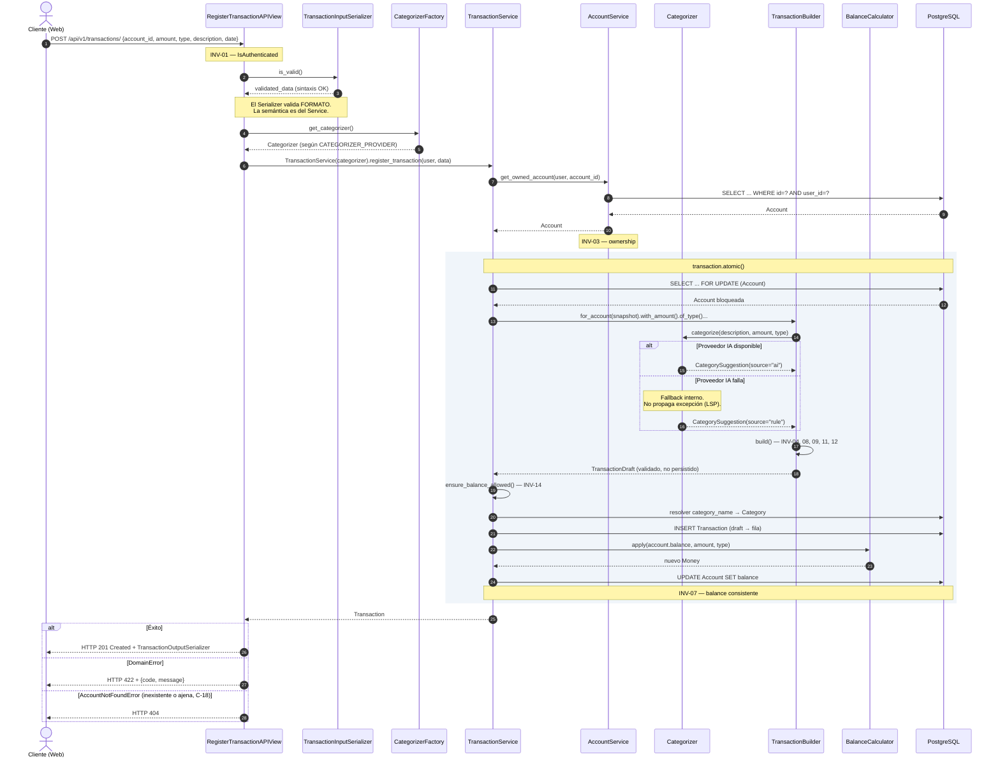
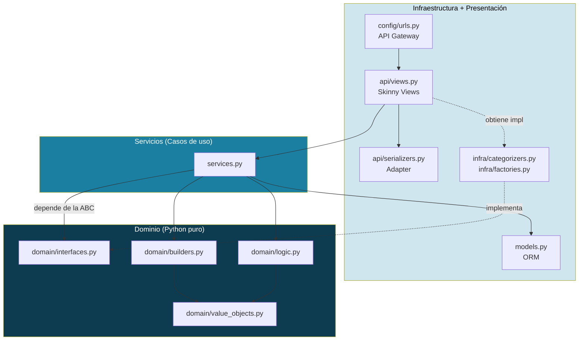
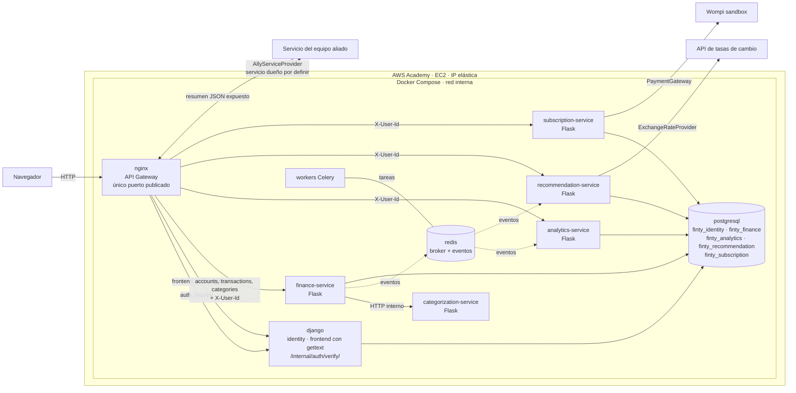
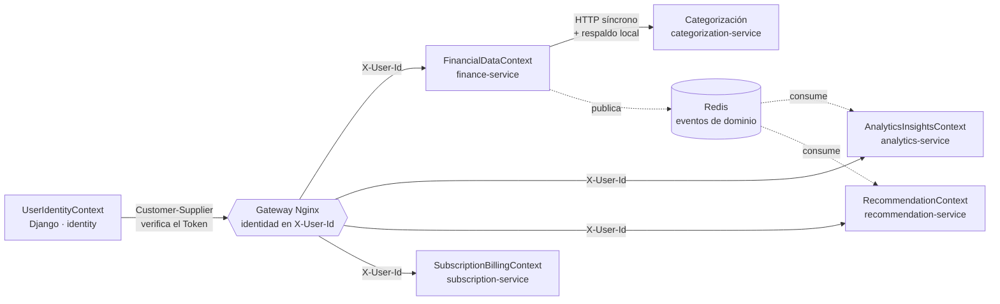
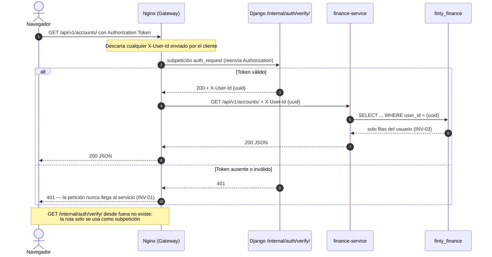
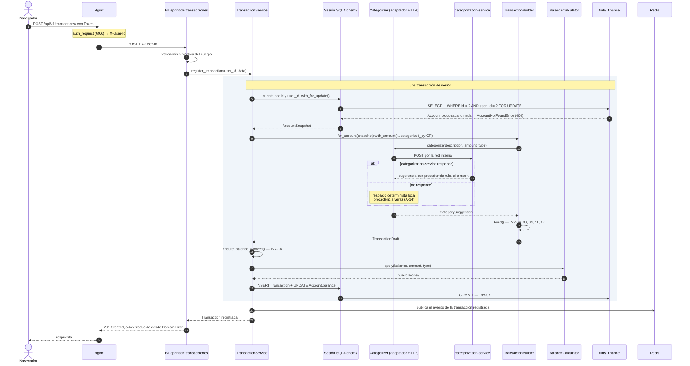
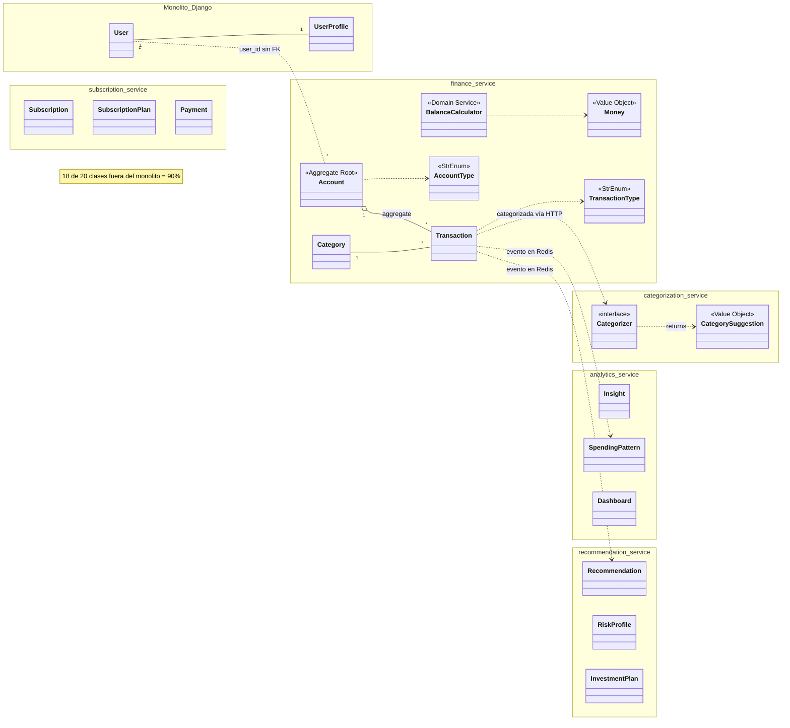

# Finty — Documentación Consolidada de Arquitectura y Dominio

**Versión:** 3.0
**Fecha:** 2026-10-19
**Estado:** Vigente — sustituye funcionalmente a los supuestos técnicos de Phase 0, Phase 1 y DDD Stage 1
**Cambios de v2.1:** correcciones derivadas de la implementación de los módulos de la Entrega 1 (ver §0, filas C-11 a C-19)
**Cambios de v3:** decisiones de la Entrega 2 — microservicios Flask, Gateway Nginx, una base por servicio, despliegue en AWS, adaptadores externos, tareas asíncronas e i18n (ver §0, filas C-20 a C-32, y ADR-07 a ADR-16)
**Alcance:** Documento único de referencia para la implementación del monolito Django + DRF y de los microservicios Flask de la Entrega 2

> Este documento **no reemplaza** los artefactos de Service Design (Phase 0 / Phase 1) ni el Event Storming / Bounded Context Map (DDD Stage 1). Los **consume, corrige y traduce** al stack y a la doctrina arquitectónica definitivos. Donde exista contradicción entre este documento y los anteriores, **prevalece este**.

---

## 0. Registro de cambios

Las filas C-01 a C-19 registran los cambios respecto a v1 (Entrega 1). Las filas C-20 en adelante registran los de v3 (Entrega 2); en ellas, la columna "Estado en v2" describe v2.1 y "Estado en v3" la decisión vigente.

| # | Área | Estado en v1 | Estado en v2 | Motivo |
|---|------|--------------|--------------|--------|
| C-01 | Nombre del producto | Finova / Finova Web | **Finty** | Decisión de producto |
| C-02 | Stack backend | Python + FastAPI + PostgreSQL | **Python + Django + DRF + PostgreSQL** | Requisito del entregable |
| C-03 | Capa de dominio | Implícita, mezclada con supuestos ORM | **Capa `domain/` pura, sin imports de framework** | Portabilidad (Strangler Pattern) |
| C-04 | Lógica de negocio | Sin ubicación explícita | **Exclusivamente en `services.py` y `domain/`** | Penalización del 50% si aparece en `views.py` o en métodos de modelo |
| C-05 | Modelos | Entidades ricas (estilo DDD clásico) | **Modelos anémicos: solo persistencia** | Restricción explícita de la rúbrica |
| C-06 | Patrones creacionales | No definidos | **Factory + Builder asignados y justificados** | Requisito del entregable |
| C-07 | Capa de entrada | REST o GraphQL (indefinido) | **DRF: ViewSet para CRUD, APIView + Service para transacciones de negocio** | Criterio de Presentación 04 |
| C-08 | API Gateway | No contemplado | **Etapa 1: `urls.py` de Django; producción: Nginx; futuro: Kong/KrakenD** | Requisito de la Wiki |
| C-09 | Alcance de implementación | 100% conceptual | **Corte del 50–60% del diagrama de clases** | Definición de la Entrega 1 |
| C-10 | Invariantes | Clasificadas por capa abstracta | **Mapeadas a mecanismos concretos de Django/DRF** | Ejecutabilidad |
| C-11 | Retorno de `TransactionBuilder.build()` | Devolvía `Transaction` (modelo) | **Devuelve `TransactionDraft`** (objeto de valor) | Un builder en `domain/` que importe modelos arrastra el ORM al núcleo por transitividad y rompe el ADR-01 |
| C-12 | Entrada del builder | Recibía `Account` (modelo) | **Recibe `AccountSnapshot`** (objeto de valor) | Misma razón que C-11, en sentido de entrada |
| C-13 | Invariantes | 13 | **14** — se formaliza INV-14 | El catálogo DDD anotaba `balance >= 0 (dependiendo tipo)` sin identificador |
| C-14 | `Transaction` | Sin registro de confianza | **Campo `categorization_confidence`** | Phase 0 exige explicabilidad con indicadores de confianza (mitigación de R-02) |
| C-15 | Tipos enumerados del dominio | `@dataclass(frozen=True)` | **`enum.StrEnum`** | Inmutabilidad y conjunto cerrado por construcción; `.value` mapea directo a los `choices` del ORM |
| C-16 | Cliente de IA | Implícitamente asumido | **Costura inyectada, sin implementación concreta** | Sin dependencias de red ni claves de API en el entregable; el respaldo determinista queda demostrado en código |
| C-17 | Formulación de INV-07 | `balance = SUM(transacciones)` | **`balance = opening_balance + SUM(transacciones)`** | La fórmula original asumía tácitamente que toda cuenta abre en cero; con saldo de apertura, recalcular desde cero destruye dinero |
| C-18 | Acceso a cuenta ajena | `AccountNotOwnedError` (403) | **`AccountNotFoundError` (404) en ambos casos** | Un 403 confirmaría que ese identificador existe en el sistema |
| C-19 | `CategorizationSource` | Tres valores: `ai`, `rule`, `manual` | **Cuatro: se agrega `mock`** | El mock reportándose como `rule` violaba A-14; no hay constraint de base sobre la columna, así que el costo es un `AlterField` de `choices` |

| # | Área | Estado en v2 | Estado en v3 | Motivo |
|---|------|--------------|--------------|--------|
| C-20 | Versión de Python | 3.12 | **3.11** (imágenes `python:3.11-slim`) | Es la versión real del entorno y la que declara el README |
| C-21 | Unidades de despliegue | Monolito Django único | **Monolito Django (`identity` + frontend + verificación de auth) y cinco microservicios Flask** | Bono de migración >70% (ADR-07) |
| C-22 | Contextos `analytics`, `recommendation`, `subscription` | Diferidos como apps Django | **Nacen directamente como servicios Flask**; nunca existen como apps Django | Evitar construirlos dos veces (ADR-07) |
| C-23 | Strangler Pattern | `/api/v2/` al microservicio mientras `/api/v1/` sigue en el monolito | **Conmutación en Nginx, sobre el mismo `/api/v1/`, del bloque `finance` completo y de una vez** (upstream `finance_backend`); `/api/v2/` reservado para cambios incompatibles del contrato | El cliente no cambia al migrar (ADR-08) |
| C-24 | Autenticación | `IsAuthenticated` de DRF en cada vista | **Validación única en Nginx con `auth_request`** contra Django; los servicios Flask confían en `X-User-Id` | Función de autenticación del Gateway (ADR-09) |
| C-25 | Persistencia | Una base compartida | **Una base lógica por servicio** en una sola instancia de PostgreSQL | Autonomía de los servicios (ADR-10) |
| C-26 | `Account.user` | `ForeignKey(User, PROTECT)` | **`user_id: UUID` sin FK** en `finance-service` | Una FK no puede cruzar bases de datos (ADR-10) |
| C-27 | Frontend | HTML estático desacoplado (headless) | **Plantillas Django con gettext** que consumen `/api/v1/` desde el navegador | Corrección eliminatoria de la E1 e i18n completo (ADR-11) |
| C-28 | Multi-moneda (D-04) | Sin conversión | **Conversión solo de presentación hacia `preferred_currency`** vía Adapter de tasas de cambio; INV-11 intacta | API de terceros por Adapter (ADR-12) |
| C-29 | Pasarela de pagos | `subscription/infra/gateways.py` (app Django) | **`PaymentGateway` en `subscription-service`** con `MockPaymentGateway` y `WompiSandboxGateway`; confirmación por consulta periódica en Celery, sin webhooks | ADR-14 |
| C-30 | Comunicación entre contextos (D-03, D-05) | Llamada directa; sin eventos | **HTTP en la red interna o eventos de dominio en Redis**; tareas asíncronas con Celery | ADR-15 |
| C-31 | Coherencia interna de v2.1 | `mock` ausente en §4.2.1, §5.2 y §9.1; cabecera "C-11 a C-18"; §5.3 decía que todo VO es `dataclass`; §9.2 usaba `AccountNotOwnedError` | **Corregido**: cuatro valores de `CategorizationSource`; cabecera C-11 a C-19; enums como `StrEnum`; §9.2 con `AccountNotFoundError` (404) | Alinear el documento con C-15, C-18 y C-19 |
| C-32 | Comportamiento HTTP fuera del contrato JSON, al conmutar `finance` (E2-M2b) | Lo que hacían Django y DRF: aceptaban cuerpos de formulario, redirigían con 301 la ruta sin barra final, respondían `OPTIONS` con metadatos y servían la API navegable en HTML | **Diferencias aceptadas** de `finance-service`: (1) un cuerpo que no es JSON responde **415**; (2) la ruta sin barra final redirige con **308** en lugar de 301; (3) `OPTIONS` responde **sin metadatos**; (4) **no hay API navegable** (`.api`, `?format=api`). Además, una URL que no existe responde 404 en JSON en lugar de la página HTML de Django. El JSON de toda ruta del contrato es idéntico (A-20) | El contrato de Finty es JSON y el frontend solo envía JSON; replicar esas piezas de DRF no aporta a ningún cliente |

---

## 1. Identidad del producto (actualizada)

| Campo | Valor |
|-------|-------|
| **Nombre** | Finty |
| **One-liner** | Finty ayuda a las personas a gestionar sus finanzas mediante seguimiento estructurado, insights automáticos y guía de decisión explicable |
| **Tipo** | Aplicación web B2C, desktop-first, SaaS |
| **Modelo de negocio** | Freemium + suscripción |
| **Ambición IA** | AI-augmented (la IA mejora un producto que funciona sin ella) |
| **Backend** | Python 3.11 · monolito Django 5.2 + DRF (`identity`, frontend, verificación de auth) · microservicios Flask (`finance`, `categorization`, `analytics`, `recommendation`, `subscription`) |
| **Base de datos** | PostgreSQL — una instancia, una base lógica por servicio |
| **Broker / asincronía** | Redis (broker de Celery y canal de eventos de dominio) |
| **API Gateway** | Nginx: punto de entrada único, enrutamiento, autenticación (`auth_request`) y rate limiting |
| **Despliegue** | Docker Compose en una instancia EC2 de AWS Academy con IP elástica |
| **Frontend** | Plantillas Django con gettext; las pantallas consumen `/api/v1/` desde el navegador, en el mismo origen, a través de Nginx |
| **Idiomas** | `es` y `en`, con selector visible; sin textos quemados |
| **Autenticación** | Token de DRF emitido por `identity`; validado una sola vez en el Gateway |

**Restricción arquitectónica no negociable:** la IA es **opcional en tiempo de ejecución**. Toda funcionalidad AI-powered debe tener fallback determinístico. Esto viene de Phase 0 (decisión "AI-augmented") y es lo que justifica el patrón Factory en la Sección 6.

---

## 2. Decisiones arquitectónicas (ADR)

### ADR-01 — Django + DRF como framework de la capa externa

**Contexto:** el catálogo de dominio original asumía FastAPI.
**Decisión:** se adopta Django + DRF.
**Consecuencia:** la capa de dominio documentada en DDD Stage 1 (entidades, value objects, invariantes) **se conserva íntegra** porque no depende del framework. Solo se re-expresa la capa externa. Esto es precisamente la propiedad que la arquitectura por capas promete: cambiar de framework debe tocar únicamente el anillo más externo.
**Estado:** aceptada. En la Entrega 2 queda acotada al monolito (`identity`, frontend y verificación de auth); ADR-07 lleva el resto del sistema a Flask, y es esta misma propiedad la que lo hace posible.

### ADR-02 — Arquitectura de tres anillos

```
┌─────────────────────────────────────────────┐
│  Infraestructura + Presentación             │  ← views.py, serializers.py, urls.py,
│                                             │     models.py (ORM), infra/
│  ┌───────────────────────────────────────┐  │
│  │  Servicios (Casos de uso)             │  │  ← services.py
│  │                                       │  │
│  │  ┌─────────────────────────────────┐  │  │
│  │  │  Dominio                        │  │  │  ← domain/ (Python puro)
│  │  │  Entidades, VOs, reglas         │  │  │
│  │  └─────────────────────────────────┘  │  │
│  └───────────────────────────────────────┘  │
└─────────────────────────────────────────────┘
```

**Regla de dependencia:** las flechas apuntan hacia adentro. `domain/` no importa nada de Django. `services.py` puede importar `domain/` y `models.py`. `views.py` solo importa `services.py` y `serializers.py`.

**Verificación mecánica:** `grep -r "django" core/domain/` debe devolver cero resultados (A-01); en `finance-service`, la pureza del dominio la verifica A-16 por AST. Este check se documenta como criterio de aceptación.

**Extensión a la Entrega 2:** cada microservicio Flask repite los tres anillos. Su `domain/` no importa Flask, SQLAlchemy ni ningún paquete de infraestructura; los blueprints ocupan el lugar de `views.py` y los modelos SQLAlchemy el de `models.py`, con las mismas prohibiciones (A-16).

### ADR-03 — Modelos anémicos

**Decisión:** `models.py` contiene únicamente campos, `Meta`, constraints de base de datos, relaciones y `__str__`. **Ningún método de negocio.**

**Justificación:** la rúbrica penaliza con el 50% de la sección la presencia de lógica de negocio en métodos de modelo. Adicionalmente, un modelo con lógica ata esa lógica al ORM de Django y rompe la portabilidad prometida en ADR-01.

**Contrapartida aceptada:** se sacrifica el "modelo rico" clásico de DDD. Las invariantes de entidad se hacen cumplir en `domain/` y en los Builders, y se replican como constraints de base de datos cuando aplica (defensa en profundidad).

**Prohibido explícitamente:**
- `Account.recalculate_balance()`
- `Transaction.save()` con lógica sobreescrita
- `Model.clean()` con reglas de negocio
- Signals (`post_save`) que ejecuten reglas de negocio

### ADR-04 — Estructura de carpetas

```
finty/
├── manage.py
├── requirements.txt
├── .env.example
│
├── config/                        # Proyecto Django
│   ├── settings.py
│   ├── urls.py                    # ← API Gateway de Etapa 1
│   ├── asgi.py
│   └── wsgi.py
│
├── core/                          # Compartido entre contextos
│   ├── domain/
│   │   ├── value_objects.py       # Money
│   │   └── exceptions.py          # DomainError y subclases
│   └── api/
│       └── exception_handler.py   # DomainError → HTTP status
│
├── identity/                      # UserIdentityContext
│   ├── models.py                  # User, UserProfile
│   ├── services.py                # ProfileService
│   ├── api/
│   │   ├── serializers.py
│   │   ├── views.py
│   │   └── urls.py
│   └── tests/
│
└── finance/                       # FinancialDataContext
    ├── domain/
    │   ├── interfaces.py          # Categorizer (ABC)
    │   ├── value_objects.py       # AccountType, TransactionType, CategorySuggestion
    │   ├── logic.py               # BalanceCalculator, TransactionRules
    │   └── builders.py            # TransactionBuilder, AccountBuilder
    ├── infra/
    │   ├── categorizers.py        # AICategorizer, RuleBasedCategorizer, MockCategorizer
    │   └── factories.py           # CategorizerFactory
    ├── models.py                  # Account, Transaction, Category
    ├── services.py                # AccountService, TransactionService
    ├── api/
    │   ├── serializers.py
    │   ├── views.py
    │   └── urls.py
    └── tests/
```

> **Desde E2-M3a**, `finance/` ya no existe en el monolito: sus módulos viven en `services/finance-service/` con la misma forma de tres anillos (ADR-04.1). Las rutas `finance/...` de este árbol y de §4 a §9 describen la Entrega 1.

**Justificación de las desviaciones respecto al árbol de la Presentación 02:**

| Desviación | Razón |
|------------|-------|
| `domain/builders.py` (archivo nuevo) | Los Builders son lógica de construcción de dominio, no infraestructura. Ubicarlos en `domain/` mantiene la regla de dependencia. |
| `infra/categorizers.py` en vez de `gateways.py` | Nombre semánticamente preciso: en Finty el adaptador externo no es una pasarela de pago sino un clasificador. La pasarela de pago aparece en la Entrega 2 dentro de `subscription-service` (ADR-14), no en una app Django. |
| `api/` como subpaquete | Separa el contrato REST del resto del app; facilita añadir un segundo contrato (GraphQL, gRPC) sin reorganizar. |
| `core/` transversal | `Money` y las excepciones de dominio se comparten entre contextos; duplicarlas rompería DRY y el lenguaje ubicuo. |

#### ADR-04.1 — Estructura de la Entrega 2

Todo el árbol es real: la raíz y `deploy/` existen desde E2-M1a, y `services/` desde E2-M2a, con `finance-service` como primer servicio. Cada servicio Flask repite la forma interna de `finance-service`: los mismos tres anillos del monolito.

```
finty/
├── Dockerfile                     # Dos etapas: `django` (python:3.11-slim, collectstatic,
│                                  # gunicorn, usuario sin root) y `gateway` (nginx con los
│                                  # estáticos copiados desde la etapa `django`)
├── docker-compose.yml             # db, db-init y migrate (un solo uso), redis, django,
│                                  # finance-migrate (un solo uso), finance-service, nginx
├── .dockerignore
├── .env.example                   # ejecución local con PostgreSQL en el host
├── .env.docker.example            # ejecución con Compose
├── deploy/
│   ├── nginx/                     # ← API Gateway de la Entrega 2 (ADR-06, ADR-08, ADR-09)
│   │   ├── conf.d/finty.conf      # upstreams (`monolith`, `finance_backend`) y rutas
│   │   └── snippets/
│   │       ├── proxy.conf         # cabeceras de proxy; X-User-Id solo si lo verificó el Gateway
│   │       └── gateway-auth.conf  # auth_request contra Django (ADR-09), en el bloque finance
│   └── postgres/
│       └── init/                  # 01-create-databases.sh: una base lógica por servicio
│                                  # (lo corren initdb y el servicio db-init)
│
├── tests/contract/                # Suite de contrato de caja negra contra CONTRACT_BASE_URL (A-20)
│
├── config/ core/ identity/        # Monolito Django (sin cambios de forma)
│
└── services/
    └── finance-service/           # Plantilla de los demás servicios Flask
        ├── Dockerfile             # python:3.11-slim, gunicorn, usuario sin root
        ├── requirements.txt       # dependencias propias del servicio
        ├── .env.docker.example    # solo la URL de su base (A-21)
        ├── app.py                 # create_app(): configuración, blueprints, sonda /health/
        ├── domain/                # Python puro: ni Flask ni SQLAlchemy (A-16)
        │   └── shared/            # copia propia de Money y DomainError (D-13)
        ├── infra/                 # categorizadores, factory, engine y sesión, Listing
        ├── models.py              # SQLAlchemy: solo persistencia
        ├── services.py            # casos de uso, sobre una sesión inyectada
        ├── messages.py            # catálogo único de mensajes al usuario (→ Flask-Babel en E2-M8)
        ├── api/                   # blueprints, esquemas pydantic, salida, errores, paginación
        ├── alembic.ini
        ├── migrations/            # Alembic: 0001 esquema, 0002 siembra del catálogo
        └── tests/                 # dominio, categorización, persistencia, servicios, contrato
```

**Migraciones:** el servicio `migrate` de Compose usa la misma imagen que `django`, corre `manage.py migrate` y termina. `django` no arranca hasta que ese paso termina con éxito (`service_completed_successfully`). Así cada `up` deja el esquema al día sin un paso manual, una migración fallida impide arrancar contra un esquema incompleto y los workers de gunicorn nunca compiten por migrar. `finance-migrate` repite el patrón con `alembic upgrade head` sobre la imagen de `finance-service`, y cada servicio Flask nuevo tendrá el suyo.

**Creación de bases en volúmenes existentes (`db-init`).** El script de `deploy/postgres/init/` lo ejecuta la imagen de PostgreSQL solo cuando inicializa un volumen vacío. En un volumen que ya existe, como el de la EC2, una base nueva nunca aparecería. Por eso Compose tiene un paso de un solo uso, `db-init`, que corre **ese mismo script** en cada `up`, por TCP contra `db`, antes de cualquier paso de migración (`migrate` y `finance-migrate` dependen de él). El script es idempotente: crea las bases que falten y no toca las existentes.

Se eligió sobre la alternativa de que cada paso de migración cree su propia base por tres razones:
- La lista de bases sigue en **un solo lugar** (`FINTY_DATABASES`). Agregar un servicio es agregar su nombre ahí.
- Crear bases es una operación de administración del servidor. Así no la hace el código de ningún servicio ni requiere privilegios de administración en su configuración.
- No se escribe código nuevo: se reutiliza el script que ya existía y que initdb sigue usando en un volumen vacío.

### ADR-05 — ViewSet vs APIView

Criterio: *¿la operación solo lee/escribe filas, o ejecuta reglas de negocio?*

| Endpoint | Clase DRF | Razón |
|----------|-----------|-------|
| `/api/v1/categories/` | `ModelViewSet` (read-only) | Catálogo de soporte, sin reglas |
| `/api/v1/accounts/` | `ModelViewSet` + Service en `perform_create` | CRUD con una regla (ownership) |
| `/api/v1/transactions/` (POST) | **`APIView` + Service** | Orquesta Factory + Builder + recálculo de balance + transacción atómica |
| `/api/v1/transactions/{id}/categorize/` | **`APIView` + Service** | Regla de negocio (INV-08) y reclasificación |
| `/api/v1/profile/` | `APIView` | Lectura/escritura simple con validación semántica |

Tener ambos tipos en el mismo proyecto es evidencia de criterio arquitectónico, no de dogma.

**En los servicios Flask** el mismo criterio se conserva sin las clases de DRF: un blueprint de lectura/escritura simple delega en el servicio igual que un `ViewSet`; uno que ejecuta reglas de negocio delega en el servicio igual que un `APIView`. En ningún caso el blueprint decide.

### ADR-06 — API Gateway por etapas

| Etapa | Rol del Gateway | Tecnología | Estado |
|-------|-----------------|------------|--------|
| **Entrega 1** | Enrutamiento y punto de entrada único | `config/urls.py` de Django + DRF | Implementado |
| **Entrega 2** | Proxy inverso, enrutamiento por servicio (Strangler), autenticación centralizada con `auth_request`, rate limiting | Nginx | Implementado (E2-M1a, E2-M2b) |
| **Escala (Horizonte 3)** | Agregación, circuit breaker | Kong / AWS API Gateway / KrakenD | Futuro |

La autenticación centralizada, que v2.1 dejaba para el Horizonte 3, se adelanta a la Entrega 2 (ADR-09). TLS queda abierto porque requiere un dominio (D-12). Las cuatro funciones críticas y su realización en Finty se detallan en la Sección 10.

### ADR-07 — Microservicios Flask para los contextos nuevos y para `finance`

**Contexto:** la Entrega 2 otorga un bono a quien migre más del 70% de los servicios y la lógica de negocio a microservicios Flask independientes. Los tres contextos diferidos en la Entrega 1 más la categorización dejan la cobertura en torno al 55–65%, según cómo se mida.
**Decisión:** `analytics`, `recommendation` y `subscription` **no se construyen en Django**: nacen como servicios Flask. Además, todo el contexto `finance` se extrae a `finance-service` y la categorización a `categorization-service`. Django conserva `identity`, la verificación de autenticación y el servidor de plantillas del frontend.
**Consecuencia:** 18 de las 20 clases del diagrama de dominio (90%) quedan fuera del monolito (§4.4, §9.8). El dominio de `finance` se traslada casi sin cambios porque ya es Python puro (ADR-02); lo que se reescribe es el anillo externo: ORM, vistas y repositorios.
**Estado:** aceptada. La métrica oficial del 70% (clases, endpoints o contextos) está por confirmar con el profesor (D-09); la distribución la supera en las tres.

### ADR-08 — Strangler Pattern por conmutación de ruta en Nginx

**Decisión:** la migración de `finance` no cambia el contrato. `accounts`, `transactions` y `categories` forman **un solo bloque de rutas**, que se conmuta **completo y de una vez**. Son un mismo agregado con FK entre sí (`Transaction → Account` por INV-02 e INV-13, `Transaction → Category`). Con una base por servicio (ADR-10) no pueden quedar repartidos entre el monolito y `finance-service`: una transacción servida por Flask no puede referenciar una cuenta que vive en la base del monolito.
**Mecanismo:** en `deploy/nginx/conf.d/finty.conf`, las tres rutas comparten un único `location` regex que hace proxy al upstream `finance_backend`. Conmutar consiste en cambiar su línea `server` de `django:8000` a `finance-service:8000` e incluir `snippets/gateway-auth.conf` (el `auth_request` de ADR-09) en ese `location`; revertir es deshacer esas dos líneas. La regex del bloque captura también las variantes sin barra final y con sufijo `.json`, así que ninguna ruta del agregado cae en el bloque genérico de `/api/v1/` (lo verifica `tests/contract/test_routing.py` con la cabecera `X-Finty-Route: finance`). No hay conmutación parcial por ruta. El bloque se conmuta solo cuando `finance-service` pasa, para las tres rutas a la vez, la misma suite de contrato que el monolito (A-20). El cliente sigue llamando a `/api/v1/` y no se entera del cambio.
**Estrategia de datos:** `finty_finance` arranca **vacía**, salvo el catálogo de categorías, que se siembra con el equivalente de `finance/migrations/0002_seed_categories.py`. Las cuentas y transacciones existentes en la base del monolito **no se migran en esta entrega** (D-16).
**Retiro del monolito:** el código de `finance` en Django permaneció como respaldo mientras duró la verificación, con el bloque entero apuntando a uno solo de los dos, y **se eliminó en E2-M3a**. El comando `verify_invariants` pasó a `finance-service` como `flask verify-invariants`. Las tablas que la app dejó en `finty_identity` no se borraron (D-20).
**Versionado:** `/api/v2/` queda reservado para cambios **incompatibles** del contrato. No se usa para migrar.
**Estado:** aceptada y **conmutada el 2026-10-20** (E2-M2b). Evidencia: la suite de contrato `tests/contract/` dio el mismo resultado, test por test, con Django detrás (`tests/contract/runs/2026-10-20-antes-de-conmutar.txt`) y con `finance-service` detrás (`…-despues-de-conmutar.txt`): 111 verdes. **Monolito retirado el 2026-10-20** (E2-M3a): la app `finance` se eliminó de Django y la suite volvió a dar el mismo resultado (`…-tras-retirar-finance-del-monolito.txt`). Sustituye la nota de v2.1 en §10.2 que proponía `/api/v2/` como vía de migración.

### ADR-09 — Autenticación centralizada en el Gateway

**Decisión:** Nginx valida cada petición dirigida a un microservicio con `auth_request` contra un endpoint interno de Django, `/internal/auth/verify/`. Django valida el Token y responde `200` con la cabecera `X-User-Id`, o `401`. Nginx reenvía `X-User-Id` al servicio.
**Reglas que la hacen segura:**
- Los servicios Flask **no validan tokens**: confían en `X-User-Id`.
- Nginx **descarta cualquier `X-User-Id` que envíe el cliente** y lo reemplaza por el que devuelve la verificación. Sin esto, cualquiera suplantaría a otro usuario con una cabecera.
- `/internal/` no es alcanzable desde fuera: solo existe como subpetición de Nginx.
- Los servicios Flask no publican puertos en el host; solo Nginx lo hace (A-17).

**Consecuencia:** INV-01 cambia de mecanismo en los servicios Flask (§7). Las rutas propias de `identity` (`auth/`, `profile/`) siguen protegidas por DRF dentro de Django.

**Implementación (E2-M2b):**
- **Verificación:** la subpetición es una `location` interna (`/_gateway/auth/verify`) que hace proxy a Django **siempre con GET**, sin cuerpo y con una sola cabecera de la petición original, `Authorization`.
- **Django:** `GatewayAuthVerifyAPIView` delega en `TokenVerificationService`, que reproduce los casos de `TokenAuthentication` de DRF. Responde `200` con `X-User-Id`, o `401` con el motivo en `X-Auth-Error` (por ejemplo `invalid_token`), sin cuerpo: Nginx no lee el cuerpo de una subpetición. No le aplican throttles, porque el Gateway la llama una vez por petición y la IP de Nginx agotaría cualquier cuota.
- **Respuesta al cliente:** Nginx traduce `X-Auth-Error` con un `map` al mismo `{"detail": ...}` y el mismo `WWW-Authenticate: Token` que respondía DRF.
- **Hacia el servicio:** el token no sigue hacia `finance-service`, que no lo necesita (`Authorization` se borra en el bloque).

**Estado:** aceptada e **implementada el 2026-10-20** en el bloque `finance` (E2-M2b). Realiza la "validación una sola vez en la entrada del Gateway" que §10.1 dejaba como futura.

### ADR-10 — Una base de datos lógica por servicio

**Decisión:** una sola instancia de PostgreSQL en Compose, con **una base lógica por servicio** (`finty_identity`, `finty_finance`, …). Ningún servicio consulta la base de otro; se comunican por HTTP en la red interna o por eventos en Redis (ADR-15).
**Consecuencia sobre `Account`:** la `ForeignKey(User, PROTECT)` no puede cruzar bases. En `finance-service` se sustituye por `user_id: UUID`, **sin FK** e indexado. El tipo coincide con `identity.User.id`, que es `UUIDField` (verificado en `identity/models.py`). INV-03 se cumple filtrando **toda** consulta por el `user_id` recibido en `X-User-Id`, y una cuenta ajena sigue respondiendo 404, no 403 (D-08).
**Contrapartida aceptada:** se pierde la protección referencial entre `User` y `Account`. Hoy no existe un caso de uso de borrado de usuario, así que no hay huérfanos posibles por la vía de la aplicación; si aparece, deberá resolverse con un evento (D-15).
**Estado:** aceptada.

### ADR-11 — Frontend en plantillas Django con gettext

**Decisión:** el cliente deja de ser un HTML estático. Django sirve plantillas con `` / `` y el `JavaScriptCatalog` para los textos que genere JavaScript. Las pantallas consumen `/api/v1/` desde el navegador, en el mismo origen y a través de Nginx. Idiomas `es` y `en`, con selector visible. Los servicios Flask traducen sus mensajes de error con Flask-Babel (gettext).
**Consecuencia:** el frontend ya no es headless en sentido estricto, pero sigue sin renderizar datos de negocio en el servidor: la plantilla aporta estructura y textos traducidos, y los datos llegan por JSON. El diseño visual lo produce Claude Design a partir de SCR-001 a SCR-008 más las pantallas de los contextos nuevos; se implementa en E2-M8.
**Estado:** aceptada. Atiende la corrección eliminatoria de la Entrega 1 (frontend intuitivo y agradable).

### ADR-12 — Adapter de tasas de cambio (TRM)

**Decisión:** la API de terceros obligatoria es una API pública de tasas de cambio, detrás del puerto `ExchangeRateProvider` (ABC). Hay un adaptador concreto contra la API externa y un **adaptador de respaldo con tasa fija**, que es el que responde si la externa falla. Las tasas se **cachean**.
**Alcance de la conversión:** **solo de presentación**, hacia el `preferred_currency` del `UserProfile`. Nunca modifica montos persistidos ni la moneda de una cuenta. **INV-11 queda intacta**: una transacción sigue teniendo la moneda de su cuenta.
**Ubicación:** `recommendation-service` (E2-M5). Cómo obtiene ese servicio el `preferred_currency` sin consultar la base de `identity` (ADR-10) se decide en ese módulo.
**Estado:** aceptada. Resuelve D-04 solo en su vertiente de presentación.

### ADR-13 — Servicio expuesto y servicio del equipo aliado

**Expuesto:** un resumen financiero agregado en JSON (por ejemplo, gasto por categoría del período), servido por `analytics-service`. La ruta y el contrato exactos se acuerdan con el equipo aliado.
**Consumido:** el servicio del aliado va detrás del puerto `AllyServiceProvider` (ABC), con `MockAllyAdapter` como respaldo cuando el aliado no responde. El adaptador concreto se escribe en un módulo aparte cuando lleguen el dominio, la URL y el contrato del aliado; **no se inventan** antes.
**Estado:** aceptada, con el aliado sin asignar (D-10).

### ADR-14 — `PaymentGateway`: un puerto y dos adaptadores

**Decisión:** `PaymentGateway` (ABC) en `subscription-service`, con dos implementaciones elegidas por variable de entorno, igual que `CategorizerFactory`:
- `MockPaymentGateway`: el predeterminado en tests y en la demo; nunca falla por red.
- `WompiSandboxGateway`: sandbox de Wompi (`https://sandbox.wompi.co/v1`), con llaves de prueba `pub_test_` / `prv_test_`.

**Confirmación sin webhooks:** una tarea de Celery consulta el estado de la transacción en Wompi hasta resolverla. Así no hace falta una URL pública con HTTPS para recibir eventos. La suscripción solo se activa con el pago confirmado (INV-05).
**Lenguaje ubicuo:** lo que Wompi llama *transaction* se traduce a `Payment` dentro del adaptador. `Transaction` no aparece en `subscription-service` (§12).
**Estado:** aceptada.

### ADR-15 — Eventos de dominio y tareas asíncronas

**Decisión:** cuando un servicio no necesita la respuesta de otro, publica un evento de dominio en Redis en lugar de llamarlo de forma síncrona. Celery, con Redis como broker, ejecuta las tareas asíncronas. Candidatas: reporte mensual (CSV o PDF), notificaciones (backend de email en consola o en archivo), consulta del estado de pagos (ADR-14) y recategorización por lotes.
**Consecuencia:** resuelve D-03 (`recommendation` deja de llamar a `finance`: consume sus eventos) y D-05. Los nombres definitivos de los eventos se fijan en el módulo que los publica.
**Estado:** aceptada.

### ADR-16 — Despliegue en Docker Compose sobre EC2

**Decisión:** todo el sistema corre en Docker Compose (Django, servicios Flask, Nginx, PostgreSQL, Redis y workers de Celery) en una instancia EC2 de AWS Academy con IP elástica. Las imágenes Python parten de `python:3.11-slim`. Solo Nginx publica un puerto en el host; el resto se comunica por la red interna de Compose.
**Estado:** aceptada. Se implementa en E2-M1; la instancia debe estar encendida durante la sustentación.

---

## 3. Mapa de Bounded Contexts (actualizado)

| Contexto | App Django | Tipo | Sistema de registro | Entrega 1 |
|----------|-----------|------|---------------------|-----------|
| UserIdentityContext | `identity` | Generic | Sí | ✅ Parcial |
| FinancialDataContext | `finance` | **Core** | Sí | ✅ Completo |
| AnalyticsInsightsContext | `analytics` | Core | No | ⛔ Entrega 2 |
| RecommendationContext | `recommendation` | Core | No | ⛔ Entrega 2 |
| SubscriptionBillingContext | `subscription` | Supporting | Sí | ⛔ Entrega 2 |

**Relaciones vigentes en la Entrega 1:**

```
[identity] --(Customer-Supplier)--> [finance]
```

`finance` consume la identidad del usuario autenticado (`request.user`). No hay acoplamiento inverso: `identity` no conoce cuentas ni transacciones.

**Cambio respecto a v1:** la relación `RecommendationContext --(Conformist)--> FinancialDataContext` queda **fuera de alcance** y se revisará en la Entrega 2, porque introduce una dependencia circular en el mapa que conviene resolver con eventos de dominio y no con llamada directa.

### 3.1 Mapa de la Entrega 2

| Contexto | Unidad de despliegue | Tecnología | Base de datos | Módulo |
|----------|----------------------|------------|---------------|--------|
| UserIdentityContext | monolito (`identity`) + frontend + `/internal/auth/verify/` | Django | `finty_identity` | existente; frontend en E2-M8 |
| FinancialDataContext | `finance-service` | Flask | `finty_finance` | E2-M2 |
| FinancialDataContext (categorización) | `categorization-service` | Flask | ninguna: las reglas viven en código | E2-M3 |
| AnalyticsInsightsContext | `analytics-service` | Flask | `finty_analytics` | E2-M4 |
| RecommendationContext | `recommendation-service` | Flask | `finty_recommendation` | E2-M5 |
| SubscriptionBillingContext | `subscription-service` | Flask | `finty_subscription` | E2-M6 |

La app `finance` de Django sirvió de respaldo durante la verificación del Strangler y se retiró en E2-M3a (ADR-08). Sus tablas antiguas siguen en `finty_identity` sin uso (D-20).

**Relaciones de la Entrega 2** (diagrama en §9.5):

- `identity` → todos los servicios: **Customer-Supplier a través del Gateway**. Ningún servicio llama a `identity`; reciben la identidad ya resuelta en `X-User-Id`.
- `finance-service` → `categorization-service`: **HTTP síncrono**, porque la categoría hace falta antes de persistir (INV-08). Si el servicio no responde, `finance-service` usa un respaldo determinista local y la procedencia sigue siendo veraz (A-14).
- `finance-service` → `analytics-service` y `recommendation-service`: **eventos de dominio en Redis**. `recommendation` deja de depender de `finance` por llamada directa, lo que resuelve D-03.
- `subscription-service` → `WompiSandboxGateway`, `recommendation-service` → API de tasas de cambio y el consumo del servicio aliado (servicio dueño por definir, D-10): **siempre detrás de un Adapter con respaldo**.

---

## 4. Corte de alcance de la Entrega 1

### 4.1 Criterio del corte

Se implementa el **camino crítico completo de extremo a extremo** en lugar de fragmentos de muchos contextos. Esto permite:

1. Demostrar el flujo APIView → Serializer → Service → Factory → Builder → Dominio → Persistencia sin simulaciones.
2. Concentrar los tres patrones creacionales en un mismo recorrido narrable.
3. Ejercitar invariantes de los cuatro tipos de capa (Middleware, App, Domain, DB).

### 4.2 Inventario del diagrama de clases completo

| # | Clase | Contexto | Entrega 1 |
|---|-------|----------|-----------|
| 1 | `User` | identity | ✅ |
| 2 | `UserProfile` | identity | ✅ |
| 3 | `Account` | finance | ✅ |
| 4 | `Transaction` | finance | ✅ |
| 5 | `Category` | finance | ✅ |
| 6 | `Money` (VO) | core | ✅ |
| 7 | `AccountType` (VO) | finance | ✅ |
| 8 | `TransactionType` (VO) | finance | ✅ |
| 9 | `CategorySuggestion` (VO) | finance | ✅ |
| 10 | `Categorizer` (ABC) | finance | ✅ |
| 11 | `BalanceCalculator` | finance | ✅ |
| 12 | `Insight` | analytics | ⛔ |
| 13 | `SpendingPattern` | analytics | ⛔ |
| 14 | `Dashboard` | analytics | ⛔ |
| 15 | `Recommendation` | recommendation | ⛔ |
| 16 | `RiskProfile` | recommendation | ⛔ |
| 17 | `InvestmentPlan` | recommendation | ⛔ |
| 18 | `Subscription` | subscription | ⛔ |
| 19 | `SubscriptionPlan` | subscription | ⛔ |
| 20 | `Payment` | subscription | ⛔ |

**Cobertura: 11 de 20 clases = 55%.** Dentro del rango 50–60% exigido.

### 4.2.1 Clases de soporte arquitectónico

Durante la implementación aparecieron cuatro clases adicionales que **no forman parte del modelo de dominio del mapa de bounded contexts** y por tanto no entran al denominador de la cobertura. Existen para sostener la frontera entre capas:

| Clase | Ubicación | Función |
|-------|-----------|---------|
| `CategorizationSource` | `finance/domain/value_objects.py` | Enumeración del origen de una categorización (`ai` / `rule` / `manual` / `mock`, C-19) |
| `TransactionDraft` | `finance/domain/value_objects.py` | Salida validada de `TransactionBuilder`; cruza del dominio hacia la persistencia |
| `AccountDraft` | `finance/domain/value_objects.py` | Salida validada de `AccountBuilder` |
| `AccountSnapshot` | `finance/domain/value_objects.py` | Lectura inmutable de la raíz de agregado que entra al dominio desde la persistencia |

Los drafts y el snapshot son las dos direcciones de la misma frontera: el snapshot entra al dominio, el draft sale. Ninguno conoce el ORM.

Tampoco entran al denominador los builders, la factory, los categorizadores concretos ni los servicios: son mecanismos de construcción y orquestación, no conceptos del lenguaje ubicuo.

### 4.3 Fuera de alcance, declarado

- Analítica, insights y detección de patrones.
- Motor de recomendaciones y perfil de riesgo.
- Suscripciones, pagos y feature gating (INV-05, INV-06 quedan diferidas).
- Integraciones bancarias automáticas (ya estaba fuera de alcance desde Phase 0).

Los tres primeros puntos entran en la Entrega 2 como microservicios Flask (ADR-07). Las integraciones bancarias automáticas siguen fuera de alcance.

### 4.4 Distribución de la Entrega 2 y cobertura de migración

Mismo denominador que §4.2: las 20 clases del diagrama de dominio. Diagrama en §9.8.

| Unidad | Tecnología | Clases del dominio | # |
|--------|------------|--------------------|---|
| Monolito: `identity` + frontend + verificación de auth | Django | `User`, `UserProfile` | 2 |
| `finance-service` | Flask | `Account`, `Transaction`, `Category`, `Money`, `AccountType`, `TransactionType`, `BalanceCalculator` | 7 |
| `categorization-service` | Flask | `Categorizer`, `CategorySuggestion` | 2 |
| `analytics-service` | Flask | `Insight`, `SpendingPattern`, `Dashboard` | 3 |
| `recommendation-service` | Flask | `Recommendation`, `RiskProfile`, `InvestmentPlan` | 3 |
| `subscription-service` | Flask | `Subscription`, `SubscriptionPlan`, `Payment` | 3 |

**Fuera del monolito: 18 de 20 clases = 90%.** Medido por bounded contexts, 4 de 5 contextos quedan fuera; medido por endpoints de negocio, solo `auth/` y `profile/` siguen en Django (más `health/` y el endpoint interno de verificación, que son de soporte).

**Criterio de asignación:** cada clase cuenta una sola vez, en el servicio que es su dueño. `finance-service` sigue *usando* `Categorizer` y `CategorySuggestion` como puerto de cliente hacia `categorization-service`, y `Money` se usa en varios servicios, pero su dueño está donde indica la tabla. Cada servicio lleva su propia copia del núcleo común (`Money`, `DomainError`) en su `domain/shared/` (D-13).
---

## 5. Modelo de dominio actualizado

### 5.1 Aggregate: `Account`

`Account` es la raíz de agregado y el punto de consistencia del balance. `Transaction` es una entidad **dentro** del agregado: no se modifica sin pasar por la raíz.

**Consecuencia práctica en Django:** toda escritura de transacciones ocurre dentro de `transaction.atomic()` con `select_for_update()` sobre la fila de `Account`, para que INV-07 (balance consistente) se sostenga bajo concurrencia.

**En `finance-service`:** la misma garantía se expresa con SQLAlchemy: una única transacción de sesión por caso de uso y `with_for_update()` sobre la fila de `Account`. El evento de dominio de la escritura se publica **después** del commit, nunca dentro de la transacción (§9.7).

**Nota sobre las tablas de §5.2:** los tipos se expresan en Django porque es el contrato vigente. En `finance-service` se usan los equivalentes de SQLAlchemy (`Numeric(14, 2)`, `Uuid`, `CheckConstraint`, `ForeignKey(..., ondelete="RESTRICT")`), con las mismas restricciones.

### 5.2 Entidades

#### `Account` (Aggregate Root)

| Atributo | Tipo Django | Requerido | Validación |
|----------|-------------|-----------|------------|
| `id` | `UUIDField(primary_key)` | Sí | Automático |
| `user` | `ForeignKey(User, PROTECT)` — en `finance-service`: `user_id: UUID` sin FK, indexado (C-26) | Sí | INV-03 |
| `name` | `CharField(120)` | Sí | No vacío |
| `type` | `CharField(choices=AccountType)` | Sí | Enum válido |
| `opening_balance` | `DecimalField(14,2)` | Sí | Saldo al abrir la cuenta; inmutable tras la creación |
| `balance` | `DecimalField(14,2)` | Sí | Derivado, persistido (INV-07) |
| `currency` | `CharField(3)` | Sí | Default `COP` |
| `is_archived` | `BooleanField` | Sí | Default `False` |
| `created_at` | `DateTimeField(auto_now_add)` | Sí | Automático |

**Ciclo de vida:** `Active → Archived`. La transición inversa está prohibida (requiere decisión de negocio, no está implementada).

**Decisión sobre `balance`:** persistido y recalculado por `BalanceCalculator`, no derivado en cada lectura. Motivo: el producto es dashboard-céntrico y desktop-first con alta densidad de información (Phase 0, PI-02); recalcular por agregación en cada carga de dashboard degradaría el p95 < 2 s exigido por SC-05.

#### `Transaction` (Entidad dentro del agregado)

| Atributo | Tipo Django | Requerido | Validación |
|----------|-------------|-----------|------------|
| `id` | `UUIDField(primary_key)` | Sí | Automático |
| `account` | `ForeignKey(Account, PROTECT)` | Sí | INV-02 |
| `amount` | `DecimalField(14,2)` | Sí | INV-04 (`!= 0`) |
| `type` | `CharField(choices=TransactionType)` | Sí | INV-09 |
| `category` | `ForeignKey(Category, PROTECT, null=True)` | No | INV-08 tras categorizar |
| `description` | `CharField(255)` | No | — |
| `occurred_on` | `DateField` | Sí | No futura |
| `categorization_source` | `CharField(choices, null=True)` | No | `ai` / `rule` / `manual` / `mock` (C-19) |
| `categorization_confidence` | `FloatField(null=True)` | No | `0.0 ≤ x ≤ 1.0` (constraint DB) |
| `created_at` | `DateTimeField(auto_now_add)` | Sí | Automático |

**Ciclo de vida:** `Created → Categorized`. El estado `IncludedInAggregation` del modelo v1 **se elimina del alcance de la Entrega 1** porque pertenece a `AnalyticsInsightsContext`.

#### `Category`

Catálogo global de solo lectura en la Entrega 1. `Categorizer` devuelve el nombre de una categoría existente; no crea categorías nuevas.

| Atributo | Tipo Django |
|----------|-------------|
| `id` | `UUIDField(primary_key)` |
| `name` | `CharField(80, unique)` |
| `applies_to` | `CharField(choices=TransactionType)` |

**Decisión pendiente de v1 resuelta:** se inicia con categorías **globales**, no por usuario. La evolución a `UserCategory` queda documentada como deuda.

#### `UserProfile`

| Atributo | Tipo Django |
|----------|-------------|
| `user` | `OneToOneField(User, CASCADE)` |
| `display_name` | `CharField(120)` |
| `preferred_currency` | `CharField(3)` |
| `onboarding_completed` | `BooleanField` |

### 5.3 Value Objects

| VO | Ubicación | Atributos | Igualdad | Validación |
|----|-----------|-----------|----------|------------|
| `Money` | `core/domain/value_objects.py` | `amount: Decimal`, `currency: str` | Por valor y moneda | 2 decimales; operaciones entre monedas distintas lanzan `CurrencyMismatchError` |
| `AccountType` | `finance/domain/value_objects.py` | `value` | Por valor | ∈ {`cash`, `bank`, `credit`} |
| `TransactionType` | `finance/domain/value_objects.py` | `value` | Por valor | ∈ {`income`, `expense`} |
| `CategorizationSource` | `finance/domain/value_objects.py` | `value` | Por valor | ∈ {`ai`, `rule`, `manual`, `mock`} |
| `CategorySuggestion` | `finance/domain/value_objects.py` | `category_name`, `confidence`, `source` | Por valor | `0.0 ≤ confidence ≤ 1.0` |

Dos formas de implementación, ambas inmutables y sin dependencia de Django (C-15):
- **Enumeraciones** (`AccountType`, `TransactionType`, `CategorizationSource`): `enum.StrEnum`. El conjunto es cerrado por construcción y `.value` se mapea directo a los `choices` del ORM.
- **VOs con atributos** (`Money`, `CategorySuggestion` y los drafts y snapshot de §4.2.1): `@dataclass(frozen=True)`.

**`CategorySuggestion` es nuevo en v2.** Es el contrato de retorno de `Categorizer` y lo que hace posible el LSP: cualquier implementación devuelve el mismo VO, incluida la que falla silenciosamente.

---

## 6. Patrones creacionales: asignación y justificación

### 6.1 Factory Method → `CategorizerFactory`

**Problema que resuelve:** la categorización de transacciones puede ejecutarse con un modelo de IA, con reglas determinísticas, o con un mock en desarrollo. Instanciar directamente el categorizador en el Service o en la View lo ataría a una implementación concreta y violaría OCP y DIP.

**Solución:**

```
domain/interfaces.py     Categorizer (ABC) con un único método
                         categorize(description, amount, type) -> CategorySuggestion

infra/categorizers.py    AICategorizer         → llama al proveedor externo
                         RuleBasedCategorizer  → diccionario de palabras clave
                         MockCategorizer       → categoría fija, para tests

infra/factories.py       CategorizerFactory.get_categorizer()
                         lee CATEGORIZER_PROVIDER desde el entorno
```

**Ventaja operativa demostrable:**

```bash
export CATEGORIZER_PROVIDER=MOCK && python manage.py runserver
```

cambia el comportamiento del sistema sin tocar una línea de código. Esto además evita consumir cuota de inferencia durante desarrollo, lo cual conecta directamente con la restricción HC-06 de Phase 0 (presupuesto limitado de IA).

**Por qué esta Factory y no la de pagos:** el `PaymentGatewayFactory` es el ejemplo más obvio, pero `SubscriptionBillingContext` está fuera del corte del 50–60%. El `CategorizerFactory` es funcionalmente equivalente en estructura, está dentro del alcance, y responde a una restricción real del producto (fallback determinístico obligatorio) en lugar de a una hipótesis futura.

**Fallback y LSP:** `AICategorizer` nunca propaga excepciones hacia arriba. Si el proveedor externo falla, delega internamente en `RuleBasedCategorizer` y devuelve un `CategorySuggestion` con `source="rule"` y confianza reducida. El contrato se mantiene: el Service no necesita saber qué ocurrió.

**En la Entrega 2:** `CategorizerFactory` y los categorizadores concretos pasan a `categorization-service`. `finance-service` conserva el puerto `Categorizer` y lo implementa con un adaptador HTTP hacia ese servicio, con respaldo determinista local si no responde. Es el mismo patrón de fallback, un nivel más afuera. La procedencia `rule` / `ai` / `mock` debe llegar intacta a la fila (E2-M3). El ejemplo de pagos que este apartado descartaba aparece ahora en ADR-14, también elegido por variable de entorno.

### 6.2 Builder → `TransactionBuilder`

**Problema que resuelve:** crear una `Transaction` válida requiere coordinar cuenta, monto, tipo, categoría resuelta, fecha, origen de la categorización y el efecto sobre el balance de la cuenta. Un constructor posicional con siete argumentos es exactamente el antipatrón descrito en la Presentación 03: inconsistente, con alta carga cognitiva y lógica dispersa.

**Solución — interfaz fluida:**

```python
draft = (
    TransactionBuilder()
    .for_account(snapshot)            # AccountSnapshot, no el modelo
    .with_amount(Money(amount, currency))
    .of_type(TransactionType.EXPENSE)
    .occurred_on(day)
    .described_as(description)
    .categorized_by(categorizer)      # opcional: dispara la categorización
    .build()                          # ← aquí ocurren TODAS las validaciones
)
```

`build()` devuelve un `TransactionDraft`, no un modelo. Es la corrección C-11: un builder alojado en `domain/` que importara `finance.models` arrastraría el ORM al núcleo por transitividad, y el `grep` de pureza no lo detectaría porque la cadena `django` no aparecería en el archivo. El draft mantiene el dominio genuinamente portable; el servicio traduce draft → fila.

`build()` es **de un solo uso**: la segunda llamada falla. El categorizador se invoca durante `build()`, y permitir reconstrucciones dispararía llamadas repetidas a un colaborador externo. `AccountBuilder` no tiene esa restricción porque no invoca a nadie.

**Qué garantiza `.build()`:**

| Garantía | Invariante |
|----------|------------|
| Campos obligatorios presentes | — |
| Monto distinto de cero | INV-04 |
| Monto no negativo (el signo lo aporta `type`) | — |
| Tipo dentro del enum | INV-09 |
| Cuenta no archivada | — |
| Moneda de la transacción == moneda de la cuenta | INV-11 |
| Fecha no futura | INV-12 |
| Categoría resuelta si se invocó `categorized_by` | INV-08 |

**Qué NO garantiza:** INV-14 (balance resultante admisible). El saldo autoritativo vive en la base y solo es confiable bajo bloqueo; el snapshot es, por definición, una foto que puede quedar obsoleta. Esa verificación pertenece al servicio, después del `select_for_update()`. En `AccountBuilder` sí se verifica INV-14, porque en la creación el saldo inicial es el único dato en juego y no existe carrera posible.

**Beneficio arquitectónico:** el objeto solo existe cuando está completo y es válido. La lógica de armado no se filtra ni a la Vista ni al Servicio; el Servicio orquesta, el Builder construye.

**Segundo Builder:** `AccountBuilder`, más simple, para la creación de cuentas con balance inicial. Se incluye para demostrar que el patrón no es un caso aislado forzado.

### 6.3 Service Layer

| Servicio | Método | Orquesta |
|----------|--------|----------|
| `AccountService` | `create_account(user, data)` | `AccountBuilder` → persistencia |
| | `get_owned_account(user, account_id)` | INV-03; consulta filtrada por usuario, lanza `AccountNotFoundError` tanto si no existe como si es ajena (C-18) |
| | `get_locked_account(user, account_id)` | Igual, con `select_for_update()`; solo válido dentro de un bloque atómico |
| | `build_snapshot(account)` | Único punto donde una fila se convierte en objeto de dominio |
| | `archive_account(user, account_id)` | Archiva aunque haya transacciones; lo protegido es borrar, no archivar |
| | `recompute_balance(user, account_id)` | `opening_balance + recompute(movimientos)`; operación de reparación |
| `TransactionService` | `register_transaction(user, data)` | **Flujo completo**: ownership → Factory → Builder → atomic → BalanceCalculator |
| | `recategorize(user, transaction_id, category)` | Reclasificación manual, INV-08 |
| `ProfileService` | `complete_profile(user, data)` | Validación semántica del perfil |

**Inyección de dependencias:** el categorizador entra por constructor.

```python
class TransactionService:
    def __init__(self, categorizer: Categorizer):
        self._categorizer = categorizer
```

La View no decide qué categorizador usar; pide uno a la Factory y lo inyecta. El Service depende de la abstracción, nunca de `AICategorizer`.

**En `finance-service`** los servicios conservan los mismos métodos y el mismo contrato. Solo cambia la entrada de identidad: reciben el `user_id` resuelto por el Gateway (ADR-09) en lugar del objeto `User` de Django, y acceden a los datos con una sesión SQLAlchemy inyectada por constructor sobre los modelos de `models.py`, igual que los del monolito usan el ORM. Los listados devuelven un `Listing` (equivalente del `QuerySet` perezoso), de modo que el blueprint pagina sin escribir SQL. No se agregó una capa de repositorios: habría sido una abstracción que el monolito no tiene.

### 6.4 Adapter → integraciones externas (Entrega 2)

Toda dependencia externa entra por un puerto definido en el `domain/` del servicio y se implementa en su `infra/`. Cada puerto tiene un adaptador de respaldo que no depende de la red, así que la caída de un tercero degrada el resultado pero no tumba el caso de uso.

| Puerto (ABC) | Servicio | Adaptador concreto | Adaptador de respaldo | Selección | Referencia |
|--------------|----------|--------------------|-----------------------|-----------|------------|
| `Categorizer` | `finance-service` | Cliente HTTP de `categorization-service` | Categorizador determinista local | Siempre el concreto; respaldo ante fallo | §6.1, E2-M3 |
| `ExchangeRateProvider` | `recommendation-service` | API pública de tasas de cambio, con caché | Tasa fija | Respaldo ante fallo | ADR-12, E2-M5 |
| `AllyServiceProvider` | Por definir con el contrato del aliado (D-10) | Por escribir cuando llegue el contrato | `MockAllyAdapter` | Respaldo ante fallo; solo mock hasta que exista el aliado | ADR-13, E2-M9 |
| `PaymentGateway` | `subscription-service` | `WompiSandboxGateway` | `MockPaymentGateway` | Variable de entorno | ADR-14, E2-M6 |

El Adapter traduce el modelo del tercero al lenguaje ubicuo de Finty. Ninguna estructura de respuesta externa cruza la frontera del puerto.

---

## 7. Catálogo de invariantes mapeado a Django

| ID | Invariante | Capa | Mecanismo concreto | Entrega 1 |
|----|-----------|------|--------------------|-----------|
| INV-01 | Usuario autenticado para operar | Middleware | `permission_classes = [IsAuthenticated]` en DRF | ✅ |
| INV-02 | Transacción pertenece a cuenta existente | DB | `ForeignKey(Account, on_delete=PROTECT, null=False)` | ✅ |
| INV-03 | Cuenta pertenece al usuario | Domain / Service | `AccountService.get_owned_account()`; querysets filtrados por `request.user` | ✅ |
| INV-04 | Monto de transacción distinto de cero | Domain + DB | `TransactionBuilder.build()` **y** `CheckConstraint(~Q(amount=0))` | ✅ |
| INV-05 | Pago exitoso antes de activar suscripción | App | — | ⛔ Entrega 2 |
| INV-06 | Premium requiere suscripción activa | Middleware | — | ⛔ Entrega 2 |
| INV-07 | Balance consistente: `balance = opening_balance + Σ movimientos` | Domain | `BalanceCalculator` dentro de `transaction.atomic()` + `select_for_update()` | ✅ |
| INV-08 | Categoría obligatoria tras procesamiento | Domain | `TransactionBuilder.build()` exige categoría si se invocó categorización | ✅ |
| INV-09 | Tipo de transacción válido | DB | `TextChoices` + `CheckConstraint` | ✅ |
| INV-10 | Email único por usuario | DB | `unique=True` en el modelo de usuario | ✅ |
| **INV-11** | Moneda de transacción == moneda de cuenta | Domain | `Money.__add__` lanza `CurrencyMismatchError`; verificado en `.build()` | ✅ **Nueva** |
| **INV-12** | Fecha de transacción no futura | Domain | Validación en `.build()` | ✅ **Nueva** |
| **INV-13** | No se elimina cuenta con transacciones | DB | `on_delete=PROTECT` | ✅ **Nueva** |
| **INV-14** | Cuenta que no admite saldo negativo no queda negativa | Domain | `AccountType.allows_negative_balance()` + `TransactionRules.ensure_balance_allowed()`, verificado en el servicio bajo bloqueo y en `AccountBuilder` al crear | ✅ **Nueva** |

**Nota sobre defensa en profundidad:** INV-04 y INV-09 aparecen en dos capas. La fuente autoritativa es el dominio; la constraint de base de datos es la red de seguridad ante escrituras que evadan la capa de servicios (migraciones de datos, shell de Django, procesos batch futuros). Esto es intencional y se documenta como tal, no es duplicación accidental.

**Las invariantes implícitas** detectadas en v1 se formalizan: "no eliminar cuentas con transacciones" pasa a ser INV-13; "fechas no futuras" pasa a ser INV-12.

### 7.1 Mecanismos en la Entrega 2

Las invariantes no cambian; cambia dónde y cómo se hacen cumplir cuando su dueño pasa a Flask.

| ID | Dueño en la Entrega 2 | Mecanismo concreto | Módulo |
|----|-----------------------|--------------------|--------|
| INV-01 | Gateway | Nginx `auth_request` → Django `/internal/auth/verify/`; sin token válido la petición no llega al servicio (401). Las rutas de `identity` siguen con `IsAuthenticated` de DRF | E2-M2b (implementada) |
| INV-02 | `finance-service` | `ForeignKey` de SQLAlchemy dentro de `finty_finance`, `nullable=False`, `ondelete="RESTRICT"` | E2-M2 |
| INV-03 | `finance-service` | Toda consulta filtrada por el `user_id` de `X-User-Id`; cuenta ajena o inexistente → `AccountNotFoundError` (404, D-08) | E2-M2 |
| INV-04 | `finance-service` | `TransactionBuilder.build()` **y** `CheckConstraint` de SQLAlchemy | E2-M2 |
| INV-05 | `subscription-service` | La suscripción solo se activa cuando `PaymentGateway` confirma el pago; la confirmación llega por la consulta periódica en Celery | E2-M6, E2-M7 |
| INV-06 | `subscription-service` | Gating de funciones premium; el mecanismo concreto (Gateway o servicio consumidor) se decide en el módulo (D-14) | E2-M6 |
| INV-07 | `finance-service` | `BalanceCalculator` dentro de una transacción SQLAlchemy con `with_for_update()` sobre `Account` | E2-M2 |
| INV-08 | `finance-service` | `TransactionBuilder.build()`; la categoría la aporta el puerto `Categorizer` (HTTP o respaldo local) | E2-M2, E2-M3 |
| INV-09 | `finance-service` | `StrEnum` en el dominio + `CheckConstraint` | E2-M2 |
| INV-10 | `identity` | Sin cambios: `unique=True` en `User.email` | — |
| INV-11 | `finance-service` | Sin cambios en el dominio. La conversión de ADR-12 es solo de presentación y nunca toca montos persistidos | E2-M2, E2-M5 |
| INV-12 | `finance-service` | Sin cambios: validación en `.build()` | E2-M2 |
| INV-13 | `finance-service` | `ondelete="RESTRICT"` en la FK `Transaction → Account` | E2-M2 |
| INV-14 | `finance-service` | Sin cambios: verificado en el servicio bajo bloqueo y en `AccountBuilder` | E2-M2 |

---

## 8. Evidencia de SOLID

| Principio | Dónde se evidencia en Finty | Verificación |
|-----------|----------------------------|--------------|
| **SRP** | `views.py` solo traduce HTTP. `serializers.py` solo valida sintaxis y formato. `services.py` solo orquesta casos de uso. `domain/` solo contiene reglas. `models.py` solo persiste. | Ninguna clase tiene dos razones para cambiar. Cambiar el cálculo de balance no toca la Vista. |
| **OCP** | Añadir un `LLMCategorizerV2` requiere: crear la clase + una línea en la Factory. **Cero cambios** en `TransactionService`, `views.py` o `serializers.py`. | El Service está cerrado a modificación, abierto a extensión. |
| **LSP** | `AICategorizer`, `RuleBasedCategorizer` y `MockCategorizer` son sustituibles sin romper el sistema: todas cumplen el contrato de devolver un `CategorySuggestion` y ninguna propaga excepciones. | Los tests del Service se ejecutan idénticos con las tres implementaciones. |
| **ISP** | `Categorizer` expone **un solo método**. No se obliga a `MockCategorizer` a implementar métodos de configuración de API, timeouts o reintentos que no usa. | Interfaz mínima. |
| **DIP** | `TransactionService.__init__(categorizer: Categorizer)` depende de la ABC de `domain/`, no de la implementación de `infra/`. La dirección de la dependencia se invierte respecto al flujo de control. | `finance/domain/` no importa nada de `finance/infra/`. |

**En la Entrega 2** la misma evidencia se extiende a los puertos de §6.4. `PaymentGateway`, `ExchangeRateProvider` y `AllyServiceProvider` repiten la forma de `Categorizer`: ABC en `domain/`, implementaciones en `infra/` y servicio que depende solo de la abstracción. Esto es DIP y OCP: añadir un proveedor no toca el caso de uso. También es LSP: el adaptador de respaldo sustituye al concreto sin que el servicio lo note.

---

## 9. Diagramas

### 9.1 Diagrama de clases — alcance Entrega 1

```mermaid
classDiagram
    direction TB

    %% ============ CAPA DOMINIO ============
    class Money {
        <<Value Object>>
        +Decimal amount
        +str currency
        +add(other) Money
        +negate() Money
        +is_zero() bool
    }

    class AccountType {
        <<StrEnum>>
        +str value
        +CASH$
        +BANK$
        +CREDIT$
    }

    class TransactionType {
        <<StrEnum>>
        +str value
        +INCOME$
        +EXPENSE$
    }

    class CategorySuggestion {
        <<Value Object>>
        +str category_name
        +float confidence
        +CategorizationSource source
        +is_confident(threshold) bool
    }

    class CategorizationSource {
        <<StrEnum>>
        +AI$
        +RULE$
        +MANUAL$
        +MOCK$
    }

    class AccountSnapshot {
        <<Value Object>>
        +UUID account_id
        +str currency
        +AccountType account_type
        +bool is_archived
        +Money balance
    }

    class TransactionDraft {
        <<Value Object>>
        +UUID account_id
        +Money amount
        +TransactionType transaction_type
        +date occurred_on
        +str description
        +str category_name
        +CategorizationSource categorization_source
        +float confidence
        +signed_amount() Money
    }

    class AccountDraft {
        <<Value Object>>
        +UUID user_id
        +str name
        +AccountType account_type
        +Money initial_balance
    }

    class Categorizer {
        <<interface>>
        +categorize(description, amount, type)* CategorySuggestion
    }

    class BalanceCalculator {
        <<Domain Service>>
        +apply(balance, amount, type)$ Money
        +recompute(transactions)$ Money
    }

    class TransactionBuilder {
        <<Builder>>
        -_account
        -_amount
        -_type
        -_category
        -_occurred_on
        +for_account(account) TransactionBuilder
        +with_amount(money) TransactionBuilder
        +of_type(type) TransactionBuilder
        +occurred_on(date) TransactionBuilder
        +described_as(text) TransactionBuilder
        +categorized_by(categorizer) TransactionBuilder
        +build() TransactionDraft
    }

    class AccountBuilder {
        <<Builder>>
        +for_user(user) AccountBuilder
        +named(name) AccountBuilder
        +of_type(type) AccountBuilder
        +with_initial_balance(money) AccountBuilder
        +build() AccountDraft
    }

    %% ============ CAPA INFRAESTRUCTURA ============
    class AICategorizer {
        -_client
        -_fallback
        +categorize(...) CategorySuggestion
    }

    class RuleBasedCategorizer {
        -_keyword_map
        +categorize(...) CategorySuggestion
    }

    class MockCategorizer {
        +categorize(...) CategorySuggestion
    }

    class CategorizerFactory {
        <<Factory>>
        +get_categorizer()$ Categorizer
    }

    %% ============ CAPA SERVICIOS ============
    class AccountService {
        <<Service>>
        +create_account(user, data) Account
        +get_owned_account(user, id) Account
        +archive_account(user, id) Account
    }

    class TransactionService {
        <<Service>>
        -_categorizer Categorizer
        +register_transaction(user, data) Transaction
        +recategorize(user, id, category) Transaction
    }

    class ProfileService {
        <<Service>>
        +complete_profile(user, data) UserProfile
    }

    %% ============ CAPA PERSISTENCIA ============
    class User {
        <<Model>>
        +UUID id
        +str email
        +str password
    }

    class UserProfile {
        <<Model>>
        +User user
        +str display_name
        +str preferred_currency
        +bool onboarding_completed
    }

    class Account {
        <<Model — Aggregate Root>>
        +UUID id
        +User user
        +str name
        +str type
        +Decimal balance
        +str currency
        +bool is_archived
    }

    class Transaction {
        <<Model>>
        +UUID id
        +Account account
        +Decimal amount
        +str type
        +Category category
        +str description
        +date occurred_on
        +str categorization_source
    }

    class Category {
        <<Model>>
        +UUID id
        +str name
        +str applies_to
    }

    %% ============ RELACIONES ============
    User "1" -- "1" UserProfile
    User "1" -- "*" Account
    Account "1" o-- "*" Transaction : aggregate
    Category "1" -- "*" Transaction

    Categorizer <|.. AICategorizer
    Categorizer <|.. RuleBasedCategorizer
    Categorizer <|.. MockCategorizer
    AICategorizer --> RuleBasedCategorizer : fallback
    CategorizerFactory ..> Categorizer : creates

    TransactionService --> Categorizer : injected
    TransactionService ..> TransactionBuilder : uses
    TransactionService ..> BalanceCalculator : uses
    TransactionService ..> TransactionDraft : persists
    TransactionService ..> AccountSnapshot : builds from ORM
    AccountService ..> AccountDraft : persists
    AccountService ..> AccountBuilder : uses

    TransactionBuilder ..> TransactionDraft : builds
    TransactionBuilder ..> AccountSnapshot : consumes
    TransactionBuilder ..> Money : validates
    TransactionBuilder ..> TransactionType : validates
    AccountBuilder ..> AccountDraft : builds
    AccountBuilder ..> AccountType : validates

    Categorizer ..> CategorySuggestion : returns
    CategorySuggestion ..> CategorizationSource : uses
    BalanceCalculator ..> Money : operates
    ProfileService ..> UserProfile : manages
```



### 9.2 Diagrama de secuencia — Registrar transacción (flujo más complejo)



### 9.3 Diagrama de capas y dependencias



### 9.4 Diagrama de despliegue — Entrega 2



Cada servicio solo se conecta a **su** base lógica (ADR-10). El bloque `finance` completo (`accounts`, `transactions`, `categories`) apunta a `finance-service` desde E2-M2b, y el monolito ya no tiene la app (ADR-08). `categorization-service` no tiene base: sus reglas viven en código.

### 9.5 Mapa de contextos — Entrega 2



No hay ninguna flecha de `RecommendationContext` hacia `FinancialDataContext`: la dependencia circular de v1 (D-03) desaparece porque `recommendation` consume eventos en lugar de llamar a `finance`.

### 9.6 Diagrama de secuencia — Autenticación en el Gateway



### 9.7 Diagrama de secuencia — Registrar transacción en `finance-service`



El evento se publica **después** del commit: si la transacción se revierte, nadie se entera de algo que no ocurrió.

### 9.8 Diagrama de clases — las 20 clases del dominio por servicio



Las relaciones internas de `analytics`, `recommendation` y `subscription` se fijan en el módulo de cada servicio (E2-M4 a E2-M6); aquí solo se muestran las que cruzan fronteras de servicio. La línea punteada `User .. Account` marca la referencia por identificador sin FK (ADR-10).

---

## 10. Estrategia de API Gateway

### 10.1 Las cuatro funciones críticas aplicadas a Finty

| Función | Realización en Etapa 1 | Realización en la Entrega 2 (Nginx) | Realización futura |
|---------|------------------------|-------------------------------------|--------------------|
| **Autenticación / Autorización** | `IsAuthenticated` de DRF, validado en cada APIView | `auth_request` contra `/internal/auth/verify/`, una vez por petición; `X-User-Id` hacia el servicio (ADR-09) | JWT validado en el propio Gateway, sin subpetición |
| **Rate limiting** | `DEFAULT_THROTTLE_RATES` de DRF | Nginx `limit_req` | Plugin de Kong |
| **Abstracción (routing)** | `config/urls.py` incluye `identity/api/urls.py` y `finance/api/urls.py`; el cliente solo conoce `/api/v1/` | Bloques `location` por grupo de rutas hacia cada servicio, con conmutación Strangler (§10.3) | Descubrimiento de servicios |
| **Agregación de datos** | No aplica: monolito, una sola llamada | No se implementa en el Gateway; el frontend compone sus pantallas con varias llamadas al mismo origen | El dashboard consolidado de Finty pedirá en una llamada datos de `finance` + `analytics` + `subscription` |

### 10.2 Contrato de rutas — Entrega 1

```
/api/v1/
├── auth/
│   ├── register/          POST    → registro
│   └── login/             POST    → token
├── profile/               GET,PUT → perfil del usuario autenticado
├── accounts/              GET,POST
│   ├── {id}/              GET,PUT,DELETE
│   └── {id}/archive/      POST    → archivar (no borra)
├── categories/            GET     → catálogo (read-only)
│   └── {id}/              GET
└── transactions/          GET,POST
    ├── {id}/              GET,DELETE
    └── {id}/categorize/   POST    → reclasificación manual
```

**Versionado desde el día 1 (`/api/v1/`):** el prefijo identifica el **contrato**, no la ubicación física de quien lo sirve. Por eso la migración a Flask no cambia de versión (ADR-08), y `/api/v2/` queda reservado para cambios incompatibles del contrato. *(v2.1 proponía usar `/api/v2/` como vía del Strangler; esa idea queda sustituida por C-23.)*

### 10.3 Tabla de enrutamiento — Entrega 2

| Bloque de rutas | Destino | Autenticación en el Gateway | Nota |
|-----------------|---------|-----------------------------|------|
| `/` (plantillas), estáticos, catálogo JavaScript de i18n | `django` | No | Frontend (ADR-11) |
| `/api/v1/health/` | `django` | No | Verificación de E2-M1 |
| `/api/v1/auth/login/`, `/api/v1/auth/register/` | `django` | No | Zona estricta `finty_auth` además de la general (D-17) |
| `/api/v1/auth/`, `/api/v1/profile/` | `django` | No (DRF lo hace dentro) | `identity` permanece en el monolito |
| `/api/v1/accounts`, `/api/v1/transactions`, `/api/v1/categories`, con o sin barra final y con sufijo `.json` | upstream `finance_backend` → **`finance-service`** (conmutado el 2026-10-20), las tres rutas juntas | **Sí** (`auth_request`, ADR-09) | Strangler (ADR-08); un solo `location`; mismo contrato que §10.2; responde con `X-Finty-Route: finance` |
| Rutas de `analytics`, `recommendation`, `subscription` | su servicio | Sí | Se definen en el módulo de cada servicio |
| `/internal/` | ninguno desde fuera | — | Solo como subpetición de `auth_request` |

**Reglas del Gateway:**
1. Nginx elimina cualquier `X-User-Id` entrante y solo reenvía el que produjo la verificación.
2. Solo Nginx publica un puerto en el host; los servicios escuchan únicamente en la red interna.
3. El bloque `finance` (`accounts`, `transactions`, `categories`) se conmuta completo y de una vez, cambiando la línea `server` del upstream `finance_backend`; nunca se conmuta una ruta suelta, porque las tres comparten agregado y base (ADR-08). Es un cambio de configuración de Nginx, no de código, y se hace solo después de que `finance-service` pase la suite de contrato de las tres rutas (A-20).
4. Las respuestas que genera el propio Gateway tienen la forma del contrato: 401 `{"detail": ...}` con el texto de DRF según el motivo (ADR-09), y 429 `{"detail": "Solicitud fue regulada (throttled)."}`, el texto de `Throttled` de DRF.
5. `limit_req` por IP en dos zonas (D-17): `finty_auth` (6/min, ráfaga 10) en login y registro, y `finty_api` (20/s, ráfaga 50) en todo `/api/v1/`.

---

## 11. Trazabilidad

### 11.1 Journeys To-Be → Features → Endpoints → Clases

| Journey (JN-TB) | Paso | Feature | Endpoint | Clases implicadas |
|-----------------|------|---------|----------|-------------------|
| JN-TB-01 | 1 | FT-001 Autenticación | `POST /auth/login/` | `User` |
| JN-TB-01 | 2 | FT-002 Dashboard | `GET /accounts/` | `Account`, `AccountService` |
| JN-TB-01 | 3 | FT-003 Categorización | `POST /transactions/` | `TransactionService`, `CategorizerFactory`, `Categorizer`, `TransactionBuilder` |
| JN-TB-01 | 4 | FT-004 Insights | Por definir en E2-M4 | `analytics-service`: `Insight`, `SpendingPattern`, `Dashboard` |
| JN-TB-01 | 5 | FT-005 Recomendaciones | Por definir en E2-M5 | `recommendation-service`: `Recommendation`, `RiskProfile`, `InvestmentPlan` |
| JN-TB-02 | 2 | FT-003 Categorización | `POST /transactions/{id}/categorize/` | `TransactionService` |
| JN-TB-04 | 1–2 | FT-002 Dashboard | `GET /accounts/` | `Account`, `BalanceCalculator` |

**Cobertura de journeys en la Entrega 1:** los pasos de captura y consolidación de datos están cubiertos; los pasos de análisis y recomendación quedan explícitamente diferidos.

### 11.2 Patrón → Clase → Requisito de la rúbrica

| Requisito | Implementación | Archivo |
|-----------|----------------|---------|
| Service Layer | `TransactionService`, `AccountService`, `ProfileService` | `*/services.py` |
| Factory | `CategorizerFactory` | `services/finance-service/infra/factories.py` |
| Builder | `TransactionBuilder`, `AccountBuilder` | `services/finance-service/domain/builders.py` |
| Vistas sin lógica de negocio | Todas las views delegan | `*/api/views.py` |
| Modelos sin lógica de negocio | ADR-03 | `*/models.py` |
| Inversión de dependencias | `Categorizer` ABC inyectada | `services/finance-service/domain/interfaces.py` |

### 11.3 Requisito de la Entrega 2 → Decisión → Módulo

| Criterio del enunciado | Peso | Decisión | Módulo |
|------------------------|------|----------|--------|
| Correcciones E1: frontend intuitivo y agradable (eliminatorio) | 10% | ADR-11 | E2-M8 |
| Diagramas con AWS, Nginx, Flask y broker | 10% | §9.4 a §9.8 | E2-M0; finales en E2-M9 |
| Exponer un endpoint JSON | 30% | ADR-13 (`analytics-service`) | E2-M4 |
| Consumir el servicio del equipo aliado | (30%) | ADR-13, `AllyServiceProvider` + `MockAllyAdapter` | E2-M9 |
| Consumir una API de terceros mediante Adapter | (30%) | ADR-12, `ExchangeRateProvider` | E2-M5 |
| Docker Compose con Django, Flask, Nginx, base de datos y broker | 30% | ADR-16 | E2-M1 |
| Despliegue en EC2 con Nginx como API Gateway | (30%) | ADR-06, ADR-09, ADR-16 | E2-M1, E2-M2 |
| Tareas asíncronas con Redis/Celery | 20% | ADR-14, ADR-15 | E2-M7 |
| i18n bilingüe con gettext, sin textos quemados | (20%) | ADR-11 | E2-M8 |
| Bono: más del 70% en microservicios Flask | — | ADR-07, §4.4 | E2-M2 a E2-M6 |

---

## 12. Glosario de lenguaje ubicuo (actualizado)

| Término de negocio | Contexto | Nombre en código | Tipo | Sinónimos prohibidos |
|--------------------|----------|------------------|------|---------------------|
| Cuenta | finance | `Account` | Modelo (Aggregate Root) | Wallet, BalanceAccount |
| Transacción | finance | `Transaction` | Modelo | Movement, Operation |
| Categoría | finance | `Category` | Modelo | Tag, Label |
| Tipo de cuenta | finance | `AccountType` | Value Object | AccountKind |
| Tipo de transacción | finance | `TransactionType` | Value Object | FlowType |
| Dinero | core | `Money` | Value Object | Amount (a secas) |
| Sugerencia de categoría | finance | `CategorySuggestion` | Value Object | Prediction, Guess |
| Clasificador | finance | `Categorizer` | Interfaz (ABC) | Classifier, Tagger |
| Calculadora de balance | finance | `BalanceCalculator` | Domain Service | BalanceHelper |
| Usuario | identity | `User` | Modelo | Client, Customer |
| Perfil de usuario | identity | `UserProfile` | Modelo | Profile (ambiguo con RiskProfile) |
| Proveedor de tasas de cambio | recommendation | `ExchangeRateProvider` | Puerto (ABC) | — |
| Pasarela de pago | subscription | `PaymentGateway` | Puerto (ABC) | — |
| Proveedor del servicio aliado | por definir | `AllyServiceProvider` | Puerto (ABC) | — |
| Identificador de usuario propagado | todos los servicios Flask | `user_id` (cabecera `X-User-Id`) | Dato de frontera | customer_id, client_id (derivan de los sinónimos prohibidos de `User`) |

Los términos de `analytics`, `recommendation` y `subscription` (`Insight`, `SpendingPattern`, `Dashboard`, `Recommendation`, `RiskProfile`, `InvestmentPlan`, `Subscription`, `SubscriptionPlan`, `Payment`) ya forman parte del inventario de §4.2. Sus sinónimos prohibidos se registran aquí en el módulo que los implementa.

**Polisemias resueltas y vigentes:**

| Término | Resolución |
|---------|-----------|
| `Plan` | `InvestmentPlan` vs `SubscriptionPlan` — ambos fuera de la Entrega 1 |
| `Profile` | `UserProfile` (identity) vs `RiskProfile` (recommendation) |
| `Transaction` | `Transaction` (movimiento financiero del usuario) vs `Payment` (pago de suscripción). **Nota crítica:** `django.db.transaction` también usa la palabra; en el código se importa como `from django.db import transaction as db_transaction` para evitar colisión de nombres. **En la Entrega 2:** lo que la API de Wompi llama *transaction* se traduce a `Payment` dentro de `WompiSandboxGateway`; la palabra `Transaction` no aparece en `subscription-service` (ADR-14). |

---

## 13. Deuda documental y decisiones pendientes

| # | Tema | Decisión provisional | A revisar en |
|---|------|---------------------|--------------|
| D-01 | Categorías globales vs. por usuario | Globales; se mantienen en la Entrega 2 (el catálogo migra tal cual a `finance-service`) | Post-Entrega 2 |
| D-02 | Balance persistido vs. calculado | Persistido, con recálculo transaccional. `analytics` consume eventos y no relee balances | E2-M4 |
| D-03 | Dependencia circular `Recommendation → FinancialData` | **Resuelta por diseño:** `recommendation` consume eventos de `finance` (ADR-15) | Implementación en E2-M5 |
| D-04 | Multi-moneda real | Una moneda por cuenta. **Conversión solo de presentación** hacia `preferred_currency` (ADR-12); la multi-moneda contable sigue fuera | Post-MVP |
| D-05 | Eventos de dominio | **Resuelta por diseño:** eventos en Redis (ADR-15); nombres definitivos en el módulo que los publique | E2-M4, E2-M5 |
| D-06 | Modelo de usuario | Se define `AbstractUser` propio desde el inicio | Cerrada — cambiar después es costoso |
| D-07 | Cliente concreto de IA | Costura inyectada sin implementación; `AICategorizer` opera degradado. Se traslada sin cambios a `categorization-service` | Abierta, E2-M3 |
| D-08 | Enumeración de cuentas ajenas | `get_owned_account` devuelve 404 y no 403 para no revelar existencia. Se conserva en `finance-service` filtrando por `X-User-Id` | Cerrada |
| D-09 | Métrica del 70% para el bono | La distribución de §4.4 supera el umbral por clases (90%), por contextos (4 de 5) y por endpoints de negocio | **Abierta** — confirmar con el profesor |
| D-10 | Equipo aliado | Sin asignar. Solo `MockAllyAdapter`; no se inventan dominio, URL ni contrato. Faltan: proyecto, URL y método, autenticación, ejemplo de respuesta, qué esperan consumir de Finty y fecha de disponibilidad | **Abierta** — Tomás lo consulta con el profesor |
| D-11 | Formato de los diagramas | Mermaid dentro del Markdown, porque la Wiki de GitHub lo renderiza | **Abierta** — confirmar que el curso no exige otro formato |
| D-12 | TLS en el Gateway | Sin TLS: la instancia se expone por IP elástica, sin dominio. ADR-14 evita depender de HTTPS para los pagos | Abierta — requiere dominio |
| D-13 | Núcleo compartido (`Money`, `DomainError`) en los servicios Flask | **Copia propia en el `domain/shared/` de cada servicio**, con las mismas reglas del original. Un paquete compartido acoplaría los despliegues: cambiarlo obligaría a reconstruir y desplegar a la vez todos los servicios que lo usan. El costo aceptado es mantener las copias alineadas a mano; el glosario (§12) sigue siendo uno solo | **Cerrada** (E2-M2a) |
| D-14 | Mecanismo concreto de INV-06 | Sin decidir: en el Gateway o en cada servicio que ofrece funciones premium | Abierta, E2-M6 |
| D-15 | Borrado de usuario sin FK entre bases | No existe caso de uso de borrado; si aparece, se propaga por evento | Abierta, sin módulo asignado |
| D-16 | Datos de `finance` del monolito al conmutar | `finty_finance` arranca vacía, solo con el catálogo de categorías sembrado (equivalente a `0002_seed_categories`). Las cuentas y transacciones del monolito no se migran en esta entrega (ADR-08) | Abierta — post-Entrega 2 |
| D-17 | Rate limiting en el Gateway | **`limit_req` por IP en dos zonas, con respuesta 429 en JSON.** **`finty_auth`** (login y registro): `rate=6r/m`, `burst=10`, `nodelay`. La cuota anónima de DRF (60/h por IP) sigue en Django para esas rutas y es la autoridad horaria; Nginx no la endurece en régimen sostenido (6/min = 360/h), pero corta las ráfagas de fuerza bruta antes de que lleguen a Django, donde cada intento cuesta un hash de contraseña: diez intentos seguidos y luego uno cada 10 s. **`finty_api`** (todo `/api/v1/`): `rate=20r/s`, `burst=50`, `nodelay`. La cuota de usuario de DRF (1000/h ≈ 0,28/s en promedio) es horaria y por usuario; esta zona es protección contra inundación por segundo y por IP, holgada para el uso legítimo (una pantalla del frontend hace a lo sumo unas seis peticiones juntas). **Residuo aceptado:** las rutas de `finance`, servidas ahora por Flask, ya no tienen la cuota horaria por usuario de DRF, solo este límite por IP; si se necesitara, una zona con clave `$http_authorization` la aproximaría | **Cerrada** (E2-M2b) |
| D-18 | Dependencias de desarrollo en la imagen de producción | Hay un solo `requirements.txt`, así que `pytest` y similares quedan instalados en la imagen `django`. Separarlas en un archivo de desarrollo | Abierta, sin módulo asignado |
| D-19 | Texto del 404 de un id válido inexistente | `GET /accounts/{uuid}/` y `GET /categories/{uuid}/` responden `{"detail": "No Account matches the given query."}` (o `Category`): el mensaje de `get_object_or_404` de Django, en inglés, que DRF conservaba y `finance-service` reproduce por contrato. Un id mal formado sí responde `No encontrado.` | Abierta, E2-M8: traducir por `code` junto con el resto del i18n |
| D-20 | Tablas de `finance` en `finty_identity` | Al retirar la app (E2-M3a) quedaron `finance_account`, `finance_transaction` y `finance_category` sin uso, junto con sus filas en `django_migrations`, sus tipos de contenido y sus permisos. No se borran en esta entrega: son el único lugar donde están los datos que el monolito tenía antes de la conmutación (D-16) | Abierta — post-Entrega 2: migrarlos a `finty_finance` o descartarlos, y después borrar las tablas |
| D-21 | `code` estable en las respuestas 401 y 429 del Gateway | Nginx no puede usar gettext, así que el frontend necesita un `code` para traducir esas respuestas en E2-M8. Hoy llevan solo `{"detail": ...}`, la forma de DRF. **No se implementó en E2-M3a:** agregar `code` al cuerpo cambia la forma del contrato, y la suite de contrato (A-20) compara ese JSON exacto. Alternativa compatible: el `code` en una cabecera (`X-Error-Code`) sin tocar el cuerpo | Abierta, E2-M8: decidir el cambio de contrato de los errores (también los de DRF) junto con el i18n |

---

## Anexo A — Criterios de aceptación verificables

| # | Criterio | Cómo se verifica |
|---|----------|------------------|
| A-01 | `domain/` no depende de Django | `grep -rn "django" core/domain/ services/finance-service/domain/` devuelve vacío; el criterio autoritativo es el AST: `core/tests/test_architecture.py` para `core/domain/` y A-16 (`services/finance-service/tests/test_architecture.py`) para el dominio de finanzas |
| A-02 | Vistas sin lógica de negocio | `grep -rnE "^[[:space:]]*(try:\|except[[:space:]])" */api/views.py` devuelve vacío. El grep debe ir **anclado a inicio de sentencia**: sin anclar, `raise_exception=True` de DRF produce falsos positivos por la subcadena `except`. Ninguna view contiene además `if` sobre reglas de dominio ni cálculos |
| A-03 | Modelos sin lógica de negocio | `models.py` solo tiene campos, `Meta`, `__str__` |
| A-04 | Factory conmutable por entorno | `CATEGORIZER_PROVIDER=MOCK` cambia el comportamiento sin tocar código |
| A-05 | Builder valida antes de construir | Existe test que verifica que `.build()` con monto 0 lanza `DomainError` |
| A-06 | Balance consistente | Test que registra N transacciones y compara `account.balance` con `opening_balance + Σ movimientos` (INV-07 según C-17) |
| A-07 | Ownership aplicado | Test que verifica que el usuario B no puede operar sobre la cuenta de A |
| A-08 | LSP en categorizadores | La suite de `TransactionService` pasa con las tres implementaciones |
| A-09 | Builder no conoce el ORM | `services/finance-service/domain/` no importa `models`, `infra` ni `sqlalchemy`: `TestPurezaDelDominio` de `services/finance-service/tests/test_architecture.py` (A-16) |
| A-10 | Servicio no conoce implementaciones concretas | `grep -rnE "AICategorizer\|RuleBasedCategorizer\|MockCategorizer" services/finance-service/services.py` devuelve vacío; por AST: `TestServiciosSinImplementacionesConcretas` de `services/finance-service/tests/test_architecture.py` |
| A-11 | Escritura bajo bloqueo | El SQL de `register_transaction` contiene `FOR UPDATE` |
| A-12 | Categoría emitida siempre existe | Test de contrato entre el mapa de reglas y la tabla `Category` |
| A-13 | El Factory es observable desde fuera | El mismo `POST /transactions/` con `CATEGORIZER_PROVIDER` en `RULE` y en `MOCK` produce categoría y procedencia distintas |
| A-14 | La procedencia registrada es veraz | `categorization_source` identifica el mecanismo que realmente clasificó, sin que una implementación se haga pasar por otra |
| A-15 | Reglas de capas verificadas en la suite | `core/tests/test_architecture.py` recorre el AST de cada módulo. Sustituye a los `grep` como criterio autoritativo: un regex sobre texto no distingue un `except` real de una subcadena |

### A.2 Criterios de la Entrega 2

| # | Criterio | Cómo se verifica | Módulo |
|---|----------|------------------|--------|
| A-16 | El `domain/` de cada servicio Flask es Python puro | Test por AST, réplica de A-15, en cada servicio: `domain/` no importa `flask`, `sqlalchemy` ni su propio `infra/` | E2-M2 en adelante |
| A-17 | Solo Nginx es alcanzable desde el host | En `docker compose config`, solo el servicio `nginx` declara `ports`; los demás usan solo la red interna | E2-M1 |
| A-18 | Un `X-User-Id` del cliente se ignora | Petición con Token de A y `X-User-Id` de B: la respuesta contiene solo datos de A | E2-M2 |
| A-19 | Ownership a través del Gateway | El usuario B recibe 404 (no 403) sobre la cuenta de A servida por `finance-service` | E2-M2 |
| A-20 | Conmutación Strangler sin romper el contrato | La misma suite de contrato de `/api/v1/accounts`, `transactions` y `categories` pasa **completa** contra el monolito y contra `finance-service`; solo entonces se cambia el upstream `finance_backend`, para las tres rutas a la vez. Implementada en `tests/contract/` (incluye A-18 en `test_auth.py` y A-19 en `test_isolation.py`); corridas guardadas en `tests/contract/runs/` | E2-M2b (cumplido) |
| A-21 | Sin acceso a bases ajenas | Cada servicio recibe en su configuración solo la URL de su propia base lógica | E2-M1 en adelante |
| A-22 | Respaldo de los adaptadores | Con el tercero caído: tasas → tasa fija; aliado → `MockAllyAdapter`; categorización → respaldo local con procedencia veraz | E2-M3, E2-M5, E2-M9 |
| A-23 | Cero textos quemados | Test que falla si una plantilla o un mensaje al usuario no pasa por gettext | E2-M8 |
| A-24 | Despliegue verificable | `curl http://<ip-elastica>/api/v1/health/` responde desde AWS | E2-M1 |

---

*Finty · Documentación Consolidada v3.0 · 2026-10-19*
