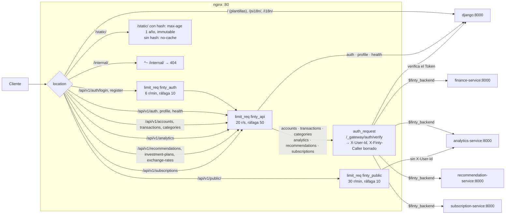
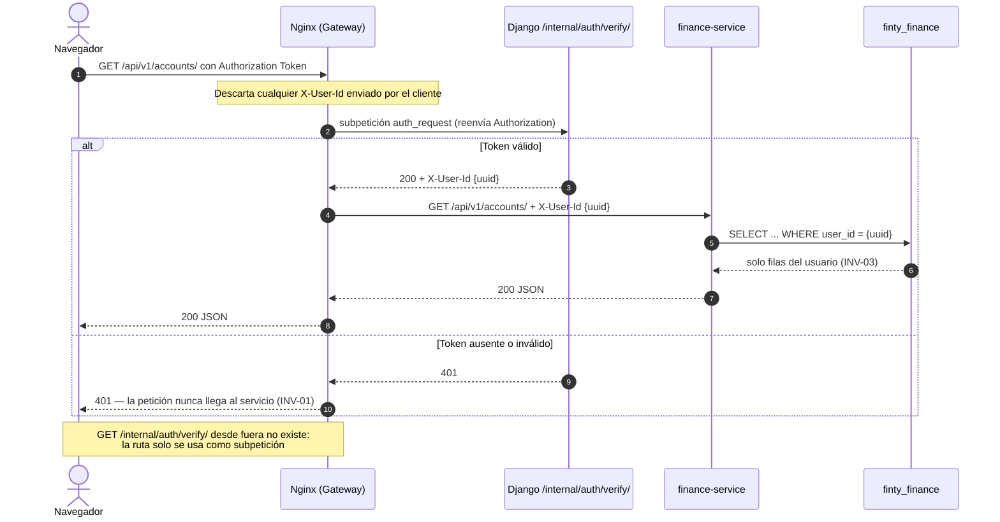

# API Gateway con Nginx

Nginx es la **única puerta de entrada**: es el único contenedor que publica un puerto en el host, el 80 (A-17). Hace las cuatro funciones de un Gateway:

1. **Enrutamiento** a cada servicio.
2. **Autenticación** centralizada.
3. **Límites de tráfico**.
4. **Servir los estáticos.**

La configuración completa está en [`deploy/nginx/conf.d/finty.conf`](https://github.com/tsepulvedf/Finty/blob/main/deploy/nginx/conf.d/finty.conf).

## Rutas

| Rutas | Destino | `auth_request` | `limit_req` |
|---|---|---|---|
| `/`, `/jsi18n/`, `/i18n/` (plantillas del frontend) | `django` | No | — |
| `/api/v1/auth/login/`, `/api/v1/auth/register/` | `django` | No | `finty_auth` (6/min, ráfaga 10) + `finty_api` |
| `/api/v1/auth/`, `/api/v1/profile/`, `/api/v1/health/` | `django` | No (DRF autentica dentro) | `finty_api` (20/s, ráfaga 50) |
| `/api/v1/accounts`, `/transactions`, `/categories` | `finance-service` | **Sí** | `finty_api` |
| `/api/v1/analytics` | `analytics-service` | **Sí** | `finty_api` |
| `/api/v1/public/` | `analytics-service` | No (endpoint del aliado) | `finty_public` (30/min, ráfaga 10) |
| `/api/v1/recommendations`, `/investment-plans`, `/exchange-rates` | `recommendation-service` | **Sí** | `finty_api` |
| `/api/v1/subscriptions` | `subscription-service` | **Sí** | `finty_api` |
| `/static/` | archivos del contenedor | — | — (con hash: caché de 1 año, `immutable`; sin hash: `no-cache`) |
| `/internal/` | ninguno | — | — (**404** desde fuera) |

## `auth_request`: autenticación una sola vez

- **Verificación:** antes de pasar una petición a un servicio Flask, Nginx hace una subpetición a `/_gateway/auth/verify`, que llega a `GET /internal/auth/verify/` de Django con el mismo `Authorization`. Si el Token es válido, Django responde 200 con `X-User-Id`, y Nginx lo pasa al servicio.
- **Rechazo:** si no es válido, Nginx responde 401 con el mismo cuerpo que DRF.
- **Cabeceras borradas:** el `X-User-Id` que mande el cliente, y también `X-Finty-Caller`, la marca de las llamadas entre servicios.
- **Confianza:** los servicios Flask **confían** en `X-User-Id` y no validan tokens. Pueden hacerlo porque solo son alcanzables por la red interna (ADR-09).

## Respuestas propias del Gateway

| Respuesta | Cuerpo |
|---|---|
| 401 | `{"detail": ...}` con el texto de DRF según el motivo |
| 429 | `{"detail": "Solicitud fue regulada (throttled)."}` |
| 503 | `{"detail": "El servicio no está disponible…", "code": "service_unavailable"}`, con `Retry-After: 10` |

El 503 cubre dos casos:
- el servicio no resuelve, no acepta la conexión o no responde;
- Django no responde a la verificación del token, que sin este manejo sería el 500 de `auth_request`.

Una petición sin verificar nunca pasa. El 503 propio de un servicio, como `entitlements_unavailable`, llega tal cual.

Cada bloque de un microservicio responde con `X-Finty-Route` (`finance`, `analytics`, `recommendation`, `subscription` o `public`), también en el 401 y en el 503, y así se ve qué servicio atendió. En el 503 de las rutas de Django, la marca es `monolith`.

## Resolución de nombres

No hay bloques `upstream`. Cada `location` fija su backend en `$finty_backend` (por ejemplo, `set $finty_backend finance-service:8000;`: esa línea es el conmutador del Strangler) y hace `proxy_pass http://$finty_backend`.

- **Resolución:** Nginx resuelve el nombre en tiempo de ejecución con el DNS de Docker (`resolver 127.0.0.11 valid=10s`).
- **Timeouts:** 2 s de conexión y 2 s de DNS.
- **Efecto:** un contenedor detenido responde enseguida con un error en lugar de dejar la petición colgada, y cuando vuelve es alcanzable en unos segundos sin reiniciar Nginx.

## Estáticos con hash

Django guarda los estáticos con nombres con hash (`ManifestStaticFilesStorage`, también en los `import` de los módulos de JavaScript). Nginx sirve con caché de un año los nombres con hash y sin caché los demás, así un despliegue nuevo nunca sirve JavaScript o CSS viejo.
