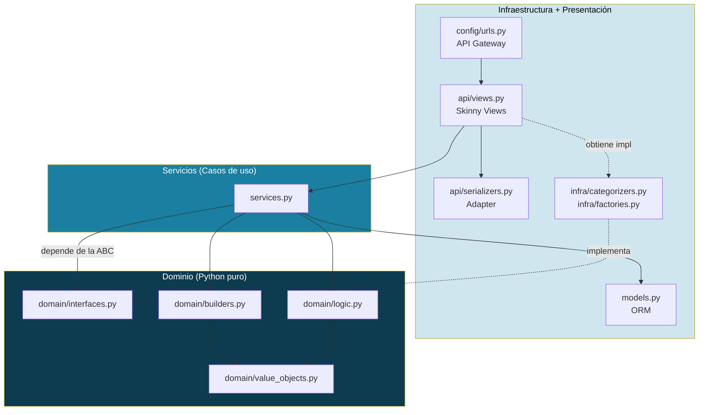
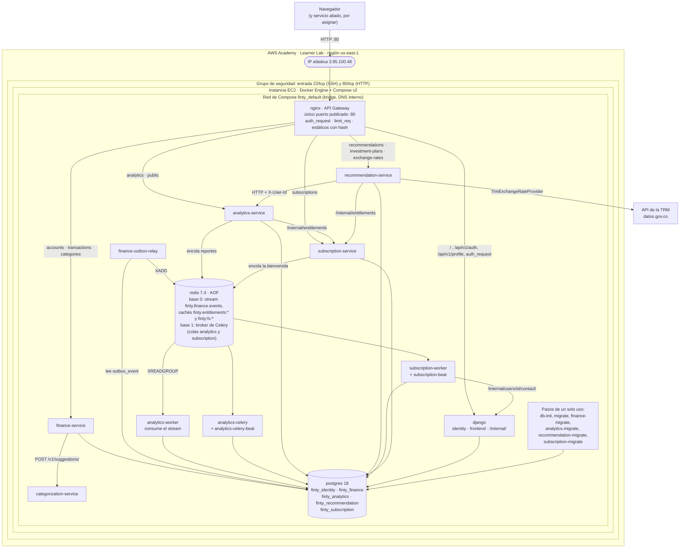
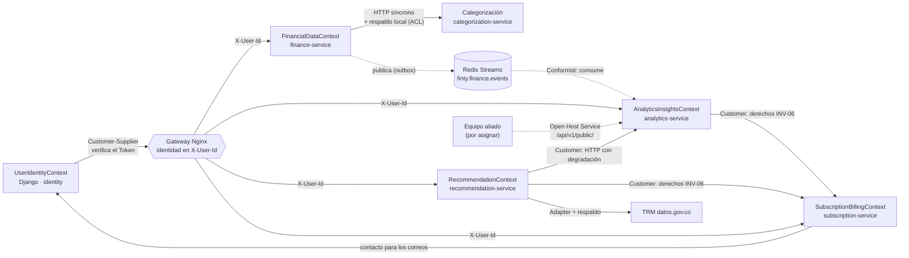

# Arquitectura

Finty combina dos ideas: **arquitectura limpia en tres anillos dentro de cada unidad** y **microservicios por contexto acotado** entre unidades. La fuente única de verdad es [`docs/ARCHITECTURE.md`](https://github.com/tsepulvedf/Finty/blob/main/docs/ARCHITECTURE.md).

## Los tres anillos

Cada unidad (el monolito Django y cada servicio Flask) tiene la misma forma:

| Anillo | Qué contiene | Qué puede importar |
|---|---|---|
| **Dominio** (`domain/`) | Entidades, value objects, reglas e invariantes, y los puertos (ABC) | Solo la biblioteca estándar y su propio dominio: **ni Django, ni Flask, ni SQLAlchemy** |
| **Servicios** (`services.py`) | Los casos de uso: orquestan el dominio y la persistencia | El dominio y las ABC; nunca una implementación concreta de `infra/` |
| **Entrada y adaptadores** (`api/`, `infra/`, `models.py`, `tasks.py`) | Vistas o blueprints, validación de sintaxis, modelos anémicos, adaptadores externos y tareas de Celery | Todo lo anterior; las dependencias siempre apuntan hacia adentro |

Las reglas se verifican sobre el AST en cada suite (A-15 y A-16):

- `domain/` no importa frameworks.
- Los blueprints no tienen `try` ni aritmética.
- Los modelos solo declaran columnas.
- Las tareas de Celery solo llaman a un caso de uso.

## Topología de microservicios

| Unidad | Tecnología | Responsabilidad | Base |
|---|---|---|---|
| `django` | Django 5.2 + DRF | Identidad (registro, ingreso, perfil), frontend con gettext y verificación del Token para el Gateway | `finty_identity` |
| `finance-service` | Flask | Cuentas, movimientos y categorías; publica eventos de dominio | `finty_finance` |
| `categorization-service` | Flask | Clasifica un movimiento por su descripción | ninguna |
| `analytics-service` | Flask + Celery | Dashboard, insights, gastos recurrentes, reporte mensual y resumen público | `finty_analytics` |
| `recommendation-service` | Flask | Perfil de riesgo, recomendaciones, planes de inversión y tasas de cambio | `finty_recommendation` |
| `subscription-service` | Flask + Celery | Planes, checkout simulado, derechos premium, correos y vencimiento | `finty_subscription` |
| `nginx` | Nginx 1.28 | API Gateway: rutas, autenticación, límites y estáticos | — |

**Cómo se comunican:**
- **Por HTTP en la red interna:** `finance → categorization`, `recommendation → analytics`, `analytics` y `recommendation → subscription` (derechos premium) y `subscription → identity` (contacto para los correos).
- **Por eventos en Redis Streams:** `finance → analytics`.
- **Ningún servicio consulta la base de otro** (ADR-10).

## Mapa de contextos

## Decisiones principales (ADR)

| ADR | Decisión |
|---|---|
| ADR-07 | Microservicios Flask para los contextos nuevos y para `finance` |
| ADR-08 | Strangler por conmutación de ruta en Nginx: ver [Migración Strangler y bono del 70%](Migracion-Strangler-y-bono) |
| ADR-09 | Autenticación centralizada en el Gateway con `auth_request`: ver [API Gateway con Nginx](API-Gateway) |
| ADR-10 | Una base de datos lógica por servicio |
| ADR-11 | Frontend en plantillas Django con gettext: ver [Frontend, UX e i18n](Frontend-UX-e-i18n) |
| ADR-12 | Tasas de cambio por Adapter: ver [Integraciones](Integraciones) |
| ADR-14 | `PaymentGateway` con un pago simulado |
| ADR-15 | Eventos de dominio y tareas asíncronas: ver [Eventos y tareas asíncronas](Eventos-y-tareas-asincronas) |
| ADR-16 | Despliegue en Docker Compose sobre EC2: ver [Despliegue en EC2](Despliegue-en-EC2) |
