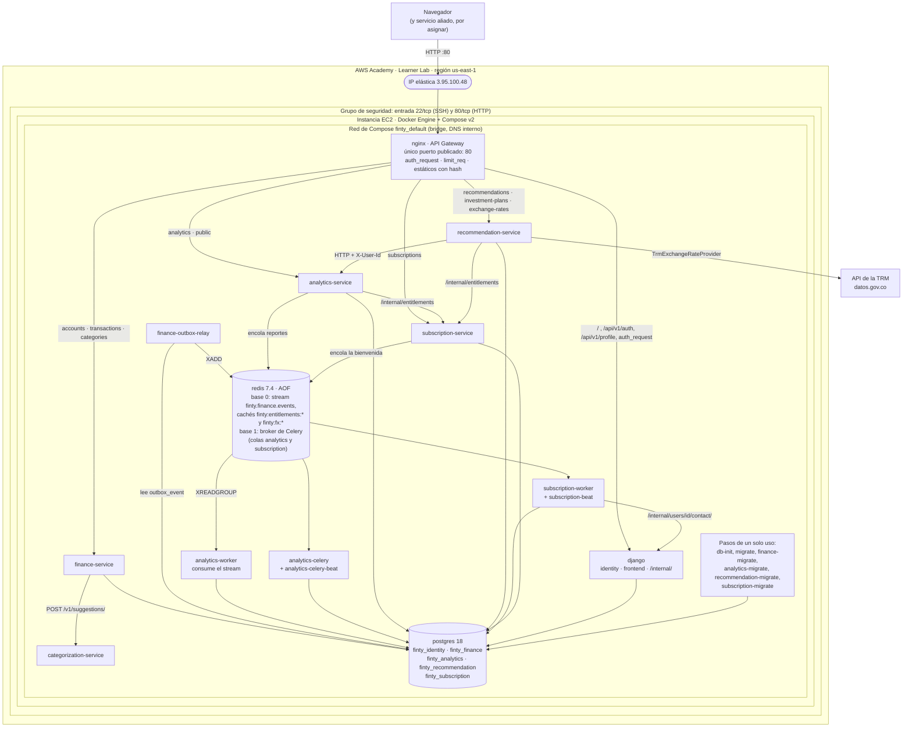

# Despliegue en EC2

Finty corre completo en **Docker Compose** sobre una instancia EC2 del **AWS Academy Learner Lab** (región `us-east-1`), con la IP elástica **3.95.100.48** (ADR-16). Solo Nginx publica un puerto (el 80); todo lo demás vive en la red interna de Compose.



> Los comandos para instalar Docker dependen de la AMI. Los de abajo son **un ejemplo para Amazon Linux 2023** (usuario `ec2-user`). En Ubuntu se usa `apt` y el usuario `ubuntu`. El resto de los pasos es igual en cualquier AMI.

## 1. Encender el laboratorio

1. Entra al curso de AWS Academy, abre **Learner Lab** y pulsa **Start Lab**. Espera a que el indicador quede en verde.
2. Pulsa **AWS** para abrir la consola, y ve a EC2 → Instances.
3. Las sesiones del Learner Lab duran unas horas. Al cerrarse, la instancia se detiene, pero **la IP elástica se conserva**, y con ella la dirección de la entrega.

## 2. Crear la instancia (una sola vez)

| Opción | Valor |
|---|---|
| AMI | Amazon Linux 2023 (o Ubuntu 24.04) |
| Tipo | Con al menos 4 GB de memoria (por ejemplo, `t3.medium`): son 15 contenedores de larga vida más los pasos de migración |
| Disco | 20 GB o más (imágenes y volúmenes de PostgreSQL y Redis) |
| Par de llaves | `vockey` (la llave del laboratorio: `labsuser.pem`, en **AWS Details**) |
| Grupo de seguridad | Entrada **solo** por el 22/TCP (SSH, para administrar) y el 80/TCP (HTTP, el Gateway) |

Después, en **Elastic IPs**: *Allocate Elastic IP address* y luego *Associate* con la instancia. Así la dirección no cambia al detener y encender la instancia.

## 3. Preparar la máquina (una sola vez)

```bash
ssh -i labsuser.pem ec2-user@3.95.100.48

# Ejemplo para Amazon Linux 2023
sudo dnf install -y docker git
sudo systemctl enable --now docker
sudo usermod -aG docker ec2-user          # sal y vuelve a entrar para que aplique
sudo mkdir -p /usr/local/lib/docker/cli-plugins
sudo curl -SL https://github.com/docker/compose/releases/latest/download/docker-compose-linux-x86_64 \
     -o /usr/local/lib/docker/cli-plugins/docker-compose
sudo chmod +x /usr/local/lib/docker/cli-plugins/docker-compose
docker compose version
```

## 4. Código y configuración (una sola vez)

```bash
git clone https://github.com/tsepulvedf/Finty.git && cd Finty
cp .env.docker.example .env.docker
for s in finance analytics recommendation subscription; do
  cp services/$s-service/.env.docker.example services/$s-service/.env.docker
done
```

| Archivo | Qué editar |
|---|---|
| `.env.docker` | `SECRET_KEY` propia, `DEBUG=False`, `ALLOWED_HOSTS` con `3.95.100.48` y la misma contraseña en `DB_PASSWORD` y `POSTGRES_PASSWORD` |
| `services/*-service/.env.docker` | Solo `DATABASE_URL`, con esa misma contraseña escapada en formato URL, y `TIME_ZONE`. Ningún otro secreto (A-21) |

Los `.env.docker` no se versionan (`.gitignore`).

## 5. Arrancar o actualizar

```bash
git pull
docker compose up -d --build
```

Los pasos de un solo uso dejan las bases al día antes de que arranque cada servicio. Una migración fallida impide arrancar contra un esquema incompleto.

| Paso | Qué hace |
|---|---|
| `db-init` | Crea las bases que falten |
| `migrate` | Corre las migraciones de Django |
| `finance-migrate` | Corre `alembic upgrade head` y siembra el catálogo de categorías |
| `analytics-migrate`, `recommendation-migrate`, `subscription-migrate` | Corren las migraciones de su servicio |

## 6. Comprobar

```bash
docker compose ps                               # todos Up; los servicios Flask (healthy)
curl http://3.95.100.48/api/v1/health/          # {"status":"ok","version":"v1"}
curl -I http://3.95.100.48/internal/auth/verify/   # 404: lo interno no se ve desde fuera
```

**Desde fuera:**
- Abre `http://3.95.100.48/` en el navegador.
- Compara el nombre con hash de la hoja de estilos con el del stack local: si coinciden, la instancia sirve la misma versión (así se verificó A-24 el 2026-10-22).

## 7. Datos de demostración

```bash
python3 tools/seed_demo.py --base-url http://3.95.100.48
```

Crea o completa, por la API, un usuario Free y uno Premium con 6 meses de movimientos. Es idempotente: una segunda corrida no duplica nada. Las credenciales están en [`docs/SUSTENTACION.md`](https://github.com/tsepulvedf/Finty/blob/main/docs/SUSTENTACION.md).

## Operación

```bash
docker compose logs -f finance-service analytics-worker    # registros
docker compose restart nginx                                # tras cambiar deploy/nginx/
docker compose down                                         # detener; los datos quedan en los volúmenes
```

**No uses `docker compose down -v` en la instancia:** borra las bases y Redis.
