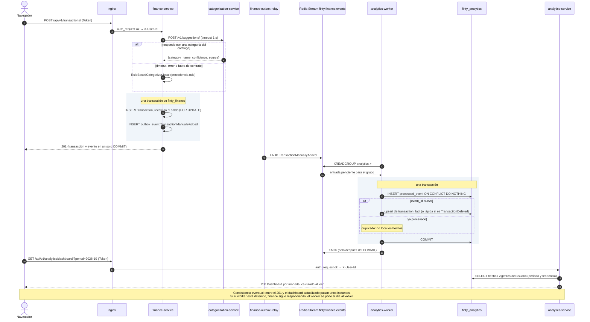
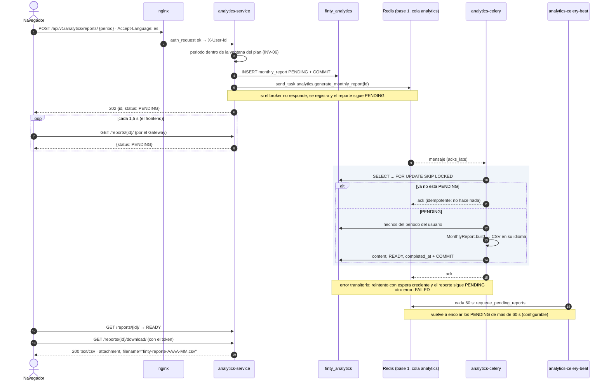
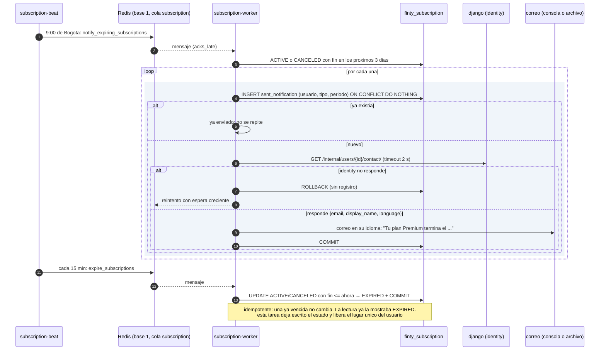

# Eventos y tareas asíncronas

Cuando un servicio no necesita la respuesta de otro, no lo llama: **publica un evento** o **encola una tarea** (ADR-15). Redis cumple los dos papeles, en bases lógicas distintas:

| Base de Redis | Contenido |
|---|---|
| 0 | El stream `finty.finance.events` y las cachés de derechos premium (`finty:entitlements:*`) y de tasas (`finty:fx:*`) |
| 1 | El broker de Celery, con una cola por servicio: `analytics` y `subscription` |

Redis corre con AOF (`appendfsync everysec`) para no perder entradas del stream en un reinicio.

## Outbox transaccional y Redis Streams

`finance-service` publica `TransactionManuallyAdded`, `TransactionCategorized` y `TransactionDeleted`:

1. **Outbox:** `TransactionService` escribe el evento en la tabla `outbox_event` **dentro de la misma transacción** que el cambio de negocio. O quedan los dos o no queda ninguno: publicar directo a Redis desde la petición dejaría una ventana en la que la base confirma y Redis no recibe.
2. **Relay:** `finance-outbox-relay` (`flask relay-outbox`) lee los pendientes en orden con `FOR UPDATE SKIP LOCKED`, los publica con `XADD` y marca cada uno. Si Redis no responde, espera y reintenta sin perder nada.
3. **Consumidor:** `analytics-worker` (`flask consume-events`) lee con el grupo `analytics` (`XREADGROUP`) y aplica cada evento en su propia transacción. Hace `XACK` solo después del `COMMIT`.
4. **Idempotencia:** la entrega es al menos una vez. Un evento repetido choca con la clave primaria de `processed_event` y no se aplica dos veces.
5. **Recuperación:** al arrancar, el worker reclama los pendientes de un worker anterior (`XAUTOCLAIM`).

**Consistencia eventual:** el dashboard refleja un movimiento alrededor de un segundo después de registrarlo. Si `analytics-worker` se detiene, `finance-service` sigue funcionando y el worker se pone al día al volver.

## Celery

| Convención (todas las tareas) | |
|---|---|
| Versión | `celery==5.5.3` |
| Broker | Redis, base 1; **sin result backend**: el estado que ve el usuario vive en la base del servicio |
| Entrega | `acks_late`, `reject_on_worker_lost` y una tarea a la vez: si el worker muere, la tarea vuelve a la cola. Toda tarea es **idempotente** |
| Reintentos | Espera creciente con *jitter* ante errores transitorios: la base, la red o identity |
| Límites | 60 s suave y 90 s duro |
| Diseño | **Las tareas son mecanismo de entrega:** cada una solo llama a un caso de uso de `services.py` (lo verifica un test de arquitectura) |
| Contenedores | La imagen de su servicio, sin puertos, con `restart: unless-stopped` y un solo beat por servicio |

| Tarea | Contenedor | Cuándo | Qué hace |
|---|---|---|---|
| `analytics.generate_monthly_report` | `analytics-celery` | Al pedir un reporte | Arma el CSV del mes, con encabezados en el idioma de la petición, y lo deja READY o FAILED |
| `analytics.requeue_pending_reports` | `analytics-celery-beat` | Cada 60 s (`REPORT_REQUEUE_EVERY_SECONDS`) | Vuelve a encolar los PENDING de más de 60 s (`REPORT_STALE_AFTER_SECONDS`) |
| `analytics.purge_expired_reports` | `analytics-celery-beat` | Cada día, 3:30 | Borra los reportes de más de 7 días |
| `subscription.send_premium_welcome` | `subscription-worker` | Al activar Premium | Envía la bienvenida en el idioma del usuario |
| `subscription.send_missing_welcomes` | `subscription-beat` | Cada 15 min | Red de seguridad: las bienvenidas que no se pudieron encolar en las últimas 24 h |
| `subscription.notify_expiring_subscriptions` | `subscription-beat` | Cada día, 9:00 | Avisa 3 días antes del fin del período |
| `subscription.expire_subscriptions` | `subscription-beat` | Cada 15 min | Pasa a EXPIRED las vencidas |

**Cada aviso sale una sola vez** por usuario, tipo y período: lo garantiza una restricción única en `sent_notification`.

## Reporte mensual asíncrono

## Vencimiento con aviso

