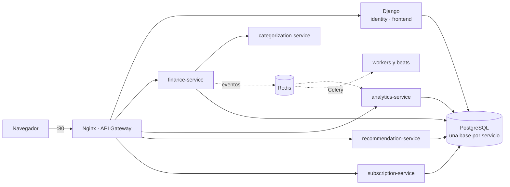

# Finty

Finty es una aplicación web de **finanzas personales**: registra los movimientos de efectivo, banco y tarjeta de crédito, los clasifica sola explicando cómo lo decidió, muestra en qué se va el dinero y, con el plan Premium, detecta gastos inusuales y recurrentes y sugiere cómo invertir el excedente según el perfil de riesgo. Está en español e inglés.

Es el proyecto de la Entrega 2 del curso: un monolito Django que conserva la identidad y el frontend, cinco microservicios Flask, un API Gateway con Nginx, Redis como broker y bus de eventos, y PostgreSQL con una base por servicio, todo en Docker Compose sobre una instancia EC2 de AWS.

| | |
|---|---|
| **Producción** | **http://3.95.100.48** (IP elástica de AWS Academy) |
| Salud | `curl http://3.95.100.48/api/v1/health/` |
| Repositorio | https://github.com/tsepulvedf/Finty (rama `main`) |
| Equipo | Tomás Sepúlveda (`tsepulvedf`) y Juan Pablo Restrepo (`RestrepoJuanP`) |

## Mapa de la Wiki

| Página | De qué trata |
|---|---|
| [Arquitectura](Arquitectura) | Los tres anillos y la topología de microservicios |
| [Migración Strangler y bono del 70%](Migracion-Strangler-y-bono) | Cómo `finance` salió del monolito y las tres métricas del 70% |
| [API Gateway con Nginx](API-Gateway) | Rutas, `auth_request`, `limit_req` y estáticos |
| [Microservicios](Microservicios) | Una sección por servicio: responsabilidad, base, rutas y patrones |
| [Integraciones](Integraciones) | TRM por Adapter, endpoint público con k-anonimato y pagos simulados |
| [Eventos y tareas asíncronas](Eventos-y-tareas-asincronas) | Outbox, Redis Streams y Celery |
| [Frontend, UX e i18n](Frontend-UX-e-i18n) | Plantillas con gettext, las 11 pantallas y la auditoría de UI/UX |
| [Despliegue en EC2](Despliegue-en-EC2) | Paso a paso, de la instancia a `docker compose up` |
| [Verificación y evidencia](Verificacion-y-evidencia) | Las suites, la suite de contrato y los `runs/` |
| [Patrones de diseño](Patrones-de-diseno) | Factory, Builder, Adapter, Service Layer y outbox, con archivo y línea |

## En una imagen

La fuente única de verdad del diseño es [`docs/ARCHITECTURE.md`](https://github.com/tsepulvedf/Finty/blob/main/docs/ARCHITECTURE.md). Esta Wiki se genera desde [`docs/wiki/`](https://github.com/tsepulvedf/Finty/blob/main/docs/wiki/Home.md) en el repositorio.
