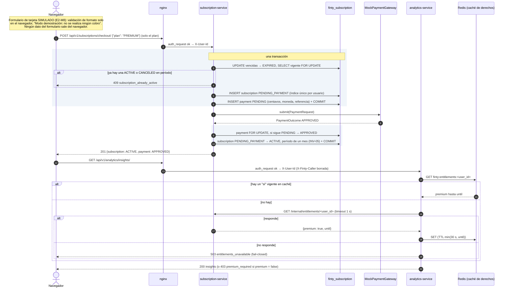

# Microservicios

Todos los servicios siguen las mismas reglas:
- **Imagen:** `python:3.11-slim`, sin usuario root.
- **Anillos:** los tres de la [Arquitectura](Arquitectura).
- **Base y puertos:** una base propia y ningún puerto publicado.
- **Entrada:** solo se llega a ellos a través del [API Gateway](API-Gateway).
- **Errores:** con la misma forma que DRF:
  - de dominio, `{"error": {"code", "message"}}`;
  - de validación, `{"campo": [...]}`.

El frontend traduce por `code`.

## Monolito Django: `identity` y frontend

| | |
|---|---|
| Responsabilidad | Registro, ingreso con Token de DRF, perfil (nombre, moneda e idioma), las 11 pantallas del frontend y la verificación del Token para el Gateway |
| Base | `finty_identity` |
| Rutas | `POST /api/v1/auth/register/`, `POST /api/v1/auth/login/`, `GET`/`PUT /api/v1/profile/`; internas: `GET /internal/auth/verify/` (el Gateway) y `GET /internal/users/<id>/contact/` (subscription-service) |
| Patrones | Service Layer (`ProfileService`), modelos anémicos y manejador global de excepciones de dominio |
| Clases del dominio | `User`, `UserProfile` |

## `finance-service`

| | |
|---|---|
| Responsabilidad | Cuentas, movimientos y categorías. Mantiene el saldo de cada cuenta en la misma transacción que el movimiento (INV-07) y publica los eventos de dominio |
| Base | `finty_finance` (más la tabla `outbox_event`) |
| Rutas | `/api/v1/accounts/` (CRUD, `archive/`, `summary/` con el saldo total por moneda), `/api/v1/transactions/` (con `q`, `type`, cuenta, categoría y fechas; `categorize/` para recategorizar), `/api/v1/categories/` |
| Patrones | **Builder** (`TransactionBuilder`, `AccountBuilder`), **Service Layer** (`TransactionService`, `AccountService`), **Adapter** (`RemoteCategorizer`, con respaldo local), **outbox transaccional** y relay a Redis Streams |
| Contenedores | `finance-service`, `finance-outbox-relay` y `finance-migrate` |
| Clases del dominio | `Account`, `Transaction`, `Category`, `Money`, `AccountType`, `TransactionType`, `BalanceCalculator` |

## `categorization-service`

| | |
|---|---|
| Responsabilidad | Sugiere la categoría de un movimiento por su descripción, con la confianza y la procedencia (`rule`, `mock` o `ai`) |
| Base | Ninguna: las reglas viven en el código |
| Rutas | Interna: `POST /v1/suggestions/`, que solo consume `finance-service` |
| Patrones | **Factory Method** (`CategorizerFactory`, elegido por `CATEGORIZER_PROVIDER`) y la estrategia `Categorizer` |
| Clases del dominio | `Categorizer`, `CategorySuggestion` |

## `analytics-service`

| | |
|---|---|
| Responsabilidad | Modelo de lectura alimentado por los eventos de `finance`: dashboard con comparaciones y tasa de ahorro, insights, gastos recurrentes, reporte mensual en CSV y resumen público con k-anonimato |
| Base | `finty_analytics` (hechos de transacción, eventos procesados y reportes) |
| Rutas | `GET /api/v1/analytics/dashboard/`, `insights/`, `spending-patterns/`, `POST reports/` con `GET reports/<id>/` y `download/`, y `GET /api/v1/public/spending-summary/` sin autenticación |
| Patrones | Consumidor idempotente por `event_id`, middleware de gating premium (INV-06), **Adapter** (`CsvReportRenderer`, `HttpEntitlementsReader`) y tareas de Celery como mecanismo de entrega |
| Contenedores | `analytics-service`, `analytics-worker` (stream), `analytics-celery` y `analytics-celery-beat` (reportes) y `analytics-migrate` |
| Clases del dominio | `Insight`, `SpendingPattern`, `Dashboard` |

## `recommendation-service`

| | |
|---|---|
| Responsabilidad | Perfil de riesgo (cuestionario de 5 preguntas), recomendaciones explicables de optimización y de inversión, planes de inversión con proyección, y la tasa USD/COP |
| Base | `finty_recommendation` (perfiles y planes; las recomendaciones se calculan al leer) |
| Rutas | `GET /api/v1/recommendations/`, `GET`/`PUT /api/v1/recommendations/risk-profile/`, `/api/v1/investment-plans/` y `GET /api/v1/exchange-rates/` |
| Patrones | **Adapter** (`TrmExchangeRateProvider` y `FixedExchangeRateProvider`; `HttpAnalyticsReader` con degradación) y **Service Layer** (`RecommendationService`, `ExchangeRateService`) |
| Clases del dominio | `Recommendation`, `RiskProfile`, `InvestmentPlan` |

## `subscription-service`

| | |
|---|---|
| Responsabilidad | Planes Free y Premium, checkout con pago simulado (INV-05), derechos premium para el resto (INV-06), correos de bienvenida y de vencimiento, y el vencimiento periódico |
| Base | `finty_subscription` (suscripciones, pagos y avisos enviados) |
| Rutas | `GET /api/v1/subscriptions/plans/`, `GET me/`, `POST checkout/` (solo `{plan}`), `POST me/cancel/`; interna: `GET /internal/entitlements/<user_id>` |
| Patrones | **Factory** (`PaymentGatewayFactory`), **Adapter** (`MockPaymentGateway`, `HttpContactDirectory`, envío de correo por consola o archivo) y tareas de Celery |
| Contenedores | `subscription-service`, `subscription-worker`, `subscription-beat` y `subscription-migrate` |
| Clases del dominio | `Subscription`, `SubscriptionPlan`, `Payment` |

## Checkout simulado y gating premium

