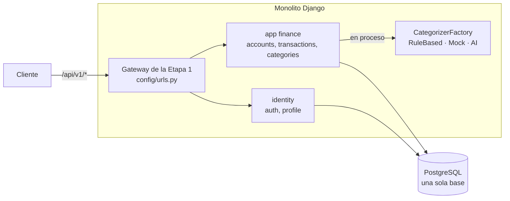
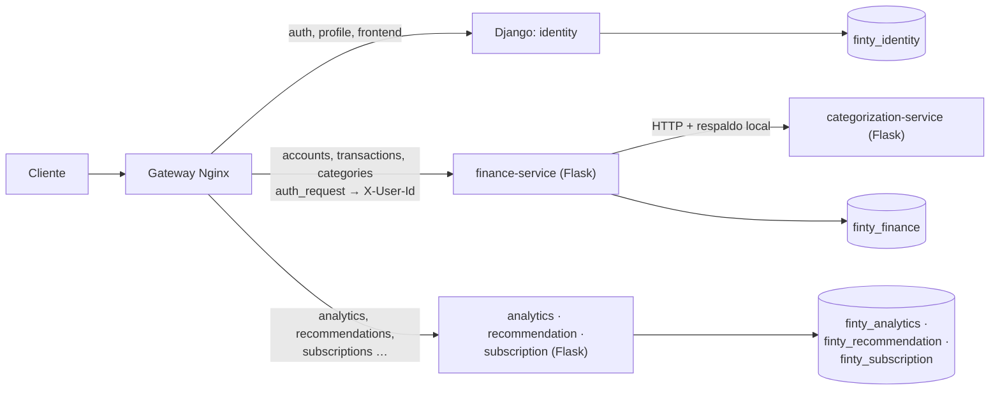
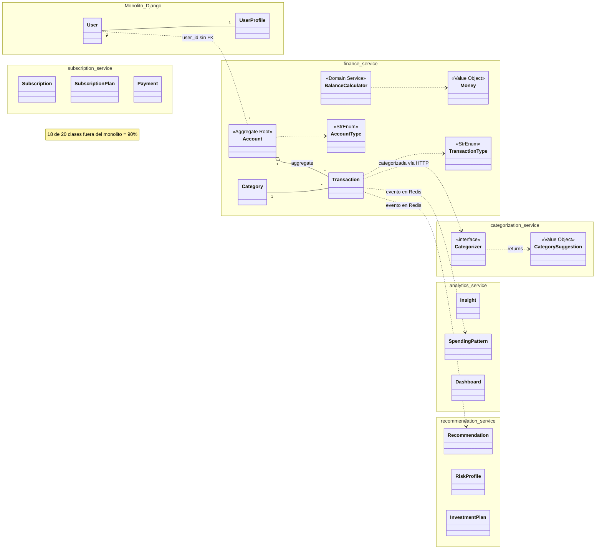

# Migración Strangler y bono del 70%

## Por qué Strangler

En la Entrega 1, el contexto `finance` (cuentas, movimientos, categorías y categorización) vivía en una app del monolito Django. Para la Entrega 2 se movió a `finance-service` (Flask) con el **Strangler Pattern**, no con una reescritura de golpe:

1. **Mismo dominio:** `finance/domain/` ya era Python puro, sin Django, así que pasó a Flask casi sin cambios. Lo que se reescribió fue el anillo externo: SQLAlchemy en lugar del ORM de Django y blueprints en lugar de vistas de DRF.
2. **Paso a paso:** el monolito siguió en pie mientras `finance-service` se verificaba con la **misma suite de contrato** de caja negra.
3. **Conmutación:** Nginx desvió el bloque completo (`accounts`, `transactions` y `categories`, que comparten agregado y base) cambiando una sola línea, la `server` del upstream `finance_backend`. Así la vuelta atrás era igual de corta.
4. **Retiro:** con la ruta nueva verificada, la app `finance` se retiró del monolito (E2-M3a).

La suite de contrato dio el mismo resultado antes de conmutar, después de conmutar y después de retirar la app (A-20). La evidencia está en [`tests/contract/runs/`](https://github.com/tsepulvedf/Finty/blob/main/tests/contract/runs/2026-10-20-despues-de-conmutar.txt).

## Antes y después

## El bono: más del 70% fuera del monolito

El enunciado exime del Parcial 02 si más del 70% de los servicios y la lógica de negocio están en microservicios Flask. Como el profesor no ha definido la métrica (D-09), se midió de tres formas, y las tres superan el umbral.

**Por clases del dominio.** El denominador son las 20 clases del diagrama de dominio (`ARCHITECTURE.md` §4.2), y cada clase cuenta una sola vez, en el servicio que es su dueño:

| Unidad | Tecnología | Clases del dominio | # |
|---|---|---|---|
| Monolito: `identity` + frontend + verificación de auth | Django | `User`, `UserProfile` | 2 |
| `finance-service` | Flask | `Account`, `Transaction`, `Category`, `Money`, `AccountType`, `TransactionType`, `BalanceCalculator` | 7 |
| `categorization-service` | Flask | `Categorizer`, `CategorySuggestion` | 2 |
| `analytics-service` | Flask | `Insight`, `SpendingPattern`, `Dashboard` | 3 |
| `recommendation-service` | Flask | `Recommendation`, `RiskProfile`, `InvestmentPlan` | 3 |
| `subscription-service` | Flask | `Subscription`, `SubscriptionPlan`, `Payment` | 3 |

**18 de 20 clases = 90% fuera del monolito.**

**Por bounded contexts:** 4 de 5 contextos quedan fuera (FinancialData, AnalyticsInsights, Recommendation y SubscriptionBilling). En Django solo queda UserIdentity, es decir, el **80%**.

**Por endpoints de negocio:** en Django solo quedan `auth/` y `profile/`, además de `health/` y los internos `/internal/auth/verify/` y `/internal/users/<id>/contact/`, que son de soporte. Todos los demás grupos de rutas de `/api/v1/` los sirve Flask:

| Grupo de rutas | Servicio |
|---|---|
| `accounts`, `transactions`, `categories` | finance |
| `analytics`, `public` | analytics |
| `recommendations`, `investment-plans`, `exchange-rates` | recommendation |
| `subscriptions` | subscription |

## Las 20 clases por servicio

